# Autómatas generados por el código

<!-- Generado por `pnpm docs:generate`; no editar a mano. -->

Convenciones: `→` estado inicial, `*` estado de aceptación, `—` sin transición (rechazo). En los diagramas, `DIGITO` agrupa las diez aristas 0–9.

### Construcción de Thompson para (s|λ)

```text
s|λ
```

#### AFN-λ (construcción de Thompson)

6 estados, 6 transiciones, alfabeto: {s}.

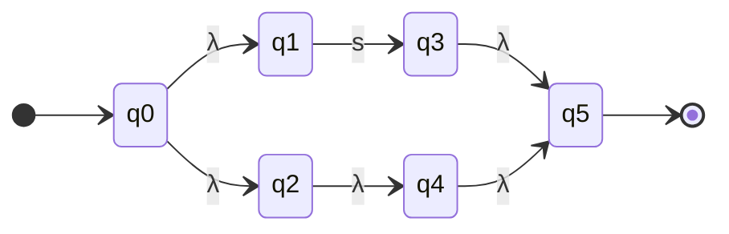

| Estado | `s` | `λ` |
| --- | --- | --- |
| →q0 | — | {q1,q2} |
| q1 | {q3} | — |
| q2 | — | {q4} |
| q3 | — | {q5} |
| q4 | — | {q5} |
| *q5 | — | — |

#### AFD (construcción de subconjuntos)

2 estados, 1 transiciones, alfabeto: {s}.

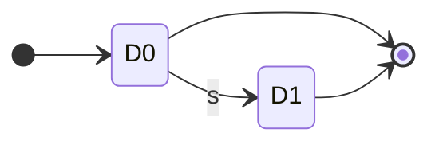

| Estado | Subconjunto AFN | `s` |
| --- | --- | --- |
| →*D0 | {q0,q1,q2,q4,q5} | D1 |
| *D1 | {q3,q5} | — |

#### AFD mínimo (refinamiento de particiones de Moore)

2 estados, 1 transiciones, alfabeto: {s}.

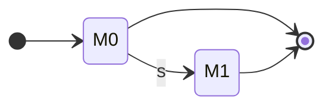

| Estado | `s` |
| --- | --- |
| →*M0 | M1 |
| *M1 | — |

### Token NUM (definición real del analizador léxico)

```text
DIGITO DIGITO*
```

#### AFN-λ (construcción de Thompson)

46 estados, 65 transiciones, alfabeto: {0, 1, 2, 3, 4, 5, 6, 7, 8, 9}.

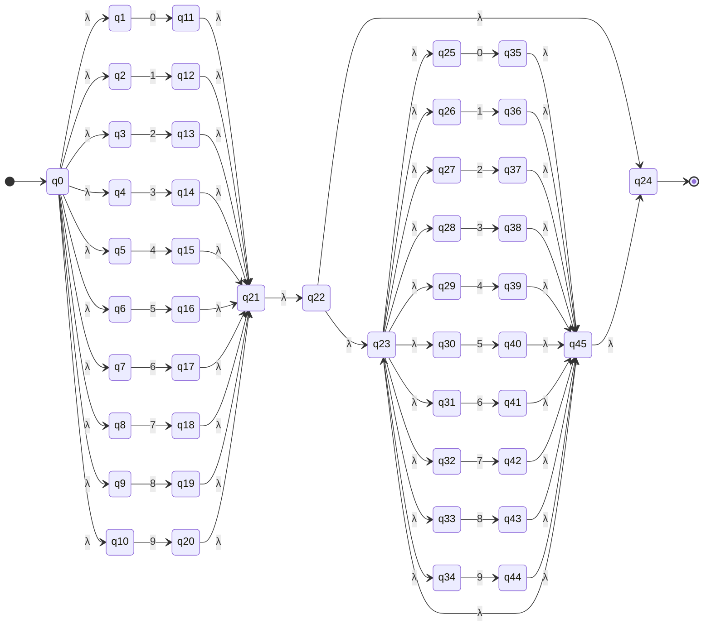

| Estado | `0` | `1` | `2` | `3` | `4` | `5` | `6` | `7` | `8` | `9` | `λ` |
| --- | --- | --- | --- | --- | --- | --- | --- | --- | --- | --- | --- |
| →q0 | — | — | — | — | — | — | — | — | — | — | {q1,q2,q3,q4,q5,q6,q7,q8,q9,q10} |
| q1 | {q11} | — | — | — | — | — | — | — | — | — | — |
| q2 | — | {q12} | — | — | — | — | — | — | — | — | — |
| q3 | — | — | {q13} | — | — | — | — | — | — | — | — |
| q4 | — | — | — | {q14} | — | — | — | — | — | — | — |
| q5 | — | — | — | — | {q15} | — | — | — | — | — | — |
| q6 | — | — | — | — | — | {q16} | — | — | — | — | — |
| q7 | — | — | — | — | — | — | {q17} | — | — | — | — |
| q8 | — | — | — | — | — | — | — | {q18} | — | — | — |
| q9 | — | — | — | — | — | — | — | — | {q19} | — | — |
| q10 | — | — | — | — | — | — | — | — | — | {q20} | — |
| q11 | — | — | — | — | — | — | — | — | — | — | {q21} |
| q12 | — | — | — | — | — | — | — | — | — | — | {q21} |
| q13 | — | — | — | — | — | — | — | — | — | — | {q21} |
| q14 | — | — | — | — | — | — | — | — | — | — | {q21} |
| q15 | — | — | — | — | — | — | — | — | — | — | {q21} |
| q16 | — | — | — | — | — | — | — | — | — | — | {q21} |
| q17 | — | — | — | — | — | — | — | — | — | — | {q21} |
| q18 | — | — | — | — | — | — | — | — | — | — | {q21} |
| q19 | — | — | — | — | — | — | — | — | — | — | {q21} |
| q20 | — | — | — | — | — | — | — | — | — | — | {q21} |
| q21 | — | — | — | — | — | — | — | — | — | — | {q22} |
| q22 | — | — | — | — | — | — | — | — | — | — | {q23,q24} |
| q23 | — | — | — | — | — | — | — | — | — | — | {q25,q26,q27,q28,q29,q30,q31,q32,q33,q34} |
| *q24 | — | — | — | — | — | — | — | — | — | — | — |
| q25 | {q35} | — | — | — | — | — | — | — | — | — | — |
| q26 | — | {q36} | — | — | — | — | — | — | — | — | — |
| q27 | — | — | {q37} | — | — | — | — | — | — | — | — |
| q28 | — | — | — | {q38} | — | — | — | — | — | — | — |
| q29 | — | — | — | — | {q39} | — | — | — | — | — | — |
| q30 | — | — | — | — | — | {q40} | — | — | — | — | — |
| q31 | — | — | — | — | — | — | {q41} | — | — | — | — |
| q32 | — | — | — | — | — | — | — | {q42} | — | — | — |
| q33 | — | — | — | — | — | — | — | — | {q43} | — | — |
| q34 | — | — | — | — | — | — | — | — | — | {q44} | — |
| q35 | — | — | — | — | — | — | — | — | — | — | {q45} |
| q36 | — | — | — | — | — | — | — | — | — | — | {q45} |
| q37 | — | — | — | — | — | — | — | — | — | — | {q45} |
| q38 | — | — | — | — | — | — | — | — | — | — | {q45} |
| q39 | — | — | — | — | — | — | — | — | — | — | {q45} |
| q40 | — | — | — | — | — | — | — | — | — | — | {q45} |
| q41 | — | — | — | — | — | — | — | — | — | — | {q45} |
| q42 | — | — | — | — | — | — | — | — | — | — | {q45} |
| q43 | — | — | — | — | — | — | — | — | — | — | {q45} |
| q44 | — | — | — | — | — | — | — | — | — | — | {q45} |
| q45 | — | — | — | — | — | — | — | — | — | — | {q23,q24} |

#### AFD (construcción de subconjuntos)

21 estados, 210 transiciones, alfabeto: {0, 1, 2, 3, 4, 5, 6, 7, 8, 9}.

_Diagrama omitido por tamaño (más de 90 aristas); ver la tabla._

| Estado | Subconjunto AFN | `0` | `1` | `2` | `3` | `4` | `5` | `6` | `7` | `8` | `9` |
| --- | --- | --- | --- | --- | --- | --- | --- | --- | --- | --- | --- |
| →D0 | {q0,q1,q2,q3,q4,q5,q6,q7,q8,q9,q10} | D1 | D2 | D3 | D4 | D5 | D6 | D7 | D8 | D9 | D10 |
| *D1 | {q11,q21,q22,q23,q24,q25,q26,q27,q28,q29,q30,q31,q32,q33,q34} | D11 | D12 | D13 | D14 | D15 | D16 | D17 | D18 | D19 | D20 |
| *D2 | {q12,q21,q22,q23,q24,q25,q26,q27,q28,q29,q30,q31,q32,q33,q34} | D11 | D12 | D13 | D14 | D15 | D16 | D17 | D18 | D19 | D20 |
| *D3 | {q13,q21,q22,q23,q24,q25,q26,q27,q28,q29,q30,q31,q32,q33,q34} | D11 | D12 | D13 | D14 | D15 | D16 | D17 | D18 | D19 | D20 |
| *D4 | {q14,q21,q22,q23,q24,q25,q26,q27,q28,q29,q30,q31,q32,q33,q34} | D11 | D12 | D13 | D14 | D15 | D16 | D17 | D18 | D19 | D20 |
| *D5 | {q15,q21,q22,q23,q24,q25,q26,q27,q28,q29,q30,q31,q32,q33,q34} | D11 | D12 | D13 | D14 | D15 | D16 | D17 | D18 | D19 | D20 |
| *D6 | {q16,q21,q22,q23,q24,q25,q26,q27,q28,q29,q30,q31,q32,q33,q34} | D11 | D12 | D13 | D14 | D15 | D16 | D17 | D18 | D19 | D20 |
| *D7 | {q17,q21,q22,q23,q24,q25,q26,q27,q28,q29,q30,q31,q32,q33,q34} | D11 | D12 | D13 | D14 | D15 | D16 | D17 | D18 | D19 | D20 |
| *D8 | {q18,q21,q22,q23,q24,q25,q26,q27,q28,q29,q30,q31,q32,q33,q34} | D11 | D12 | D13 | D14 | D15 | D16 | D17 | D18 | D19 | D20 |
| *D9 | {q19,q21,q22,q23,q24,q25,q26,q27,q28,q29,q30,q31,q32,q33,q34} | D11 | D12 | D13 | D14 | D15 | D16 | D17 | D18 | D19 | D20 |
| *D10 | {q20,q21,q22,q23,q24,q25,q26,q27,q28,q29,q30,q31,q32,q33,q34} | D11 | D12 | D13 | D14 | D15 | D16 | D17 | D18 | D19 | D20 |
| *D11 | {q23,q24,q25,q26,q27,q28,q29,q30,q31,q32,q33,q34,q35,q45} | D11 | D12 | D13 | D14 | D15 | D16 | D17 | D18 | D19 | D20 |
| *D12 | {q23,q24,q25,q26,q27,q28,q29,q30,q31,q32,q33,q34,q36,q45} | D11 | D12 | D13 | D14 | D15 | D16 | D17 | D18 | D19 | D20 |
| *D13 | {q23,q24,q25,q26,q27,q28,q29,q30,q31,q32,q33,q34,q37,q45} | D11 | D12 | D13 | D14 | D15 | D16 | D17 | D18 | D19 | D20 |
| *D14 | {q23,q24,q25,q26,q27,q28,q29,q30,q31,q32,q33,q34,q38,q45} | D11 | D12 | D13 | D14 | D15 | D16 | D17 | D18 | D19 | D20 |
| *D15 | {q23,q24,q25,q26,q27,q28,q29,q30,q31,q32,q33,q34,q39,q45} | D11 | D12 | D13 | D14 | D15 | D16 | D17 | D18 | D19 | D20 |
| *D16 | {q23,q24,q25,q26,q27,q28,q29,q30,q31,q32,q33,q34,q40,q45} | D11 | D12 | D13 | D14 | D15 | D16 | D17 | D18 | D19 | D20 |
| *D17 | {q23,q24,q25,q26,q27,q28,q29,q30,q31,q32,q33,q34,q41,q45} | D11 | D12 | D13 | D14 | D15 | D16 | D17 | D18 | D19 | D20 |
| *D18 | {q23,q24,q25,q26,q27,q28,q29,q30,q31,q32,q33,q34,q42,q45} | D11 | D12 | D13 | D14 | D15 | D16 | D17 | D18 | D19 | D20 |
| *D19 | {q23,q24,q25,q26,q27,q28,q29,q30,q31,q32,q33,q34,q43,q45} | D11 | D12 | D13 | D14 | D15 | D16 | D17 | D18 | D19 | D20 |
| *D20 | {q23,q24,q25,q26,q27,q28,q29,q30,q31,q32,q33,q34,q44,q45} | D11 | D12 | D13 | D14 | D15 | D16 | D17 | D18 | D19 | D20 |

#### AFD mínimo (refinamiento de particiones de Moore)

2 estados, 20 transiciones, alfabeto: {0, 1, 2, 3, 4, 5, 6, 7, 8, 9}.

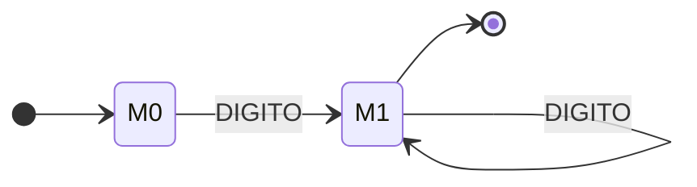

| Estado | `0` | `1` | `2` | `3` | `4` | `5` | `6` | `7` | `8` | `9` |
| --- | --- | --- | --- | --- | --- | --- | --- | --- | --- | --- |
| →M0 | M1 | M1 | M1 | M1 | M1 | M1 | M1 | M1 | M1 | M1 |
| *M1 | M1 | M1 | M1 | M1 | M1 | M1 | M1 | M1 | M1 | M1 |

### Token NUM_MILES (definición real del analizador léxico)

```text
DIGITO (DIGITO|λ) (DIGITO|λ) (\. DIGITO DIGITO DIGITO)+
```

#### AFN-λ (construcción de Thompson)

212 estados, 296 transiciones, alfabeto: {., 0, 1, 2, 3, 4, 5, 6, 7, 8, 9}.

_Diagrama omitido por tamaño (más de 90 aristas); ver la tabla._

| Estado | `.` | `0` | `1` | `2` | `3` | `4` | `5` | `6` | `7` | `8` | `9` | `λ` |
| --- | --- | --- | --- | --- | --- | --- | --- | --- | --- | --- | --- | --- |
| →q0 | — | — | — | — | — | — | — | — | — | — | — | {q1,q2,q3,q4,q5,q6,q7,q8,q9,q10} |
| q1 | — | {q11} | — | — | — | — | — | — | — | — | — | — |
| q2 | — | — | {q12} | — | — | — | — | — | — | — | — | — |
| q3 | — | — | — | {q13} | — | — | — | — | — | — | — | — |
| q4 | — | — | — | — | {q14} | — | — | — | — | — | — | — |
| q5 | — | — | — | — | — | {q15} | — | — | — | — | — | — |
| q6 | — | — | — | — | — | — | {q16} | — | — | — | — | — |
| q7 | — | — | — | — | — | — | — | {q17} | — | — | — | — |
| q8 | — | — | — | — | — | — | — | — | {q18} | — | — | — |
| q9 | — | — | — | — | — | — | — | — | — | {q19} | — | — |
| q10 | — | — | — | — | — | — | — | — | — | — | {q20} | — |
| q11 | — | — | — | — | — | — | — | — | — | — | — | {q21} |
| q12 | — | — | — | — | — | — | — | — | — | — | — | {q21} |
| q13 | — | — | — | — | — | — | — | — | — | — | — | {q21} |
| q14 | — | — | — | — | — | — | — | — | — | — | — | {q21} |
| q15 | — | — | — | — | — | — | — | — | — | — | — | {q21} |
| q16 | — | — | — | — | — | — | — | — | — | — | — | {q21} |
| q17 | — | — | — | — | — | — | — | — | — | — | — | {q21} |
| q18 | — | — | — | — | — | — | — | — | — | — | — | {q21} |
| q19 | — | — | — | — | — | — | — | — | — | — | — | {q21} |
| q20 | — | — | — | — | — | — | — | — | — | — | — | {q21} |
| q21 | — | — | — | — | — | — | — | — | — | — | — | {q22} |
| q22 | — | — | — | — | — | — | — | — | — | — | — | {q23,q24} |
| q23 | — | — | — | — | — | — | — | — | — | — | — | {q25,q26,q27,q28,q29,q30,q31,q32,q33,q34} |
| q24 | — | — | — | — | — | — | — | — | — | — | — | {q35} |
| q25 | — | {q36} | — | — | — | — | — | — | — | — | — | — |
| q26 | — | — | {q37} | — | — | — | — | — | — | — | — | — |
| q27 | — | — | — | {q38} | — | — | — | — | — | — | — | — |
| q28 | — | — | — | — | {q39} | — | — | — | — | — | — | — |
| q29 | — | — | — | — | — | {q40} | — | — | — | — | — | — |
| q30 | — | — | — | — | — | — | {q41} | — | — | — | — | — |
| q31 | — | — | — | — | — | — | — | {q42} | — | — | — | — |
| q32 | — | — | — | — | — | — | — | — | {q43} | — | — | — |
| q33 | — | — | — | — | — | — | — | — | — | {q44} | — | — |
| q34 | — | — | — | — | — | — | — | — | — | — | {q45} | — |
| q35 | — | — | — | — | — | — | — | — | — | — | — | {q46} |
| q36 | — | — | — | — | — | — | — | — | — | — | — | {q47} |
| q37 | — | — | — | — | — | — | — | — | — | — | — | {q47} |
| q38 | — | — | — | — | — | — | — | — | — | — | — | {q47} |
| q39 | — | — | — | — | — | — | — | — | — | — | — | {q47} |
| q40 | — | — | — | — | — | — | — | — | — | — | — | {q47} |
| q41 | — | — | — | — | — | — | — | — | — | — | — | {q47} |
| q42 | — | — | — | — | — | — | — | — | — | — | — | {q47} |
| q43 | — | — | — | — | — | — | — | — | — | — | — | {q47} |
| q44 | — | — | — | — | — | — | — | — | — | — | — | {q47} |
| q45 | — | — | — | — | — | — | — | — | — | — | — | {q47} |
| q46 | — | — | — | — | — | — | — | — | — | — | — | {q48} |
| q47 | — | — | — | — | — | — | — | — | — | — | — | {q46} |
| q48 | — | — | — | — | — | — | — | — | — | — | — | {q49,q50} |
| q49 | — | — | — | — | — | — | — | — | — | — | — | {q51,q52,q53,q54,q55,q56,q57,q58,q59,q60} |
| q50 | — | — | — | — | — | — | — | — | — | — | — | {q61} |
| q51 | — | {q62} | — | — | — | — | — | — | — | — | — | — |
| q52 | — | — | {q63} | — | — | — | — | — | — | — | — | — |
| q53 | — | — | — | {q64} | — | — | — | — | — | — | — | — |
| q54 | — | — | — | — | {q65} | — | — | — | — | — | — | — |
| q55 | — | — | — | — | — | {q66} | — | — | — | — | — | — |
| q56 | — | — | — | — | — | — | {q67} | — | — | — | — | — |
| q57 | — | — | — | — | — | — | — | {q68} | — | — | — | — |
| q58 | — | — | — | — | — | — | — | — | {q69} | — | — | — |
| q59 | — | — | — | — | — | — | — | — | — | {q70} | — | — |
| q60 | — | — | — | — | — | — | — | — | — | — | {q71} | — |
| q61 | — | — | — | — | — | — | — | — | — | — | — | {q72} |
| q62 | — | — | — | — | — | — | — | — | — | — | — | {q73} |
| q63 | — | — | — | — | — | — | — | — | — | — | — | {q73} |
| q64 | — | — | — | — | — | — | — | — | — | — | — | {q73} |
| q65 | — | — | — | — | — | — | — | — | — | — | — | {q73} |
| q66 | — | — | — | — | — | — | — | — | — | — | — | {q73} |
| q67 | — | — | — | — | — | — | — | — | — | — | — | {q73} |
| q68 | — | — | — | — | — | — | — | — | — | — | — | {q73} |
| q69 | — | — | — | — | — | — | — | — | — | — | — | {q73} |
| q70 | — | — | — | — | — | — | — | — | — | — | — | {q73} |
| q71 | — | — | — | — | — | — | — | — | — | — | — | {q73} |
| q72 | — | — | — | — | — | — | — | — | — | — | — | {q74} |
| q73 | — | — | — | — | — | — | — | — | — | — | — | {q72} |
| q74 | {q75} | — | — | — | — | — | — | — | — | — | — | — |
| q75 | — | — | — | — | — | — | — | — | — | — | — | {q76} |
| q76 | — | — | — | — | — | — | — | — | — | — | — | {q77,q78,q79,q80,q81,q82,q83,q84,q85,q86} |
| q77 | — | {q87} | — | — | — | — | — | — | — | — | — | — |
| q78 | — | — | {q88} | — | — | — | — | — | — | — | — | — |
| q79 | — | — | — | {q89} | — | — | — | — | — | — | — | — |
| q80 | — | — | — | — | {q90} | — | — | — | — | — | — | — |
| q81 | — | — | — | — | — | {q91} | — | — | — | — | — | — |
| q82 | — | — | — | — | — | — | {q92} | — | — | — | — | — |
| q83 | — | — | — | — | — | — | — | {q93} | — | — | — | — |
| q84 | — | — | — | — | — | — | — | — | {q94} | — | — | — |
| q85 | — | — | — | — | — | — | — | — | — | {q95} | — | — |
| q86 | — | — | — | — | — | — | — | — | — | — | {q96} | — |
| q87 | — | — | — | — | — | — | — | — | — | — | — | {q97} |
| q88 | — | — | — | — | — | — | — | — | — | — | — | {q97} |
| q89 | — | — | — | — | — | — | — | — | — | — | — | {q97} |
| q90 | — | — | — | — | — | — | — | — | — | — | — | {q97} |
| q91 | — | — | — | — | — | — | — | — | — | — | — | {q97} |
| q92 | — | — | — | — | — | — | — | — | — | — | — | {q97} |
| q93 | — | — | — | — | — | — | — | — | — | — | — | {q97} |
| q94 | — | — | — | — | — | — | — | — | — | — | — | {q97} |
| q95 | — | — | — | — | — | — | — | — | — | — | — | {q97} |
| q96 | — | — | — | — | — | — | — | — | — | — | — | {q97} |
| q97 | — | — | — | — | — | — | — | — | — | — | — | {q98} |
| q98 | — | — | — | — | — | — | — | — | — | — | — | {q99,q100,q101,q102,q103,q104,q105,q106,q107,q108} |
| q99 | — | {q109} | — | — | — | — | — | — | — | — | — | — |
| q100 | — | — | {q110} | — | — | — | — | — | — | — | — | — |
| q101 | — | — | — | {q111} | — | — | — | — | — | — | — | — |
| q102 | — | — | — | — | {q112} | — | — | — | — | — | — | — |
| q103 | — | — | — | — | — | {q113} | — | — | — | — | — | — |
| q104 | — | — | — | — | — | — | {q114} | — | — | — | — | — |
| q105 | — | — | — | — | — | — | — | {q115} | — | — | — | — |
| q106 | — | — | — | — | — | — | — | — | {q116} | — | — | — |
| q107 | — | — | — | — | — | — | — | — | — | {q117} | — | — |
| q108 | — | — | — | — | — | — | — | — | — | — | {q118} | — |
| q109 | — | — | — | — | — | — | — | — | — | — | — | {q119} |
| q110 | — | — | — | — | — | — | — | — | — | — | — | {q119} |
| q111 | — | — | — | — | — | — | — | — | — | — | — | {q119} |
| q112 | — | — | — | — | — | — | — | — | — | — | — | {q119} |
| q113 | — | — | — | — | — | — | — | — | — | — | — | {q119} |
| q114 | — | — | — | — | — | — | — | — | — | — | — | {q119} |
| q115 | — | — | — | — | — | — | — | — | — | — | — | {q119} |
| q116 | — | — | — | — | — | — | — | — | — | — | — | {q119} |
| q117 | — | — | — | — | — | — | — | — | — | — | — | {q119} |
| q118 | — | — | — | — | — | — | — | — | — | — | — | {q119} |
| q119 | — | — | — | — | — | — | — | — | — | — | — | {q120} |
| q120 | — | — | — | — | — | — | — | — | — | — | — | {q121,q122,q123,q124,q125,q126,q127,q128,q129,q130} |
| q121 | — | {q131} | — | — | — | — | — | — | — | — | — | — |
| q122 | — | — | {q132} | — | — | — | — | — | — | — | — | — |
| q123 | — | — | — | {q133} | — | — | — | — | — | — | — | — |
| q124 | — | — | — | — | {q134} | — | — | — | — | — | — | — |
| q125 | — | — | — | — | — | {q135} | — | — | — | — | — | — |
| q126 | — | — | — | — | — | — | {q136} | — | — | — | — | — |
| q127 | — | — | — | — | — | — | — | {q137} | — | — | — | — |
| q128 | — | — | — | — | — | — | — | — | {q138} | — | — | — |
| q129 | — | — | — | — | — | — | — | — | — | {q139} | — | — |
| q130 | — | — | — | — | — | — | — | — | — | — | {q140} | — |
| q131 | — | — | — | — | — | — | — | — | — | — | — | {q141} |
| q132 | — | — | — | — | — | — | — | — | — | — | — | {q141} |
| q133 | — | — | — | — | — | — | — | — | — | — | — | {q141} |
| q134 | — | — | — | — | — | — | — | — | — | — | — | {q141} |
| q135 | — | — | — | — | — | — | — | — | — | — | — | {q141} |
| q136 | — | — | — | — | — | — | — | — | — | — | — | {q141} |
| q137 | — | — | — | — | — | — | — | — | — | — | — | {q141} |
| q138 | — | — | — | — | — | — | — | — | — | — | — | {q141} |
| q139 | — | — | — | — | — | — | — | — | — | — | — | {q141} |
| q140 | — | — | — | — | — | — | — | — | — | — | — | {q141} |
| q141 | — | — | — | — | — | — | — | — | — | — | — | {q142} |
| q142 | — | — | — | — | — | — | — | — | — | — | — | {q143,q144} |
| q143 | {q145} | — | — | — | — | — | — | — | — | — | — | — |
| *q144 | — | — | — | — | — | — | — | — | — | — | — | — |
| q145 | — | — | — | — | — | — | — | — | — | — | — | {q146} |
| q146 | — | — | — | — | — | — | — | — | — | — | — | {q147,q148,q149,q150,q151,q152,q153,q154,q155,q156} |
| q147 | — | {q157} | — | — | — | — | — | — | — | — | — | — |
| q148 | — | — | {q158} | — | — | — | — | — | — | — | — | — |
| q149 | — | — | — | {q159} | — | — | — | — | — | — | — | — |
| q150 | — | — | — | — | {q160} | — | — | — | — | — | — | — |
| q151 | — | — | — | — | — | {q161} | — | — | — | — | — | — |
| q152 | — | — | — | — | — | — | {q162} | — | — | — | — | — |
| q153 | — | — | — | — | — | — | — | {q163} | — | — | — | — |
| q154 | — | — | — | — | — | — | — | — | {q164} | — | — | — |
| q155 | — | — | — | — | — | — | — | — | — | {q165} | — | — |
| q156 | — | — | — | — | — | — | — | — | — | — | {q166} | — |
| q157 | — | — | — | — | — | — | — | — | — | — | — | {q167} |
| q158 | — | — | — | — | — | — | — | — | — | — | — | {q167} |
| q159 | — | — | — | — | — | — | — | — | — | — | — | {q167} |
| q160 | — | — | — | — | — | — | — | — | — | — | — | {q167} |
| q161 | — | — | — | — | — | — | — | — | — | — | — | {q167} |
| q162 | — | — | — | — | — | — | — | — | — | — | — | {q167} |
| q163 | — | — | — | — | — | — | — | — | — | — | — | {q167} |
| q164 | — | — | — | — | — | — | — | — | — | — | — | {q167} |
| q165 | — | — | — | — | — | — | — | — | — | — | — | {q167} |
| q166 | — | — | — | — | — | — | — | — | — | — | — | {q167} |
| q167 | — | — | — | — | — | — | — | — | — | — | — | {q168} |
| q168 | — | — | — | — | — | — | — | — | — | — | — | {q169,q170,q171,q172,q173,q174,q175,q176,q177,q178} |
| q169 | — | {q179} | — | — | — | — | — | — | — | — | — | — |
| q170 | — | — | {q180} | — | — | — | — | — | — | — | — | — |
| q171 | — | — | — | {q181} | — | — | — | — | — | — | — | — |
| q172 | — | — | — | — | {q182} | — | — | — | — | — | — | — |
| q173 | — | — | — | — | — | {q183} | — | — | — | — | — | — |
| q174 | — | — | — | — | — | — | {q184} | — | — | — | — | — |
| q175 | — | — | — | — | — | — | — | {q185} | — | — | — | — |
| q176 | — | — | — | — | — | — | — | — | {q186} | — | — | — |
| q177 | — | — | — | — | — | — | — | — | — | {q187} | — | — |
| q178 | — | — | — | — | — | — | — | — | — | — | {q188} | — |
| q179 | — | — | — | — | — | — | — | — | — | — | — | {q189} |
| q180 | — | — | — | — | — | — | — | — | — | — | — | {q189} |
| q181 | — | — | — | — | — | — | — | — | — | — | — | {q189} |
| q182 | — | — | — | — | — | — | — | — | — | — | — | {q189} |
| q183 | — | — | — | — | — | — | — | — | — | — | — | {q189} |
| q184 | — | — | — | — | — | — | — | — | — | — | — | {q189} |
| q185 | — | — | — | — | — | — | — | — | — | — | — | {q189} |
| q186 | — | — | — | — | — | — | — | — | — | — | — | {q189} |
| q187 | — | — | — | — | — | — | — | — | — | — | — | {q189} |
| q188 | — | — | — | — | — | — | — | — | — | — | — | {q189} |
| q189 | — | — | — | — | — | — | — | — | — | — | — | {q190} |
| q190 | — | — | — | — | — | — | — | — | — | — | — | {q191,q192,q193,q194,q195,q196,q197,q198,q199,q200} |
| q191 | — | {q201} | — | — | — | — | — | — | — | — | — | — |
| q192 | — | — | {q202} | — | — | — | — | — | — | — | — | — |
| q193 | — | — | — | {q203} | — | — | — | — | — | — | — | — |
| q194 | — | — | — | — | {q204} | — | — | — | — | — | — | — |
| q195 | — | — | — | — | — | {q205} | — | — | — | — | — | — |
| q196 | — | — | — | — | — | — | {q206} | — | — | — | — | — |
| q197 | — | — | — | — | — | — | — | {q207} | — | — | — | — |
| q198 | — | — | — | — | — | — | — | — | {q208} | — | — | — |
| q199 | — | — | — | — | — | — | — | — | — | {q209} | — | — |
| q200 | — | — | — | — | — | — | — | — | — | — | {q210} | — |
| q201 | — | — | — | — | — | — | — | — | — | — | — | {q211} |
| q202 | — | — | — | — | — | — | — | — | — | — | — | {q211} |
| q203 | — | — | — | — | — | — | — | — | — | — | — | {q211} |
| q204 | — | — | — | — | — | — | — | — | — | — | — | {q211} |
| q205 | — | — | — | — | — | — | — | — | — | — | — | {q211} |
| q206 | — | — | — | — | — | — | — | — | — | — | — | {q211} |
| q207 | — | — | — | — | — | — | — | — | — | — | — | {q211} |
| q208 | — | — | — | — | — | — | — | — | — | — | — | {q211} |
| q209 | — | — | — | — | — | — | — | — | — | — | — | {q211} |
| q210 | — | — | — | — | — | — | — | — | — | — | — | {q211} |
| q211 | — | — | — | — | — | — | — | — | — | — | — | {q143,q144} |

#### AFD (construcción de subconjuntos)

93 estados, 680 transiciones, alfabeto: {., 0, 1, 2, 3, 4, 5, 6, 7, 8, 9}.

_Diagrama omitido por tamaño (más de 90 aristas); ver la tabla._

| Estado | Subconjunto AFN | `.` | `0` | `1` | `2` | `3` | `4` | `5` | `6` | `7` | `8` | `9` |
| --- | --- | --- | --- | --- | --- | --- | --- | --- | --- | --- | --- | --- |
| →D0 | {q0,q1,q2,q3,q4,q5,q6,q7,q8,q9,q10} | — | D1 | D2 | D3 | D4 | D5 | D6 | D7 | D8 | D9 | D10 |
| D1 | {q11,q21,q22,q23,q24,q25,q26,q27,q28,q29,q30,q31,q32,q33,q34,q35,q46,q48,q49,q50,q51,q52,q53,q54,q55,q56,q57,q58,q59,q60,q61,q72,q74} | D11 | D12 | D13 | D14 | D15 | D16 | D17 | D18 | D19 | D20 | D21 |
| D2 | {q12,q21,q22,q23,q24,q25,q26,q27,q28,q29,q30,q31,q32,q33,q34,q35,q46,q48,q49,q50,q51,q52,q53,q54,q55,q56,q57,q58,q59,q60,q61,q72,q74} | D11 | D12 | D13 | D14 | D15 | D16 | D17 | D18 | D19 | D20 | D21 |
| D3 | {q13,q21,q22,q23,q24,q25,q26,q27,q28,q29,q30,q31,q32,q33,q34,q35,q46,q48,q49,q50,q51,q52,q53,q54,q55,q56,q57,q58,q59,q60,q61,q72,q74} | D11 | D12 | D13 | D14 | D15 | D16 | D17 | D18 | D19 | D20 | D21 |
| D4 | {q14,q21,q22,q23,q24,q25,q26,q27,q28,q29,q30,q31,q32,q33,q34,q35,q46,q48,q49,q50,q51,q52,q53,q54,q55,q56,q57,q58,q59,q60,q61,q72,q74} | D11 | D12 | D13 | D14 | D15 | D16 | D17 | D18 | D19 | D20 | D21 |
| D5 | {q15,q21,q22,q23,q24,q25,q26,q27,q28,q29,q30,q31,q32,q33,q34,q35,q46,q48,q49,q50,q51,q52,q53,q54,q55,q56,q57,q58,q59,q60,q61,q72,q74} | D11 | D12 | D13 | D14 | D15 | D16 | D17 | D18 | D19 | D20 | D21 |
| D6 | {q16,q21,q22,q23,q24,q25,q26,q27,q28,q29,q30,q31,q32,q33,q34,q35,q46,q48,q49,q50,q51,q52,q53,q54,q55,q56,q57,q58,q59,q60,q61,q72,q74} | D11 | D12 | D13 | D14 | D15 | D16 | D17 | D18 | D19 | D20 | D21 |
| D7 | {q17,q21,q22,q23,q24,q25,q26,q27,q28,q29,q30,q31,q32,q33,q34,q35,q46,q48,q49,q50,q51,q52,q53,q54,q55,q56,q57,q58,q59,q60,q61,q72,q74} | D11 | D12 | D13 | D14 | D15 | D16 | D17 | D18 | D19 | D20 | D21 |
| D8 | {q18,q21,q22,q23,q24,q25,q26,q27,q28,q29,q30,q31,q32,q33,q34,q35,q46,q48,q49,q50,q51,q52,q53,q54,q55,q56,q57,q58,q59,q60,q61,q72,q74} | D11 | D12 | D13 | D14 | D15 | D16 | D17 | D18 | D19 | D20 | D21 |
| D9 | {q19,q21,q22,q23,q24,q25,q26,q27,q28,q29,q30,q31,q32,q33,q34,q35,q46,q48,q49,q50,q51,q52,q53,q54,q55,q56,q57,q58,q59,q60,q61,q72,q74} | D11 | D12 | D13 | D14 | D15 | D16 | D17 | D18 | D19 | D20 | D21 |
| D10 | {q20,q21,q22,q23,q24,q25,q26,q27,q28,q29,q30,q31,q32,q33,q34,q35,q46,q48,q49,q50,q51,q52,q53,q54,q55,q56,q57,q58,q59,q60,q61,q72,q74} | D11 | D12 | D13 | D14 | D15 | D16 | D17 | D18 | D19 | D20 | D21 |
| D11 | {q75,q76,q77,q78,q79,q80,q81,q82,q83,q84,q85,q86} | — | D22 | D23 | D24 | D25 | D26 | D27 | D28 | D29 | D30 | D31 |
| D12 | {q36,q46,q47,q48,q49,q50,q51,q52,q53,q54,q55,q56,q57,q58,q59,q60,q61,q62,q72,q73,q74} | D11 | D32 | D33 | D34 | D35 | D36 | D37 | D38 | D39 | D40 | D41 |
| D13 | {q37,q46,q47,q48,q49,q50,q51,q52,q53,q54,q55,q56,q57,q58,q59,q60,q61,q63,q72,q73,q74} | D11 | D32 | D33 | D34 | D35 | D36 | D37 | D38 | D39 | D40 | D41 |
| D14 | {q38,q46,q47,q48,q49,q50,q51,q52,q53,q54,q55,q56,q57,q58,q59,q60,q61,q64,q72,q73,q74} | D11 | D32 | D33 | D34 | D35 | D36 | D37 | D38 | D39 | D40 | D41 |
| D15 | {q39,q46,q47,q48,q49,q50,q51,q52,q53,q54,q55,q56,q57,q58,q59,q60,q61,q65,q72,q73,q74} | D11 | D32 | D33 | D34 | D35 | D36 | D37 | D38 | D39 | D40 | D41 |
| D16 | {q40,q46,q47,q48,q49,q50,q51,q52,q53,q54,q55,q56,q57,q58,q59,q60,q61,q66,q72,q73,q74} | D11 | D32 | D33 | D34 | D35 | D36 | D37 | D38 | D39 | D40 | D41 |
| D17 | {q41,q46,q47,q48,q49,q50,q51,q52,q53,q54,q55,q56,q57,q58,q59,q60,q61,q67,q72,q73,q74} | D11 | D32 | D33 | D34 | D35 | D36 | D37 | D38 | D39 | D40 | D41 |
| D18 | {q42,q46,q47,q48,q49,q50,q51,q52,q53,q54,q55,q56,q57,q58,q59,q60,q61,q68,q72,q73,q74} | D11 | D32 | D33 | D34 | D35 | D36 | D37 | D38 | D39 | D40 | D41 |
| D19 | {q43,q46,q47,q48,q49,q50,q51,q52,q53,q54,q55,q56,q57,q58,q59,q60,q61,q69,q72,q73,q74} | D11 | D32 | D33 | D34 | D35 | D36 | D37 | D38 | D39 | D40 | D41 |
| D20 | {q44,q46,q47,q48,q49,q50,q51,q52,q53,q54,q55,q56,q57,q58,q59,q60,q61,q70,q72,q73,q74} | D11 | D32 | D33 | D34 | D35 | D36 | D37 | D38 | D39 | D40 | D41 |
| D21 | {q45,q46,q47,q48,q49,q50,q51,q52,q53,q54,q55,q56,q57,q58,q59,q60,q61,q71,q72,q73,q74} | D11 | D32 | D33 | D34 | D35 | D36 | D37 | D38 | D39 | D40 | D41 |
| D22 | {q87,q97,q98,q99,q100,q101,q102,q103,q104,q105,q106,q107,q108} | — | D42 | D43 | D44 | D45 | D46 | D47 | D48 | D49 | D50 | D51 |
| D23 | {q88,q97,q98,q99,q100,q101,q102,q103,q104,q105,q106,q107,q108} | — | D42 | D43 | D44 | D45 | D46 | D47 | D48 | D49 | D50 | D51 |
| D24 | {q89,q97,q98,q99,q100,q101,q102,q103,q104,q105,q106,q107,q108} | — | D42 | D43 | D44 | D45 | D46 | D47 | D48 | D49 | D50 | D51 |
| D25 | {q90,q97,q98,q99,q100,q101,q102,q103,q104,q105,q106,q107,q108} | — | D42 | D43 | D44 | D45 | D46 | D47 | D48 | D49 | D50 | D51 |
| D26 | {q91,q97,q98,q99,q100,q101,q102,q103,q104,q105,q106,q107,q108} | — | D42 | D43 | D44 | D45 | D46 | D47 | D48 | D49 | D50 | D51 |
| D27 | {q92,q97,q98,q99,q100,q101,q102,q103,q104,q105,q106,q107,q108} | — | D42 | D43 | D44 | D45 | D46 | D47 | D48 | D49 | D50 | D51 |
| D28 | {q93,q97,q98,q99,q100,q101,q102,q103,q104,q105,q106,q107,q108} | — | D42 | D43 | D44 | D45 | D46 | D47 | D48 | D49 | D50 | D51 |
| D29 | {q94,q97,q98,q99,q100,q101,q102,q103,q104,q105,q106,q107,q108} | — | D42 | D43 | D44 | D45 | D46 | D47 | D48 | D49 | D50 | D51 |
| D30 | {q95,q97,q98,q99,q100,q101,q102,q103,q104,q105,q106,q107,q108} | — | D42 | D43 | D44 | D45 | D46 | D47 | D48 | D49 | D50 | D51 |
| D31 | {q96,q97,q98,q99,q100,q101,q102,q103,q104,q105,q106,q107,q108} | — | D42 | D43 | D44 | D45 | D46 | D47 | D48 | D49 | D50 | D51 |
| D32 | {q62,q72,q73,q74} | D11 | — | — | — | — | — | — | — | — | — | — |
| D33 | {q63,q72,q73,q74} | D11 | — | — | — | — | — | — | — | — | — | — |
| D34 | {q64,q72,q73,q74} | D11 | — | — | — | — | — | — | — | — | — | — |
| D35 | {q65,q72,q73,q74} | D11 | — | — | — | — | — | — | — | — | — | — |
| D36 | {q66,q72,q73,q74} | D11 | — | — | — | — | — | — | — | — | — | — |
| D37 | {q67,q72,q73,q74} | D11 | — | — | — | — | — | — | — | — | — | — |
| D38 | {q68,q72,q73,q74} | D11 | — | — | — | — | — | — | — | — | — | — |
| D39 | {q69,q72,q73,q74} | D11 | — | — | — | — | — | — | — | — | — | — |
| D40 | {q70,q72,q73,q74} | D11 | — | — | — | — | — | — | — | — | — | — |
| D41 | {q71,q72,q73,q74} | D11 | — | — | — | — | — | — | — | — | — | — |
| D42 | {q109,q119,q120,q121,q122,q123,q124,q125,q126,q127,q128,q129,q130} | — | D52 | D53 | D54 | D55 | D56 | D57 | D58 | D59 | D60 | D61 |
| D43 | {q110,q119,q120,q121,q122,q123,q124,q125,q126,q127,q128,q129,q130} | — | D52 | D53 | D54 | D55 | D56 | D57 | D58 | D59 | D60 | D61 |
| D44 | {q111,q119,q120,q121,q122,q123,q124,q125,q126,q127,q128,q129,q130} | — | D52 | D53 | D54 | D55 | D56 | D57 | D58 | D59 | D60 | D61 |
| D45 | {q112,q119,q120,q121,q122,q123,q124,q125,q126,q127,q128,q129,q130} | — | D52 | D53 | D54 | D55 | D56 | D57 | D58 | D59 | D60 | D61 |
| D46 | {q113,q119,q120,q121,q122,q123,q124,q125,q126,q127,q128,q129,q130} | — | D52 | D53 | D54 | D55 | D56 | D57 | D58 | D59 | D60 | D61 |
| D47 | {q114,q119,q120,q121,q122,q123,q124,q125,q126,q127,q128,q129,q130} | — | D52 | D53 | D54 | D55 | D56 | D57 | D58 | D59 | D60 | D61 |
| D48 | {q115,q119,q120,q121,q122,q123,q124,q125,q126,q127,q128,q129,q130} | — | D52 | D53 | D54 | D55 | D56 | D57 | D58 | D59 | D60 | D61 |
| D49 | {q116,q119,q120,q121,q122,q123,q124,q125,q126,q127,q128,q129,q130} | — | D52 | D53 | D54 | D55 | D56 | D57 | D58 | D59 | D60 | D61 |
| D50 | {q117,q119,q120,q121,q122,q123,q124,q125,q126,q127,q128,q129,q130} | — | D52 | D53 | D54 | D55 | D56 | D57 | D58 | D59 | D60 | D61 |
| D51 | {q118,q119,q120,q121,q122,q123,q124,q125,q126,q127,q128,q129,q130} | — | D52 | D53 | D54 | D55 | D56 | D57 | D58 | D59 | D60 | D61 |
| *D52 | {q131,q141,q142,q143,q144} | D62 | — | — | — | — | — | — | — | — | — | — |
| *D53 | {q132,q141,q142,q143,q144} | D62 | — | — | — | — | — | — | — | — | — | — |
| *D54 | {q133,q141,q142,q143,q144} | D62 | — | — | — | — | — | — | — | — | — | — |
| *D55 | {q134,q141,q142,q143,q144} | D62 | — | — | — | — | — | — | — | — | — | — |
| *D56 | {q135,q141,q142,q143,q144} | D62 | — | — | — | — | — | — | — | — | — | — |
| *D57 | {q136,q141,q142,q143,q144} | D62 | — | — | — | — | — | — | — | — | — | — |
| *D58 | {q137,q141,q142,q143,q144} | D62 | — | — | — | — | — | — | — | — | — | — |
| *D59 | {q138,q141,q142,q143,q144} | D62 | — | — | — | — | — | — | — | — | — | — |
| *D60 | {q139,q141,q142,q143,q144} | D62 | — | — | — | — | — | — | — | — | — | — |
| *D61 | {q140,q141,q142,q143,q144} | D62 | — | — | — | — | — | — | — | — | — | — |
| D62 | {q145,q146,q147,q148,q149,q150,q151,q152,q153,q154,q155,q156} | — | D63 | D64 | D65 | D66 | D67 | D68 | D69 | D70 | D71 | D72 |
| D63 | {q157,q167,q168,q169,q170,q171,q172,q173,q174,q175,q176,q177,q178} | — | D73 | D74 | D75 | D76 | D77 | D78 | D79 | D80 | D81 | D82 |
| D64 | {q158,q167,q168,q169,q170,q171,q172,q173,q174,q175,q176,q177,q178} | — | D73 | D74 | D75 | D76 | D77 | D78 | D79 | D80 | D81 | D82 |
| D65 | {q159,q167,q168,q169,q170,q171,q172,q173,q174,q175,q176,q177,q178} | — | D73 | D74 | D75 | D76 | D77 | D78 | D79 | D80 | D81 | D82 |
| D66 | {q160,q167,q168,q169,q170,q171,q172,q173,q174,q175,q176,q177,q178} | — | D73 | D74 | D75 | D76 | D77 | D78 | D79 | D80 | D81 | D82 |
| D67 | {q161,q167,q168,q169,q170,q171,q172,q173,q174,q175,q176,q177,q178} | — | D73 | D74 | D75 | D76 | D77 | D78 | D79 | D80 | D81 | D82 |
| D68 | {q162,q167,q168,q169,q170,q171,q172,q173,q174,q175,q176,q177,q178} | — | D73 | D74 | D75 | D76 | D77 | D78 | D79 | D80 | D81 | D82 |
| D69 | {q163,q167,q168,q169,q170,q171,q172,q173,q174,q175,q176,q177,q178} | — | D73 | D74 | D75 | D76 | D77 | D78 | D79 | D80 | D81 | D82 |
| D70 | {q164,q167,q168,q169,q170,q171,q172,q173,q174,q175,q176,q177,q178} | — | D73 | D74 | D75 | D76 | D77 | D78 | D79 | D80 | D81 | D82 |
| D71 | {q165,q167,q168,q169,q170,q171,q172,q173,q174,q175,q176,q177,q178} | — | D73 | D74 | D75 | D76 | D77 | D78 | D79 | D80 | D81 | D82 |
| D72 | {q166,q167,q168,q169,q170,q171,q172,q173,q174,q175,q176,q177,q178} | — | D73 | D74 | D75 | D76 | D77 | D78 | D79 | D80 | D81 | D82 |
| D73 | {q179,q189,q190,q191,q192,q193,q194,q195,q196,q197,q198,q199,q200} | — | D83 | D84 | D85 | D86 | D87 | D88 | D89 | D90 | D91 | D92 |
| D74 | {q180,q189,q190,q191,q192,q193,q194,q195,q196,q197,q198,q199,q200} | — | D83 | D84 | D85 | D86 | D87 | D88 | D89 | D90 | D91 | D92 |
| D75 | {q181,q189,q190,q191,q192,q193,q194,q195,q196,q197,q198,q199,q200} | — | D83 | D84 | D85 | D86 | D87 | D88 | D89 | D90 | D91 | D92 |
| D76 | {q182,q189,q190,q191,q192,q193,q194,q195,q196,q197,q198,q199,q200} | — | D83 | D84 | D85 | D86 | D87 | D88 | D89 | D90 | D91 | D92 |
| D77 | {q183,q189,q190,q191,q192,q193,q194,q195,q196,q197,q198,q199,q200} | — | D83 | D84 | D85 | D86 | D87 | D88 | D89 | D90 | D91 | D92 |
| D78 | {q184,q189,q190,q191,q192,q193,q194,q195,q196,q197,q198,q199,q200} | — | D83 | D84 | D85 | D86 | D87 | D88 | D89 | D90 | D91 | D92 |
| D79 | {q185,q189,q190,q191,q192,q193,q194,q195,q196,q197,q198,q199,q200} | — | D83 | D84 | D85 | D86 | D87 | D88 | D89 | D90 | D91 | D92 |
| D80 | {q186,q189,q190,q191,q192,q193,q194,q195,q196,q197,q198,q199,q200} | — | D83 | D84 | D85 | D86 | D87 | D88 | D89 | D90 | D91 | D92 |
| D81 | {q187,q189,q190,q191,q192,q193,q194,q195,q196,q197,q198,q199,q200} | — | D83 | D84 | D85 | D86 | D87 | D88 | D89 | D90 | D91 | D92 |
| D82 | {q188,q189,q190,q191,q192,q193,q194,q195,q196,q197,q198,q199,q200} | — | D83 | D84 | D85 | D86 | D87 | D88 | D89 | D90 | D91 | D92 |
| *D83 | {q143,q144,q201,q211} | D62 | — | — | — | — | — | — | — | — | — | — |
| *D84 | {q143,q144,q202,q211} | D62 | — | — | — | — | — | — | — | — | — | — |
| *D85 | {q143,q144,q203,q211} | D62 | — | — | — | — | — | — | — | — | — | — |
| *D86 | {q143,q144,q204,q211} | D62 | — | — | — | — | — | — | — | — | — | — |
| *D87 | {q143,q144,q205,q211} | D62 | — | — | — | — | — | — | — | — | — | — |
| *D88 | {q143,q144,q206,q211} | D62 | — | — | — | — | — | — | — | — | — | — |
| *D89 | {q143,q144,q207,q211} | D62 | — | — | — | — | — | — | — | — | — | — |
| *D90 | {q143,q144,q208,q211} | D62 | — | — | — | — | — | — | — | — | — | — |
| *D91 | {q143,q144,q209,q211} | D62 | — | — | — | — | — | — | — | — | — | — |
| *D92 | {q143,q144,q210,q211} | D62 | — | — | — | — | — | — | — | — | — | — |

#### AFD mínimo (refinamiento de particiones de Moore)

8 estados, 64 transiciones, alfabeto: {., 0, 1, 2, 3, 4, 5, 6, 7, 8, 9}.

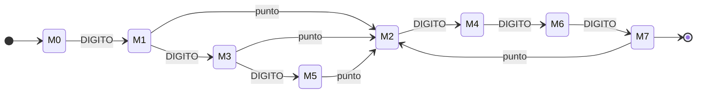

| Estado | `.` | `0` | `1` | `2` | `3` | `4` | `5` | `6` | `7` | `8` | `9` |
| --- | --- | --- | --- | --- | --- | --- | --- | --- | --- | --- | --- |
| →M0 | — | M1 | M1 | M1 | M1 | M1 | M1 | M1 | M1 | M1 | M1 |
| M1 | M2 | M3 | M3 | M3 | M3 | M3 | M3 | M3 | M3 | M3 | M3 |
| M2 | — | M4 | M4 | M4 | M4 | M4 | M4 | M4 | M4 | M4 | M4 |
| M3 | M2 | M5 | M5 | M5 | M5 | M5 | M5 | M5 | M5 | M5 | M5 |
| M4 | — | M6 | M6 | M6 | M6 | M6 | M6 | M6 | M6 | M6 | M6 |
| M5 | M2 | — | — | — | — | — | — | — | — | — | — |
| M6 | — | M7 | M7 | M7 | M7 | M7 | M7 | M7 | M7 | M7 | M7 |
| *M7 | M2 | — | — | — | — | — | — | — | — | — | — |

### ANIMAL de la propuesta (§5.1)

```text
(vaca|toro|caballo|cabra|oveja|cerdo)(s|λ)
```

#### AFN-λ (construcción de Thompson)

68 estados, 73 transiciones, alfabeto: {a, b, c, d, e, j, l, o, r, s, t, v}.

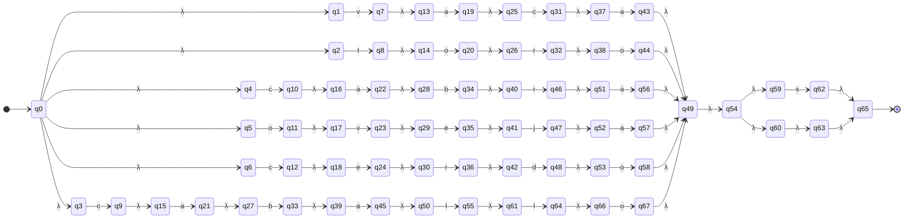

| Estado | `a` | `b` | `c` | `d` | `e` | `j` | `l` | `o` | `r` | `s` | `t` | `v` | `λ` |
| --- | --- | --- | --- | --- | --- | --- | --- | --- | --- | --- | --- | --- | --- |
| →q0 | — | — | — | — | — | — | — | — | — | — | — | — | {q1,q2,q3,q4,q5,q6} |
| q1 | — | — | — | — | — | — | — | — | — | — | — | {q7} | — |
| q2 | — | — | — | — | — | — | — | — | — | — | {q8} | — | — |
| q3 | — | — | {q9} | — | — | — | — | — | — | — | — | — | — |
| q4 | — | — | {q10} | — | — | — | — | — | — | — | — | — | — |
| q5 | — | — | — | — | — | — | — | {q11} | — | — | — | — | — |
| q6 | — | — | {q12} | — | — | — | — | — | — | — | — | — | — |
| q7 | — | — | — | — | — | — | — | — | — | — | — | — | {q13} |
| q8 | — | — | — | — | — | — | — | — | — | — | — | — | {q14} |
| q9 | — | — | — | — | — | — | — | — | — | — | — | — | {q15} |
| q10 | — | — | — | — | — | — | — | — | — | — | — | — | {q16} |
| q11 | — | — | — | — | — | — | — | — | — | — | — | — | {q17} |
| q12 | — | — | — | — | — | — | — | — | — | — | — | — | {q18} |
| q13 | {q19} | — | — | — | — | — | — | — | — | — | — | — | — |
| q14 | — | — | — | — | — | — | — | {q20} | — | — | — | — | — |
| q15 | {q21} | — | — | — | — | — | — | — | — | — | — | — | — |
| q16 | {q22} | — | — | — | — | — | — | — | — | — | — | — | — |
| q17 | — | — | — | — | — | — | — | — | — | — | — | {q23} | — |
| q18 | — | — | — | — | {q24} | — | — | — | — | — | — | — | — |
| q19 | — | — | — | — | — | — | — | — | — | — | — | — | {q25} |
| q20 | — | — | — | — | — | — | — | — | — | — | — | — | {q26} |
| q21 | — | — | — | — | — | — | — | — | — | — | — | — | {q27} |
| q22 | — | — | — | — | — | — | — | — | — | — | — | — | {q28} |
| q23 | — | — | — | — | — | — | — | — | — | — | — | — | {q29} |
| q24 | — | — | — | — | — | — | — | — | — | — | — | — | {q30} |
| q25 | — | — | {q31} | — | — | — | — | — | — | — | — | — | — |
| q26 | — | — | — | — | — | — | — | — | {q32} | — | — | — | — |
| q27 | — | {q33} | — | — | — | — | — | — | — | — | — | — | — |
| q28 | — | {q34} | — | — | — | — | — | — | — | — | — | — | — |
| q29 | — | — | — | — | {q35} | — | — | — | — | — | — | — | — |
| q30 | — | — | — | — | — | — | — | — | {q36} | — | — | — | — |
| q31 | — | — | — | — | — | — | — | — | — | — | — | — | {q37} |
| q32 | — | — | — | — | — | — | — | — | — | — | — | — | {q38} |
| q33 | — | — | — | — | — | — | — | — | — | — | — | — | {q39} |
| q34 | — | — | — | — | — | — | — | — | — | — | — | — | {q40} |
| q35 | — | — | — | — | — | — | — | — | — | — | — | — | {q41} |
| q36 | — | — | — | — | — | — | — | — | — | — | — | — | {q42} |
| q37 | {q43} | — | — | — | — | — | — | — | — | — | — | — | — |
| q38 | — | — | — | — | — | — | — | {q44} | — | — | — | — | — |
| q39 | {q45} | — | — | — | — | — | — | — | — | — | — | — | — |
| q40 | — | — | — | — | — | — | — | — | {q46} | — | — | — | — |
| q41 | — | — | — | — | — | {q47} | — | — | — | — | — | — | — |
| q42 | — | — | — | {q48} | — | — | — | — | — | — | — | — | — |
| q43 | — | — | — | — | — | — | — | — | — | — | — | — | {q49} |
| q44 | — | — | — | — | — | — | — | — | — | — | — | — | {q49} |
| q45 | — | — | — | — | — | — | — | — | — | — | — | — | {q50} |
| q46 | — | — | — | — | — | — | — | — | — | — | — | — | {q51} |
| q47 | — | — | — | — | — | — | — | — | — | — | — | — | {q52} |
| q48 | — | — | — | — | — | — | — | — | — | — | — | — | {q53} |
| q49 | — | — | — | — | — | — | — | — | — | — | — | — | {q54} |
| q50 | — | — | — | — | — | — | {q55} | — | — | — | — | — | — |
| q51 | {q56} | — | — | — | — | — | — | — | — | — | — | — | — |
| q52 | {q57} | — | — | — | — | — | — | — | — | — | — | — | — |
| q53 | — | — | — | — | — | — | — | {q58} | — | — | — | — | — |
| q54 | — | — | — | — | — | — | — | — | — | — | — | — | {q59,q60} |
| q55 | — | — | — | — | — | — | — | — | — | — | — | — | {q61} |
| q56 | — | — | — | — | — | — | — | — | — | — | — | — | {q49} |
| q57 | — | — | — | — | — | — | — | — | — | — | — | — | {q49} |
| q58 | — | — | — | — | — | — | — | — | — | — | — | — | {q49} |
| q59 | — | — | — | — | — | — | — | — | — | {q62} | — | — | — |
| q60 | — | — | — | — | — | — | — | — | — | — | — | — | {q63} |
| q61 | — | — | — | — | — | — | {q64} | — | — | — | — | — | — |
| q62 | — | — | — | — | — | — | — | — | — | — | — | — | {q65} |
| q63 | — | — | — | — | — | — | — | — | — | — | — | — | {q65} |
| q64 | — | — | — | — | — | — | — | — | — | — | — | — | {q66} |
| *q65 | — | — | — | — | — | — | — | — | — | — | — | — | — |
| q66 | — | — | — | — | — | — | — | {q67} | — | — | — | — | — |
| q67 | — | — | — | — | — | — | — | — | — | — | — | — | {q49} |

#### AFD (construcción de subconjuntos)

28 estados, 32 transiciones, alfabeto: {a, b, c, d, e, j, l, o, r, s, t, v}.

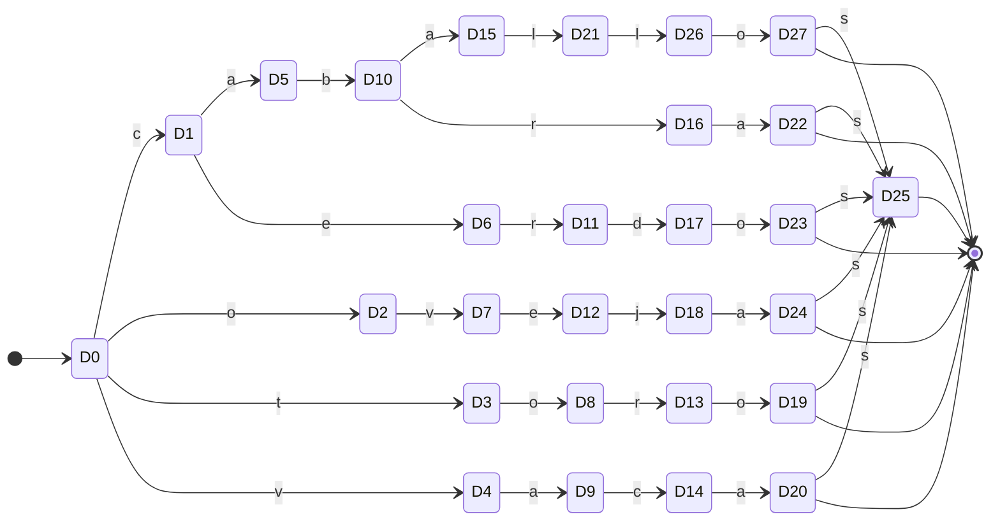

| Estado | Subconjunto AFN | `a` | `b` | `c` | `d` | `e` | `j` | `l` | `o` | `r` | `s` | `t` | `v` |
| --- | --- | --- | --- | --- | --- | --- | --- | --- | --- | --- | --- | --- | --- |
| →D0 | {q0,q1,q2,q3,q4,q5,q6} | — | — | D1 | — | — | — | — | D2 | — | — | D3 | D4 |
| D1 | {q9,q10,q12,q15,q16,q18} | D5 | — | — | — | D6 | — | — | — | — | — | — | — |
| D2 | {q11,q17} | — | — | — | — | — | — | — | — | — | — | — | D7 |
| D3 | {q8,q14} | — | — | — | — | — | — | — | D8 | — | — | — | — |
| D4 | {q7,q13} | D9 | — | — | — | — | — | — | — | — | — | — | — |
| D5 | {q21,q22,q27,q28} | — | D10 | — | — | — | — | — | — | — | — | — | — |
| D6 | {q24,q30} | — | — | — | — | — | — | — | — | D11 | — | — | — |
| D7 | {q23,q29} | — | — | — | — | D12 | — | — | — | — | — | — | — |
| D8 | {q20,q26} | — | — | — | — | — | — | — | — | D13 | — | — | — |
| D9 | {q19,q25} | — | — | D14 | — | — | — | — | — | — | — | — | — |
| D10 | {q33,q34,q39,q40} | D15 | — | — | — | — | — | — | — | D16 | — | — | — |
| D11 | {q36,q42} | — | — | — | D17 | — | — | — | — | — | — | — | — |
| D12 | {q35,q41} | — | — | — | — | — | D18 | — | — | — | — | — | — |
| D13 | {q32,q38} | — | — | — | — | — | — | — | D19 | — | — | — | — |
| D14 | {q31,q37} | D20 | — | — | — | — | — | — | — | — | — | — | — |
| D15 | {q45,q50} | — | — | — | — | — | — | D21 | — | — | — | — | — |
| D16 | {q46,q51} | D22 | — | — | — | — | — | — | — | — | — | — | — |
| D17 | {q48,q53} | — | — | — | — | — | — | — | D23 | — | — | — | — |
| D18 | {q47,q52} | D24 | — | — | — | — | — | — | — | — | — | — | — |
| *D19 | {q44,q49,q54,q59,q60,q63,q65} | — | — | — | — | — | — | — | — | — | D25 | — | — |
| *D20 | {q43,q49,q54,q59,q60,q63,q65} | — | — | — | — | — | — | — | — | — | D25 | — | — |
| D21 | {q55,q61} | — | — | — | — | — | — | D26 | — | — | — | — | — |
| *D22 | {q49,q54,q56,q59,q60,q63,q65} | — | — | — | — | — | — | — | — | — | D25 | — | — |
| *D23 | {q49,q54,q58,q59,q60,q63,q65} | — | — | — | — | — | — | — | — | — | D25 | — | — |
| *D24 | {q49,q54,q57,q59,q60,q63,q65} | — | — | — | — | — | — | — | — | — | D25 | — | — |
| *D25 | {q62,q65} | — | — | — | — | — | — | — | — | — | — | — | — |
| D26 | {q64,q66} | — | — | — | — | — | — | — | D27 | — | — | — | — |
| *D27 | {q49,q54,q59,q60,q63,q65,q67} | — | — | — | — | — | — | — | — | — | D25 | — | — |

#### AFD mínimo (refinamiento de particiones de Moore)

19 estados, 23 transiciones, alfabeto: {a, b, c, d, e, j, l, o, r, s, t, v}.

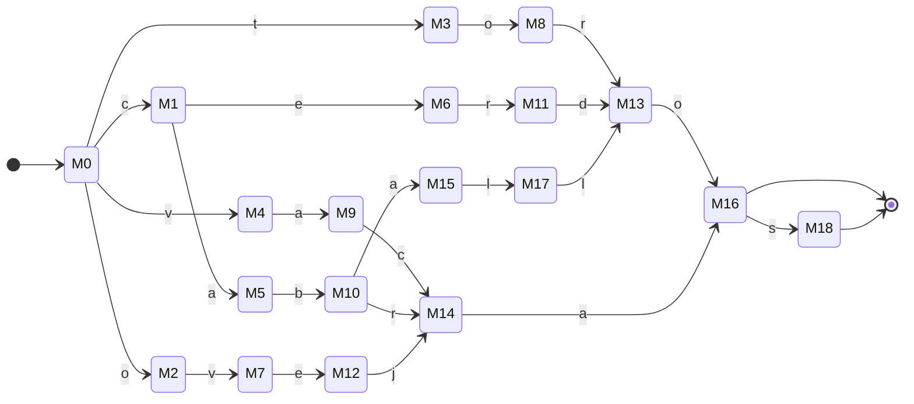

| Estado | `a` | `b` | `c` | `d` | `e` | `j` | `l` | `o` | `r` | `s` | `t` | `v` |
| --- | --- | --- | --- | --- | --- | --- | --- | --- | --- | --- | --- | --- |
| →M0 | — | — | M1 | — | — | — | — | M2 | — | — | M3 | M4 |
| M1 | M5 | — | — | — | M6 | — | — | — | — | — | — | — |
| M2 | — | — | — | — | — | — | — | — | — | — | — | M7 |
| M3 | — | — | — | — | — | — | — | M8 | — | — | — | — |
| M4 | M9 | — | — | — | — | — | — | — | — | — | — | — |
| M5 | — | M10 | — | — | — | — | — | — | — | — | — | — |
| M6 | — | — | — | — | — | — | — | — | M11 | — | — | — |
| M7 | — | — | — | — | M12 | — | — | — | — | — | — | — |
| M8 | — | — | — | — | — | — | — | — | M13 | — | — | — |
| M9 | — | — | M14 | — | — | — | — | — | — | — | — | — |
| M10 | M15 | — | — | — | — | — | — | — | M14 | — | — | — |
| M11 | — | — | — | M13 | — | — | — | — | — | — | — | — |
| M12 | — | — | — | — | — | M14 | — | — | — | — | — | — |
| M13 | — | — | — | — | — | — | — | M16 | — | — | — | — |
| M14 | M16 | — | — | — | — | — | — | — | — | — | — | — |
| M15 | — | — | — | — | — | — | M17 | — | — | — | — | — |
| *M16 | — | — | — | — | — | — | — | — | — | M18 | — | — |
| M17 | — | — | — | — | — | — | M13 | — | — | — | — | — |
| *M18 | — | — | — | — | — | — | — | — | — | — | — | — |

### Token ANIMAL (definición real del analizador léxico)

```text
(vaca|toro|caballo|yegua|cabra|oveja|cerdo|ternero|ternera|novillo|novilla|becerro|becerra|mula)(s|λ) | (buey)(es|λ)
```

#### AFN-λ (construcción de Thompson)

188 estados, 203 transiciones, alfabeto: {a, b, c, d, e, g, i, j, l, m, n, o, r, s, t, u, v, y}.

_Diagrama omitido por tamaño (más de 90 aristas); ver la tabla._

| Estado | `a` | `b` | `c` | `d` | `e` | `g` | `i` | `j` | `l` | `m` | `n` | `o` | `r` | `s` | `t` | `u` | `v` | `y` | `λ` |
| --- | --- | --- | --- | --- | --- | --- | --- | --- | --- | --- | --- | --- | --- | --- | --- | --- | --- | --- | --- |
| →q0 | — | — | — | — | — | — | — | — | — | — | — | — | — | — | — | — | — | — | {q1,q2} |
| q1 | — | — | — | — | — | — | — | — | — | — | — | — | — | — | — | — | — | — | {q3,q4,q5,q6,q7,q8,q9,q10,q11,q12,q13,q14,q15,q16} |
| q2 | — | {q17} | — | — | — | — | — | — | — | — | — | — | — | — | — | — | — | — | — |
| q3 | — | — | — | — | — | — | — | — | — | — | — | — | — | — | — | — | {q18} | — | — |
| q4 | — | — | — | — | — | — | — | — | — | — | — | — | — | — | {q19} | — | — | — | — |
| q5 | — | — | {q20} | — | — | — | — | — | — | — | — | — | — | — | — | — | — | — | — |
| q6 | — | — | — | — | — | — | — | — | — | — | — | — | — | — | — | — | — | {q21} | — |
| q7 | — | — | {q22} | — | — | — | — | — | — | — | — | — | — | — | — | — | — | — | — |
| q8 | — | — | — | — | — | — | — | — | — | — | — | {q23} | — | — | — | — | — | — | — |
| q9 | — | — | {q24} | — | — | — | — | — | — | — | — | — | — | — | — | — | — | — | — |
| q10 | — | — | — | — | — | — | — | — | — | — | — | — | — | — | {q25} | — | — | — | — |
| q11 | — | — | — | — | — | — | — | — | — | — | — | — | — | — | {q26} | — | — | — | — |
| q12 | — | — | — | — | — | — | — | — | — | — | {q27} | — | — | — | — | — | — | — | — |
| q13 | — | — | — | — | — | — | — | — | — | — | {q28} | — | — | — | — | — | — | — | — |
| q14 | — | {q29} | — | — | — | — | — | — | — | — | — | — | — | — | — | — | — | — | — |
| q15 | — | {q30} | — | — | — | — | — | — | — | — | — | — | — | — | — | — | — | — | — |
| q16 | — | — | — | — | — | — | — | — | — | {q31} | — | — | — | — | — | — | — | — | — |
| q17 | — | — | — | — | — | — | — | — | — | — | — | — | — | — | — | — | — | — | {q32} |
| q18 | — | — | — | — | — | — | — | — | — | — | — | — | — | — | — | — | — | — | {q33} |
| q19 | — | — | — | — | — | — | — | — | — | — | — | — | — | — | — | — | — | — | {q34} |
| q20 | — | — | — | — | — | — | — | — | — | — | — | — | — | — | — | — | — | — | {q35} |
| q21 | — | — | — | — | — | — | — | — | — | — | — | — | — | — | — | — | — | — | {q36} |
| q22 | — | — | — | — | — | — | — | — | — | — | — | — | — | — | — | — | — | — | {q37} |
| q23 | — | — | — | — | — | — | — | — | — | — | — | — | — | — | — | — | — | — | {q38} |
| q24 | — | — | — | — | — | — | — | — | — | — | — | — | — | — | — | — | — | — | {q39} |
| q25 | — | — | — | — | — | — | — | — | — | — | — | — | — | — | — | — | — | — | {q40} |
| q26 | — | — | — | — | — | — | — | — | — | — | — | — | — | — | — | — | — | — | {q41} |
| q27 | — | — | — | — | — | — | — | — | — | — | — | — | — | — | — | — | — | — | {q42} |
| q28 | — | — | — | — | — | — | — | — | — | — | — | — | — | — | — | — | — | — | {q43} |
| q29 | — | — | — | — | — | — | — | — | — | — | — | — | — | — | — | — | — | — | {q44} |
| q30 | — | — | — | — | — | — | — | — | — | — | — | — | — | — | — | — | — | — | {q45} |
| q31 | — | — | — | — | — | — | — | — | — | — | — | — | — | — | — | — | — | — | {q46} |
| q32 | — | — | — | — | — | — | — | — | — | — | — | — | — | — | — | {q47} | — | — | — |
| q33 | {q48} | — | — | — | — | — | — | — | — | — | — | — | — | — | — | — | — | — | — |
| q34 | — | — | — | — | — | — | — | — | — | — | — | {q49} | — | — | — | — | — | — | — |
| q35 | {q50} | — | — | — | — | — | — | — | — | — | — | — | — | — | — | — | — | — | — |
| q36 | — | — | — | — | {q51} | — | — | — | — | — | — | — | — | — | — | — | — | — | — |
| q37 | {q52} | — | — | — | — | — | — | — | — | — | — | — | — | — | — | — | — | — | — |
| q38 | — | — | — | — | — | — | — | — | — | — | — | — | — | — | — | — | {q53} | — | — |
| q39 | — | — | — | — | {q54} | — | — | — | — | — | — | — | — | — | — | — | — | — | — |
| q40 | — | — | — | — | {q55} | — | — | — | — | — | — | — | — | — | — | — | — | — | — |
| q41 | — | — | — | — | {q56} | — | — | — | — | — | — | — | — | — | — | — | — | — | — |
| q42 | — | — | — | — | — | — | — | — | — | — | — | {q57} | — | — | — | — | — | — | — |
| q43 | — | — | — | — | — | — | — | — | — | — | — | {q58} | — | — | — | — | — | — | — |
| q44 | — | — | — | — | {q59} | — | — | — | — | — | — | — | — | — | — | — | — | — | — |
| q45 | — | — | — | — | {q60} | — | — | — | — | — | — | — | — | — | — | — | — | — | — |
| q46 | — | — | — | — | — | — | — | — | — | — | — | — | — | — | — | {q61} | — | — | — |
| q47 | — | — | — | — | — | — | — | — | — | — | — | — | — | — | — | — | — | — | {q62} |
| q48 | — | — | — | — | — | — | — | — | — | — | — | — | — | — | — | — | — | — | {q63} |
| q49 | — | — | — | — | — | — | — | — | — | — | — | — | — | — | — | — | — | — | {q64} |
| q50 | — | — | — | — | — | — | — | — | — | — | — | — | — | — | — | — | — | — | {q65} |
| q51 | — | — | — | — | — | — | — | — | — | — | — | — | — | — | — | — | — | — | {q66} |
| q52 | — | — | — | — | — | — | — | — | — | — | — | — | — | — | — | — | — | — | {q67} |
| q53 | — | — | — | — | — | — | — | — | — | — | — | — | — | — | — | — | — | — | {q68} |
| q54 | — | — | — | — | — | — | — | — | — | — | — | — | — | — | — | — | — | — | {q69} |
| q55 | — | — | — | — | — | — | — | — | — | — | — | — | — | — | — | — | — | — | {q70} |
| q56 | — | — | — | — | — | — | — | — | — | — | — | — | — | — | — | — | — | — | {q71} |
| q57 | — | — | — | — | — | — | — | — | — | — | — | — | — | — | — | — | — | — | {q72} |
| q58 | — | — | — | — | — | — | — | — | — | — | — | — | — | — | — | — | — | — | {q73} |
| q59 | — | — | — | — | — | — | — | — | — | — | — | — | — | — | — | — | — | — | {q74} |
| q60 | — | — | — | — | — | — | — | — | — | — | — | — | — | — | — | — | — | — | {q75} |
| q61 | — | — | — | — | — | — | — | — | — | — | — | — | — | — | — | — | — | — | {q76} |
| q62 | — | — | — | — | {q77} | — | — | — | — | — | — | — | — | — | — | — | — | — | — |
| q63 | — | — | {q78} | — | — | — | — | — | — | — | — | — | — | — | — | — | — | — | — |
| q64 | — | — | — | — | — | — | — | — | — | — | — | — | {q79} | — | — | — | — | — | — |
| q65 | — | {q80} | — | — | — | — | — | — | — | — | — | — | — | — | — | — | — | — | — |
| q66 | — | — | — | — | — | {q81} | — | — | — | — | — | — | — | — | — | — | — | — | — |
| q67 | — | {q82} | — | — | — | — | — | — | — | — | — | — | — | — | — | — | — | — | — |
| q68 | — | — | — | — | {q83} | — | — | — | — | — | — | — | — | — | — | — | — | — | — |
| q69 | — | — | — | — | — | — | — | — | — | — | — | — | {q84} | — | — | — | — | — | — |
| q70 | — | — | — | — | — | — | — | — | — | — | — | — | {q85} | — | — | — | — | — | — |
| q71 | — | — | — | — | — | — | — | — | — | — | — | — | {q86} | — | — | — | — | — | — |
| q72 | — | — | — | — | — | — | — | — | — | — | — | — | — | — | — | — | {q87} | — | — |
| q73 | — | — | — | — | — | — | — | — | — | — | — | — | — | — | — | — | {q88} | — | — |
| q74 | — | — | {q89} | — | — | — | — | — | — | — | — | — | — | — | — | — | — | — | — |
| q75 | — | — | {q90} | — | — | — | — | — | — | — | — | — | — | — | — | — | — | — | — |
| q76 | — | — | — | — | — | — | — | — | {q91} | — | — | — | — | — | — | — | — | — | — |
| q77 | — | — | — | — | — | — | — | — | — | — | — | — | — | — | — | — | — | — | {q92} |
| q78 | — | — | — | — | — | — | — | — | — | — | — | — | — | — | — | — | — | — | {q93} |
| q79 | — | — | — | — | — | — | — | — | — | — | — | — | — | — | — | — | — | — | {q94} |
| q80 | — | — | — | — | — | — | — | — | — | — | — | — | — | — | — | — | — | — | {q95} |
| q81 | — | — | — | — | — | — | — | — | — | — | — | — | — | — | — | — | — | — | {q96} |
| q82 | — | — | — | — | — | — | — | — | — | — | — | — | — | — | — | — | — | — | {q97} |
| q83 | — | — | — | — | — | — | — | — | — | — | — | — | — | — | — | — | — | — | {q98} |
| q84 | — | — | — | — | — | — | — | — | — | — | — | — | — | — | — | — | — | — | {q99} |
| q85 | — | — | — | — | — | — | — | — | — | — | — | — | — | — | — | — | — | — | {q100} |
| q86 | — | — | — | — | — | — | — | — | — | — | — | — | — | — | — | — | — | — | {q101} |
| q87 | — | — | — | — | — | — | — | — | — | — | — | — | — | — | — | — | — | — | {q102} |
| q88 | — | — | — | — | — | — | — | — | — | — | — | — | — | — | — | — | — | — | {q103} |
| q89 | — | — | — | — | — | — | — | — | — | — | — | — | — | — | — | — | — | — | {q104} |
| q90 | — | — | — | — | — | — | — | — | — | — | — | — | — | — | — | — | — | — | {q105} |
| q91 | — | — | — | — | — | — | — | — | — | — | — | — | — | — | — | — | — | — | {q106} |
| q92 | — | — | — | — | — | — | — | — | — | — | — | — | — | — | — | — | — | {q107} | — |
| q93 | {q108} | — | — | — | — | — | — | — | — | — | — | — | — | — | — | — | — | — | — |
| q94 | — | — | — | — | — | — | — | — | — | — | — | {q109} | — | — | — | — | — | — | — |
| q95 | {q110} | — | — | — | — | — | — | — | — | — | — | — | — | — | — | — | — | — | — |
| q96 | — | — | — | — | — | — | — | — | — | — | — | — | — | — | — | {q111} | — | — | — |
| q97 | — | — | — | — | — | — | — | — | — | — | — | — | {q112} | — | — | — | — | — | — |
| q98 | — | — | — | — | — | — | — | {q113} | — | — | — | — | — | — | — | — | — | — | — |
| q99 | — | — | — | {q114} | — | — | — | — | — | — | — | — | — | — | — | — | — | — | — |
| q100 | — | — | — | — | — | — | — | — | — | — | {q115} | — | — | — | — | — | — | — | — |
| q101 | — | — | — | — | — | — | — | — | — | — | {q116} | — | — | — | — | — | — | — | — |
| q102 | — | — | — | — | — | — | {q117} | — | — | — | — | — | — | — | — | — | — | — | — |
| q103 | — | — | — | — | — | — | {q118} | — | — | — | — | — | — | — | — | — | — | — | — |
| q104 | — | — | — | — | {q119} | — | — | — | — | — | — | — | — | — | — | — | — | — | — |
| q105 | — | — | — | — | {q120} | — | — | — | — | — | — | — | — | — | — | — | — | — | — |
| q106 | {q121} | — | — | — | — | — | — | — | — | — | — | — | — | — | — | — | — | — | — |
| q107 | — | — | — | — | — | — | — | — | — | — | — | — | — | — | — | — | — | — | {q122} |
| q108 | — | — | — | — | — | — | — | — | — | — | — | — | — | — | — | — | — | — | {q123} |
| q109 | — | — | — | — | — | — | — | — | — | — | — | — | — | — | — | — | — | — | {q123} |
| q110 | — | — | — | — | — | — | — | — | — | — | — | — | — | — | — | — | — | — | {q124} |
| q111 | — | — | — | — | — | — | — | — | — | — | — | — | — | — | — | — | — | — | {q125} |
| q112 | — | — | — | — | — | — | — | — | — | — | — | — | — | — | — | — | — | — | {q126} |
| q113 | — | — | — | — | — | — | — | — | — | — | — | — | — | — | — | — | — | — | {q127} |
| q114 | — | — | — | — | — | — | — | — | — | — | — | — | — | — | — | — | — | — | {q128} |
| q115 | — | — | — | — | — | — | — | — | — | — | — | — | — | — | — | — | — | — | {q129} |
| q116 | — | — | — | — | — | — | — | — | — | — | — | — | — | — | — | — | — | — | {q130} |
| q117 | — | — | — | — | — | — | — | — | — | — | — | — | — | — | — | — | — | — | {q131} |
| q118 | — | — | — | — | — | — | — | — | — | — | — | — | — | — | — | — | — | — | {q132} |
| q119 | — | — | — | — | — | — | — | — | — | — | — | — | — | — | — | — | — | — | {q133} |
| q120 | — | — | — | — | — | — | — | — | — | — | — | — | — | — | — | — | — | — | {q134} |
| q121 | — | — | — | — | — | — | — | — | — | — | — | — | — | — | — | — | — | — | {q123} |
| q122 | — | — | — | — | — | — | — | — | — | — | — | — | — | — | — | — | — | — | {q135,q136} |
| q123 | — | — | — | — | — | — | — | — | — | — | — | — | — | — | — | — | — | — | {q137} |
| q124 | — | — | — | — | — | — | — | — | {q138} | — | — | — | — | — | — | — | — | — | — |
| q125 | {q139} | — | — | — | — | — | — | — | — | — | — | — | — | — | — | — | — | — | — |
| q126 | {q140} | — | — | — | — | — | — | — | — | — | — | — | — | — | — | — | — | — | — |
| q127 | {q141} | — | — | — | — | — | — | — | — | — | — | — | — | — | — | — | — | — | — |
| q128 | — | — | — | — | — | — | — | — | — | — | — | {q142} | — | — | — | — | — | — | — |
| q129 | — | — | — | — | {q143} | — | — | — | — | — | — | — | — | — | — | — | — | — | — |
| q130 | — | — | — | — | {q144} | — | — | — | — | — | — | — | — | — | — | — | — | — | — |
| q131 | — | — | — | — | — | — | — | — | {q145} | — | — | — | — | — | — | — | — | — | — |
| q132 | — | — | — | — | — | — | — | — | {q146} | — | — | — | — | — | — | — | — | — | — |
| q133 | — | — | — | — | — | — | — | — | — | — | — | — | {q147} | — | — | — | — | — | — |
| q134 | — | — | — | — | — | — | — | — | — | — | — | — | {q148} | — | — | — | — | — | — |
| q135 | — | — | — | — | {q149} | — | — | — | — | — | — | — | — | — | — | — | — | — | — |
| q136 | — | — | — | — | — | — | — | — | — | — | — | — | — | — | — | — | — | — | {q150} |
| q137 | — | — | — | — | — | — | — | — | — | — | — | — | — | — | — | — | — | — | {q151,q152} |
| q138 | — | — | — | — | — | — | — | — | — | — | — | — | — | — | — | — | — | — | {q153} |
| q139 | — | — | — | — | — | — | — | — | — | — | — | — | — | — | — | — | — | — | {q123} |
| q140 | — | — | — | — | — | — | — | — | — | — | — | — | — | — | — | — | — | — | {q123} |
| q141 | — | — | — | — | — | — | — | — | — | — | — | — | — | — | — | — | — | — | {q123} |
| q142 | — | — | — | — | — | — | — | — | — | — | — | — | — | — | — | — | — | — | {q123} |
| q143 | — | — | — | — | — | — | — | — | — | — | — | — | — | — | — | — | — | — | {q154} |
| q144 | — | — | — | — | — | — | — | — | — | — | — | — | — | — | — | — | — | — | {q155} |
| q145 | — | — | — | — | — | — | — | — | — | — | — | — | — | — | — | — | — | — | {q156} |
| q146 | — | — | — | — | — | — | — | — | — | — | — | — | — | — | — | — | — | — | {q157} |
| q147 | — | — | — | — | — | — | — | — | — | — | — | — | — | — | — | — | — | — | {q158} |
| q148 | — | — | — | — | — | — | — | — | — | — | — | — | — | — | — | — | — | — | {q159} |
| q149 | — | — | — | — | — | — | — | — | — | — | — | — | — | — | — | — | — | — | {q160} |
| q150 | — | — | — | — | — | — | — | — | — | — | — | — | — | — | — | — | — | — | {q161} |
| q151 | — | — | — | — | — | — | — | — | — | — | — | — | — | {q162} | — | — | — | — | — |
| q152 | — | — | — | — | — | — | — | — | — | — | — | — | — | — | — | — | — | — | {q163} |
| q153 | — | — | — | — | — | — | — | — | {q164} | — | — | — | — | — | — | — | — | — | — |
| q154 | — | — | — | — | — | — | — | — | — | — | — | — | {q165} | — | — | — | — | — | — |
| q155 | — | — | — | — | — | — | — | — | — | — | — | — | {q166} | — | — | — | — | — | — |
| q156 | — | — | — | — | — | — | — | — | {q167} | — | — | — | — | — | — | — | — | — | — |
| q157 | — | — | — | — | — | — | — | — | {q168} | — | — | — | — | — | — | — | — | — | — |
| q158 | — | — | — | — | — | — | — | — | — | — | — | — | {q169} | — | — | — | — | — | — |
| q159 | — | — | — | — | — | — | — | — | — | — | — | — | {q170} | — | — | — | — | — | — |
| q160 | — | — | — | — | — | — | — | — | — | — | — | — | — | {q171} | — | — | — | — | — |
| q161 | — | — | — | — | — | — | — | — | — | — | — | — | — | — | — | — | — | — | {q172} |
| q162 | — | — | — | — | — | — | — | — | — | — | — | — | — | — | — | — | — | — | {q173} |
| q163 | — | — | — | — | — | — | — | — | — | — | — | — | — | — | — | — | — | — | {q173} |
| q164 | — | — | — | — | — | — | — | — | — | — | — | — | — | — | — | — | — | — | {q174} |
| q165 | — | — | — | — | — | — | — | — | — | — | — | — | — | — | — | — | — | — | {q175} |
| q166 | — | — | — | — | — | — | — | — | — | — | — | — | — | — | — | — | — | — | {q176} |
| q167 | — | — | — | — | — | — | — | — | — | — | — | — | — | — | — | — | — | — | {q177} |
| q168 | — | — | — | — | — | — | — | — | — | — | — | — | — | — | — | — | — | — | {q178} |
| q169 | — | — | — | — | — | — | — | — | — | — | — | — | — | — | — | — | — | — | {q179} |
| q170 | — | — | — | — | — | — | — | — | — | — | — | — | — | — | — | — | — | — | {q180} |
| q171 | — | — | — | — | — | — | — | — | — | — | — | — | — | — | — | — | — | — | {q161} |
| *q172 | — | — | — | — | — | — | — | — | — | — | — | — | — | — | — | — | — | — | — |
| q173 | — | — | — | — | — | — | — | — | — | — | — | — | — | — | — | — | — | — | {q172} |
| q174 | — | — | — | — | — | — | — | — | — | — | — | {q181} | — | — | — | — | — | — | — |
| q175 | — | — | — | — | — | — | — | — | — | — | — | {q182} | — | — | — | — | — | — | — |
| q176 | {q183} | — | — | — | — | — | — | — | — | — | — | — | — | — | — | — | — | — | — |
| q177 | — | — | — | — | — | — | — | — | — | — | — | {q184} | — | — | — | — | — | — | — |
| q178 | {q185} | — | — | — | — | — | — | — | — | — | — | — | — | — | — | — | — | — | — |
| q179 | — | — | — | — | — | — | — | — | — | — | — | {q186} | — | — | — | — | — | — | — |
| q180 | {q187} | — | — | — | — | — | — | — | — | — | — | — | — | — | — | — | — | — | — |
| q181 | — | — | — | — | — | — | — | — | — | — | — | — | — | — | — | — | — | — | {q123} |
| q182 | — | — | — | — | — | — | — | — | — | — | — | — | — | — | — | — | — | — | {q123} |
| q183 | — | — | — | — | — | — | — | — | — | — | — | — | — | — | — | — | — | — | {q123} |
| q184 | — | — | — | — | — | — | — | — | — | — | — | — | — | — | — | — | — | — | {q123} |
| q185 | — | — | — | — | — | — | — | — | — | — | — | — | — | — | — | — | — | — | {q123} |
| q186 | — | — | — | — | — | — | — | — | — | — | — | — | — | — | — | — | — | — | {q123} |
| q187 | — | — | — | — | — | — | — | — | — | — | — | — | — | — | — | — | — | — | {q123} |

#### AFD (construcción de subconjuntos)

65 estados, 77 transiciones, alfabeto: {a, b, c, d, e, g, i, j, l, m, n, o, r, s, t, u, v, y}.

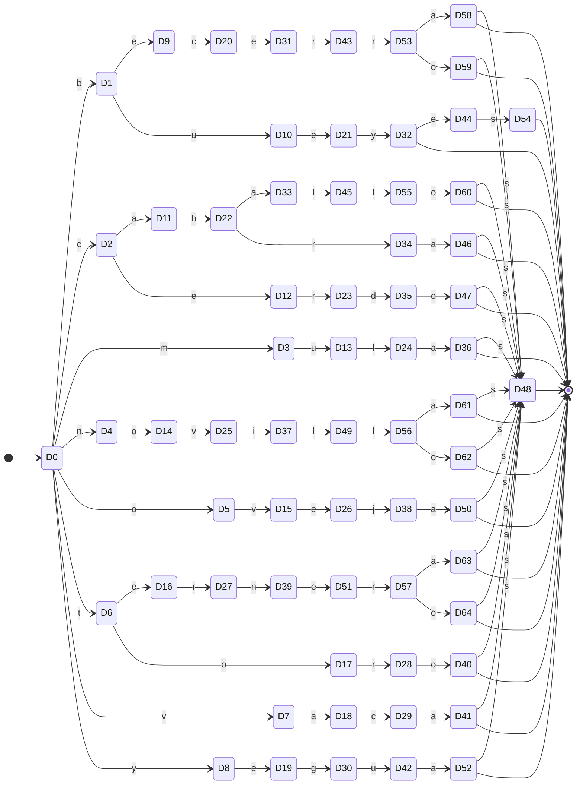

| Estado | Subconjunto AFN | `a` | `b` | `c` | `d` | `e` | `g` | `i` | `j` | `l` | `m` | `n` | `o` | `r` | `s` | `t` | `u` | `v` | `y` |
| --- | --- | --- | --- | --- | --- | --- | --- | --- | --- | --- | --- | --- | --- | --- | --- | --- | --- | --- | --- |
| →D0 | {q0,q1,q2,q3,q4,q5,q6,q7,q8,q9,q10,q11,q12,q13,q14,q15,q16} | — | D1 | D2 | — | — | — | — | — | — | D3 | D4 | D5 | — | — | D6 | — | D7 | D8 |
| D1 | {q17,q29,q30,q32,q44,q45} | — | — | — | — | D9 | — | — | — | — | — | — | — | — | — | — | D10 | — | — |
| D2 | {q20,q22,q24,q35,q37,q39} | D11 | — | — | — | D12 | — | — | — | — | — | — | — | — | — | — | — | — | — |
| D3 | {q31,q46} | — | — | — | — | — | — | — | — | — | — | — | — | — | — | — | D13 | — | — |
| D4 | {q27,q28,q42,q43} | — | — | — | — | — | — | — | — | — | — | — | D14 | — | — | — | — | — | — |
| D5 | {q23,q38} | — | — | — | — | — | — | — | — | — | — | — | — | — | — | — | — | D15 | — |
| D6 | {q19,q25,q26,q34,q40,q41} | — | — | — | — | D16 | — | — | — | — | — | — | D17 | — | — | — | — | — | — |
| D7 | {q18,q33} | D18 | — | — | — | — | — | — | — | — | — | — | — | — | — | — | — | — | — |
| D8 | {q21,q36} | — | — | — | — | D19 | — | — | — | — | — | — | — | — | — | — | — | — | — |
| D9 | {q59,q60,q74,q75} | — | — | D20 | — | — | — | — | — | — | — | — | — | — | — | — | — | — | — |
| D10 | {q47,q62} | — | — | — | — | D21 | — | — | — | — | — | — | — | — | — | — | — | — | — |
| D11 | {q50,q52,q65,q67} | — | D22 | — | — | — | — | — | — | — | — | — | — | — | — | — | — | — | — |
| D12 | {q54,q69} | — | — | — | — | — | — | — | — | — | — | — | — | D23 | — | — | — | — | — |
| D13 | {q61,q76} | — | — | — | — | — | — | — | — | D24 | — | — | — | — | — | — | — | — | — |
| D14 | {q57,q58,q72,q73} | — | — | — | — | — | — | — | — | — | — | — | — | — | — | — | — | D25 | — |
| D15 | {q53,q68} | — | — | — | — | D26 | — | — | — | — | — | — | — | — | — | — | — | — | — |
| D16 | {q55,q56,q70,q71} | — | — | — | — | — | — | — | — | — | — | — | — | D27 | — | — | — | — | — |
| D17 | {q49,q64} | — | — | — | — | — | — | — | — | — | — | — | — | D28 | — | — | — | — | — |
| D18 | {q48,q63} | — | — | D29 | — | — | — | — | — | — | — | — | — | — | — | — | — | — | — |
| D19 | {q51,q66} | — | — | — | — | — | D30 | — | — | — | — | — | — | — | — | — | — | — | — |
| D20 | {q89,q90,q104,q105} | — | — | — | — | D31 | — | — | — | — | — | — | — | — | — | — | — | — | — |
| D21 | {q77,q92} | — | — | — | — | — | — | — | — | — | — | — | — | — | — | — | — | — | D32 |
| D22 | {q80,q82,q95,q97} | D33 | — | — | — | — | — | — | — | — | — | — | — | D34 | — | — | — | — | — |
| D23 | {q84,q99} | — | — | — | D35 | — | — | — | — | — | — | — | — | — | — | — | — | — | — |
| D24 | {q91,q106} | D36 | — | — | — | — | — | — | — | — | — | — | — | — | — | — | — | — | — |
| D25 | {q87,q88,q102,q103} | — | — | — | — | — | — | D37 | — | — | — | — | — | — | — | — | — | — | — |
| D26 | {q83,q98} | — | — | — | — | — | — | — | D38 | — | — | — | — | — | — | — | — | — | — |
| D27 | {q85,q86,q100,q101} | — | — | — | — | — | — | — | — | — | — | D39 | — | — | — | — | — | — | — |
| D28 | {q79,q94} | — | — | — | — | — | — | — | — | — | — | — | D40 | — | — | — | — | — | — |
| D29 | {q78,q93} | D41 | — | — | — | — | — | — | — | — | — | — | — | — | — | — | — | — | — |
| D30 | {q81,q96} | — | — | — | — | — | — | — | — | — | — | — | — | — | — | — | D42 | — | — |
| D31 | {q119,q120,q133,q134} | — | — | — | — | — | — | — | — | — | — | — | — | D43 | — | — | — | — | — |
| *D32 | {q107,q122,q135,q136,q150,q161,q172} | — | — | — | — | D44 | — | — | — | — | — | — | — | — | — | — | — | — | — |
| D33 | {q110,q124} | — | — | — | — | — | — | — | — | D45 | — | — | — | — | — | — | — | — | — |
| D34 | {q112,q126} | D46 | — | — | — | — | — | — | — | — | — | — | — | — | — | — | — | — | — |
| D35 | {q114,q128} | — | — | — | — | — | — | — | — | — | — | — | D47 | — | — | — | — | — | — |
| *D36 | {q121,q123,q137,q151,q152,q163,q172,q173} | — | — | — | — | — | — | — | — | — | — | — | — | — | D48 | — | — | — | — |
| D37 | {q117,q118,q131,q132} | — | — | — | — | — | — | — | — | D49 | — | — | — | — | — | — | — | — | — |
| D38 | {q113,q127} | D50 | — | — | — | — | — | — | — | — | — | — | — | — | — | — | — | — | — |
| D39 | {q115,q116,q129,q130} | — | — | — | — | D51 | — | — | — | — | — | — | — | — | — | — | — | — | — |
| *D40 | {q109,q123,q137,q151,q152,q163,q172,q173} | — | — | — | — | — | — | — | — | — | — | — | — | — | D48 | — | — | — | — |
| *D41 | {q108,q123,q137,q151,q152,q163,q172,q173} | — | — | — | — | — | — | — | — | — | — | — | — | — | D48 | — | — | — | — |
| D42 | {q111,q125} | D52 | — | — | — | — | — | — | — | — | — | — | — | — | — | — | — | — | — |
| D43 | {q147,q148,q158,q159} | — | — | — | — | — | — | — | — | — | — | — | — | D53 | — | — | — | — | — |
| D44 | {q149,q160} | — | — | — | — | — | — | — | — | — | — | — | — | — | D54 | — | — | — | — |
| D45 | {q138,q153} | — | — | — | — | — | — | — | — | D55 | — | — | — | — | — | — | — | — | — |
| *D46 | {q123,q137,q140,q151,q152,q163,q172,q173} | — | — | — | — | — | — | — | — | — | — | — | — | — | D48 | — | — | — | — |
| *D47 | {q123,q137,q142,q151,q152,q163,q172,q173} | — | — | — | — | — | — | — | — | — | — | — | — | — | D48 | — | — | — | — |
| *D48 | {q162,q172,q173} | — | — | — | — | — | — | — | — | — | — | — | — | — | — | — | — | — | — |
| D49 | {q145,q146,q156,q157} | — | — | — | — | — | — | — | — | D56 | — | — | — | — | — | — | — | — | — |
| *D50 | {q123,q137,q141,q151,q152,q163,q172,q173} | — | — | — | — | — | — | — | — | — | — | — | — | — | D48 | — | — | — | — |
| D51 | {q143,q144,q154,q155} | — | — | — | — | — | — | — | — | — | — | — | — | D57 | — | — | — | — | — |
| *D52 | {q123,q137,q139,q151,q152,q163,q172,q173} | — | — | — | — | — | — | — | — | — | — | — | — | — | D48 | — | — | — | — |
| D53 | {q169,q170,q179,q180} | D58 | — | — | — | — | — | — | — | — | — | — | D59 | — | — | — | — | — | — |
| *D54 | {q161,q171,q172} | — | — | — | — | — | — | — | — | — | — | — | — | — | — | — | — | — | — |
| D55 | {q164,q174} | — | — | — | — | — | — | — | — | — | — | — | D60 | — | — | — | — | — | — |
| D56 | {q167,q168,q177,q178} | D61 | — | — | — | — | — | — | — | — | — | — | D62 | — | — | — | — | — | — |
| D57 | {q165,q166,q175,q176} | D63 | — | — | — | — | — | — | — | — | — | — | D64 | — | — | — | — | — | — |
| *D58 | {q123,q137,q151,q152,q163,q172,q173,q187} | — | — | — | — | — | — | — | — | — | — | — | — | — | D48 | — | — | — | — |
| *D59 | {q123,q137,q151,q152,q163,q172,q173,q186} | — | — | — | — | — | — | — | — | — | — | — | — | — | D48 | — | — | — | — |
| *D60 | {q123,q137,q151,q152,q163,q172,q173,q181} | — | — | — | — | — | — | — | — | — | — | — | — | — | D48 | — | — | — | — |
| *D61 | {q123,q137,q151,q152,q163,q172,q173,q185} | — | — | — | — | — | — | — | — | — | — | — | — | — | D48 | — | — | — | — |
| *D62 | {q123,q137,q151,q152,q163,q172,q173,q184} | — | — | — | — | — | — | — | — | — | — | — | — | — | D48 | — | — | — | — |
| *D63 | {q123,q137,q151,q152,q163,q172,q173,q183} | — | — | — | — | — | — | — | — | — | — | — | — | — | D48 | — | — | — | — |
| *D64 | {q123,q137,q151,q152,q163,q172,q173,q182} | — | — | — | — | — | — | — | — | — | — | — | — | — | D48 | — | — | — | — |

#### AFD mínimo (refinamiento de particiones de Moore)

42 estados, 53 transiciones, alfabeto: {a, b, c, d, e, g, i, j, l, m, n, o, r, s, t, u, v, y}.

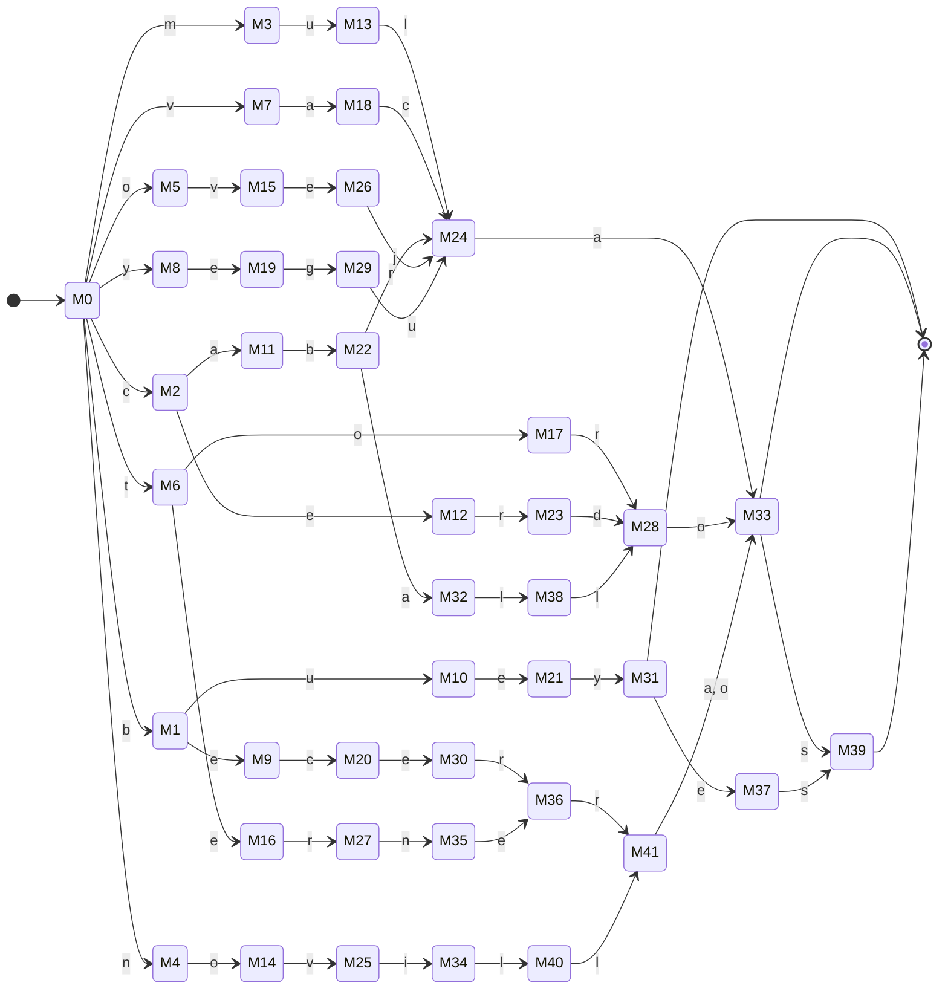

| Estado | `a` | `b` | `c` | `d` | `e` | `g` | `i` | `j` | `l` | `m` | `n` | `o` | `r` | `s` | `t` | `u` | `v` | `y` |
| --- | --- | --- | --- | --- | --- | --- | --- | --- | --- | --- | --- | --- | --- | --- | --- | --- | --- | --- |
| →M0 | — | M1 | M2 | — | — | — | — | — | — | M3 | M4 | M5 | — | — | M6 | — | M7 | M8 |
| M1 | — | — | — | — | M9 | — | — | — | — | — | — | — | — | — | — | M10 | — | — |
| M2 | M11 | — | — | — | M12 | — | — | — | — | — | — | — | — | — | — | — | — | — |
| M3 | — | — | — | — | — | — | — | — | — | — | — | — | — | — | — | M13 | — | — |
| M4 | — | — | — | — | — | — | — | — | — | — | — | M14 | — | — | — | — | — | — |
| M5 | — | — | — | — | — | — | — | — | — | — | — | — | — | — | — | — | M15 | — |
| M6 | — | — | — | — | M16 | — | — | — | — | — | — | M17 | — | — | — | — | — | — |
| M7 | M18 | — | — | — | — | — | — | — | — | — | — | — | — | — | — | — | — | — |
| M8 | — | — | — | — | M19 | — | — | — | — | — | — | — | — | — | — | — | — | — |
| M9 | — | — | M20 | — | — | — | — | — | — | — | — | — | — | — | — | — | — | — |
| M10 | — | — | — | — | M21 | — | — | — | — | — | — | — | — | — | — | — | — | — |
| M11 | — | M22 | — | — | — | — | — | — | — | — | — | — | — | — | — | — | — | — |
| M12 | — | — | — | — | — | — | — | — | — | — | — | — | M23 | — | — | — | — | — |
| M13 | — | — | — | — | — | — | — | — | M24 | — | — | — | — | — | — | — | — | — |
| M14 | — | — | — | — | — | — | — | — | — | — | — | — | — | — | — | — | M25 | — |
| M15 | — | — | — | — | M26 | — | — | — | — | — | — | — | — | — | — | — | — | — |
| M16 | — | — | — | — | — | — | — | — | — | — | — | — | M27 | — | — | — | — | — |
| M17 | — | — | — | — | — | — | — | — | — | — | — | — | M28 | — | — | — | — | — |
| M18 | — | — | M24 | — | — | — | — | — | — | — | — | — | — | — | — | — | — | — |
| M19 | — | — | — | — | — | M29 | — | — | — | — | — | — | — | — | — | — | — | — |
| M20 | — | — | — | — | M30 | — | — | — | — | — | — | — | — | — | — | — | — | — |
| M21 | — | — | — | — | — | — | — | — | — | — | — | — | — | — | — | — | — | M31 |
| M22 | M32 | — | — | — | — | — | — | — | — | — | — | — | M24 | — | — | — | — | — |
| M23 | — | — | — | M28 | — | — | — | — | — | — | — | — | — | — | — | — | — | — |
| M24 | M33 | — | — | — | — | — | — | — | — | — | — | — | — | — | — | — | — | — |
| M25 | — | — | — | — | — | — | M34 | — | — | — | — | — | — | — | — | — | — | — |
| M26 | — | — | — | — | — | — | — | M24 | — | — | — | — | — | — | — | — | — | — |
| M27 | — | — | — | — | — | — | — | — | — | — | M35 | — | — | — | — | — | — | — |
| M28 | — | — | — | — | — | — | — | — | — | — | — | M33 | — | — | — | — | — | — |
| M29 | — | — | — | — | — | — | — | — | — | — | — | — | — | — | — | M24 | — | — |
| M30 | — | — | — | — | — | — | — | — | — | — | — | — | M36 | — | — | — | — | — |
| *M31 | — | — | — | — | M37 | — | — | — | — | — | — | — | — | — | — | — | — | — |
| M32 | — | — | — | — | — | — | — | — | M38 | — | — | — | — | — | — | — | — | — |
| *M33 | — | — | — | — | — | — | — | — | — | — | — | — | — | M39 | — | — | — | — |
| M34 | — | — | — | — | — | — | — | — | M40 | — | — | — | — | — | — | — | — | — |
| M35 | — | — | — | — | M36 | — | — | — | — | — | — | — | — | — | — | — | — | — |
| M36 | — | — | — | — | — | — | — | — | — | — | — | — | M41 | — | — | — | — | — |
| M37 | — | — | — | — | — | — | — | — | — | — | — | — | — | M39 | — | — | — | — |
| M38 | — | — | — | — | — | — | — | — | M28 | — | — | — | — | — | — | — | — | — |
| *M39 | — | — | — | — | — | — | — | — | — | — | — | — | — | — | — | — | — | — |
| M40 | — | — | — | — | — | — | — | — | M41 | — | — | — | — | — | — | — | — | — |
| M41 | M33 | — | — | — | — | — | — | — | — | — | — | M33 | — | — | — | — | — | — |

### Token MES (definición real del analizador léxico)

```text
enero|febrero|marzo|abril|mayo|junio|julio|agosto|septiembre|octubre|noviembre|diciembre|setiembre
```

#### AFN-λ (construcción de Thompson)

174 estados, 185 transiciones, alfabeto: {a, b, c, d, e, f, g, i, j, l, m, n, o, p, r, s, t, u, v, y, z}.

_Diagrama omitido por tamaño (más de 90 aristas); ver la tabla._

| Estado | `a` | `b` | `c` | `d` | `e` | `f` | `g` | `i` | `j` | `l` | `m` | `n` | `o` | `p` | `r` | `s` | `t` | `u` | `v` | `y` | `z` | `λ` |
| --- | --- | --- | --- | --- | --- | --- | --- | --- | --- | --- | --- | --- | --- | --- | --- | --- | --- | --- | --- | --- | --- | --- |
| →q0 | — | — | — | — | — | — | — | — | — | — | — | — | — | — | — | — | — | — | — | — | — | {q1,q2,q3,q4,q5,q6,q7,q8,q9,q10,q11,q12,q13} |
| q1 | — | — | — | — | {q14} | — | — | — | — | — | — | — | — | — | — | — | — | — | — | — | — | — |
| q2 | — | — | — | — | — | {q15} | — | — | — | — | — | — | — | — | — | — | — | — | — | — | — | — |
| q3 | — | — | — | — | — | — | — | — | — | — | {q16} | — | — | — | — | — | — | — | — | — | — | — |
| q4 | {q17} | — | — | — | — | — | — | — | — | — | — | — | — | — | — | — | — | — | — | — | — | — |
| q5 | — | — | — | — | — | — | — | — | — | — | {q18} | — | — | — | — | — | — | — | — | — | — | — |
| q6 | — | — | — | — | — | — | — | — | {q19} | — | — | — | — | — | — | — | — | — | — | — | — | — |
| q7 | — | — | — | — | — | — | — | — | {q20} | — | — | — | — | — | — | — | — | — | — | — | — | — |
| q8 | {q21} | — | — | — | — | — | — | — | — | — | — | — | — | — | — | — | — | — | — | — | — | — |
| q9 | — | — | — | — | — | — | — | — | — | — | — | — | — | — | — | {q22} | — | — | — | — | — | — |
| q10 | — | — | — | — | — | — | — | — | — | — | — | — | {q23} | — | — | — | — | — | — | — | — | — |
| q11 | — | — | — | — | — | — | — | — | — | — | — | {q24} | — | — | — | — | — | — | — | — | — | — |
| q12 | — | — | — | {q25} | — | — | — | — | — | — | — | — | — | — | — | — | — | — | — | — | — | — |
| q13 | — | — | — | — | — | — | — | — | — | — | — | — | — | — | — | {q26} | — | — | — | — | — | — |
| q14 | — | — | — | — | — | — | — | — | — | — | — | — | — | — | — | — | — | — | — | — | — | {q27} |
| q15 | — | — | — | — | — | — | — | — | — | — | — | — | — | — | — | — | — | — | — | — | — | {q28} |
| q16 | — | — | — | — | — | — | — | — | — | — | — | — | — | — | — | — | — | — | — | — | — | {q29} |
| q17 | — | — | — | — | — | — | — | — | — | — | — | — | — | — | — | — | — | — | — | — | — | {q30} |
| q18 | — | — | — | — | — | — | — | — | — | — | — | — | — | — | — | — | — | — | — | — | — | {q31} |
| q19 | — | — | — | — | — | — | — | — | — | — | — | — | — | — | — | — | — | — | — | — | — | {q32} |
| q20 | — | — | — | — | — | — | — | — | — | — | — | — | — | — | — | — | — | — | — | — | — | {q33} |
| q21 | — | — | — | — | — | — | — | — | — | — | — | — | — | — | — | — | — | — | — | — | — | {q34} |
| q22 | — | — | — | — | — | — | — | — | — | — | — | — | — | — | — | — | — | — | — | — | — | {q35} |
| q23 | — | — | — | — | — | — | — | — | — | — | — | — | — | — | — | — | — | — | — | — | — | {q36} |
| q24 | — | — | — | — | — | — | — | — | — | — | — | — | — | — | — | — | — | — | — | — | — | {q37} |
| q25 | — | — | — | — | — | — | — | — | — | — | — | — | — | — | — | — | — | — | — | — | — | {q38} |
| q26 | — | — | — | — | — | — | — | — | — | — | — | — | — | — | — | — | — | — | — | — | — | {q39} |
| q27 | — | — | — | — | — | — | — | — | — | — | — | {q40} | — | — | — | — | — | — | — | — | — | — |
| q28 | — | — | — | — | {q41} | — | — | — | — | — | — | — | — | — | — | — | — | — | — | — | — | — |
| q29 | {q42} | — | — | — | — | — | — | — | — | — | — | — | — | — | — | — | — | — | — | — | — | — |
| q30 | — | {q43} | — | — | — | — | — | — | — | — | — | — | — | — | — | — | — | — | — | — | — | — |
| q31 | {q44} | — | — | — | — | — | — | — | — | — | — | — | — | — | — | — | — | — | — | — | — | — |
| q32 | — | — | — | — | — | — | — | — | — | — | — | — | — | — | — | — | — | {q45} | — | — | — | — |
| q33 | — | — | — | — | — | — | — | — | — | — | — | — | — | — | — | — | — | {q46} | — | — | — | — |
| q34 | — | — | — | — | — | — | {q47} | — | — | — | — | — | — | — | — | — | — | — | — | — | — | — |
| q35 | — | — | — | — | {q48} | — | — | — | — | — | — | — | — | — | — | — | — | — | — | — | — | — |
| q36 | — | — | {q49} | — | — | — | — | — | — | — | — | — | — | — | — | — | — | — | — | — | — | — |
| q37 | — | — | — | — | — | — | — | — | — | — | — | — | {q50} | — | — | — | — | — | — | — | — | — |
| q38 | — | — | — | — | — | — | — | {q51} | — | — | — | — | — | — | — | — | — | — | — | — | — | — |
| q39 | — | — | — | — | {q52} | — | — | — | — | — | — | — | — | — | — | — | — | — | — | — | — | — |
| q40 | — | — | — | — | — | — | — | — | — | — | — | — | — | — | — | — | — | — | — | — | — | {q53} |
| q41 | — | — | — | — | — | — | — | — | — | — | — | — | — | — | — | — | — | — | — | — | — | {q54} |
| q42 | — | — | — | — | — | — | — | — | — | — | — | — | — | — | — | — | — | — | — | — | — | {q55} |
| q43 | — | — | — | — | — | — | — | — | — | — | — | — | — | — | — | — | — | — | — | — | — | {q56} |
| q44 | — | — | — | — | — | — | — | — | — | — | — | — | — | — | — | — | — | — | — | — | — | {q57} |
| q45 | — | — | — | — | — | — | — | — | — | — | — | — | — | — | — | — | — | — | — | — | — | {q58} |
| q46 | — | — | — | — | — | — | — | — | — | — | — | — | — | — | — | — | — | — | — | — | — | {q59} |
| q47 | — | — | — | — | — | — | — | — | — | — | — | — | — | — | — | — | — | — | — | — | — | {q60} |
| q48 | — | — | — | — | — | — | — | — | — | — | — | — | — | — | — | — | — | — | — | — | — | {q61} |
| q49 | — | — | — | — | — | — | — | — | — | — | — | — | — | — | — | — | — | — | — | — | — | {q62} |
| q50 | — | — | — | — | — | — | — | — | — | — | — | — | — | — | — | — | — | — | — | — | — | {q63} |
| q51 | — | — | — | — | — | — | — | — | — | — | — | — | — | — | — | — | — | — | — | — | — | {q64} |
| q52 | — | — | — | — | — | — | — | — | — | — | — | — | — | — | — | — | — | — | — | — | — | {q65} |
| q53 | — | — | — | — | {q66} | — | — | — | — | — | — | — | — | — | — | — | — | — | — | — | — | — |
| q54 | — | {q67} | — | — | — | — | — | — | — | — | — | — | — | — | — | — | — | — | — | — | — | — |
| q55 | — | — | — | — | — | — | — | — | — | — | — | — | — | — | {q68} | — | — | — | — | — | — | — |
| q56 | — | — | — | — | — | — | — | — | — | — | — | — | — | — | {q69} | — | — | — | — | — | — | — |
| q57 | — | — | — | — | — | — | — | — | — | — | — | — | — | — | — | — | — | — | — | {q70} | — | — |
| q58 | — | — | — | — | — | — | — | — | — | — | — | {q71} | — | — | — | — | — | — | — | — | — | — |
| q59 | — | — | — | — | — | — | — | — | — | {q72} | — | — | — | — | — | — | — | — | — | — | — | — |
| q60 | — | — | — | — | — | — | — | — | — | — | — | — | {q73} | — | — | — | — | — | — | — | — | — |
| q61 | — | — | — | — | — | — | — | — | — | — | — | — | — | {q74} | — | — | — | — | — | — | — | — |
| q62 | — | — | — | — | — | — | — | — | — | — | — | — | — | — | — | — | {q75} | — | — | — | — | — |
| q63 | — | — | — | — | — | — | — | — | — | — | — | — | — | — | — | — | — | — | {q76} | — | — | — |
| q64 | — | — | {q77} | — | — | — | — | — | — | — | — | — | — | — | — | — | — | — | — | — | — | — |
| q65 | — | — | — | — | — | — | — | — | — | — | — | — | — | — | — | — | {q78} | — | — | — | — | — |
| q66 | — | — | — | — | — | — | — | — | — | — | — | — | — | — | — | — | — | — | — | — | — | {q79} |
| q67 | — | — | — | — | — | — | — | — | — | — | — | — | — | — | — | — | — | — | — | — | — | {q80} |
| q68 | — | — | — | — | — | — | — | — | — | — | — | — | — | — | — | — | — | — | — | — | — | {q81} |
| q69 | — | — | — | — | — | — | — | — | — | — | — | — | — | — | — | — | — | — | — | — | — | {q82} |
| q70 | — | — | — | — | — | — | — | — | — | — | — | — | — | — | — | — | — | — | — | — | — | {q83} |
| q71 | — | — | — | — | — | — | — | — | — | — | — | — | — | — | — | — | — | — | — | — | — | {q84} |
| q72 | — | — | — | — | — | — | — | — | — | — | — | — | — | — | — | — | — | — | — | — | — | {q85} |
| q73 | — | — | — | — | — | — | — | — | — | — | — | — | — | — | — | — | — | — | — | — | — | {q86} |
| q74 | — | — | — | — | — | — | — | — | — | — | — | — | — | — | — | — | — | — | — | — | — | {q87} |
| q75 | — | — | — | — | — | — | — | — | — | — | — | — | — | — | — | — | — | — | — | — | — | {q88} |
| q76 | — | — | — | — | — | — | — | — | — | — | — | — | — | — | — | — | — | — | — | — | — | {q89} |
| q77 | — | — | — | — | — | — | — | — | — | — | — | — | — | — | — | — | — | — | — | — | — | {q90} |
| q78 | — | — | — | — | — | — | — | — | — | — | — | — | — | — | — | — | — | — | — | — | — | {q91} |
| q79 | — | — | — | — | — | — | — | — | — | — | — | — | — | — | {q92} | — | — | — | — | — | — | — |
| q80 | — | — | — | — | — | — | — | — | — | — | — | — | — | — | {q93} | — | — | — | — | — | — | — |
| q81 | — | — | — | — | — | — | — | — | — | — | — | — | — | — | — | — | — | — | — | — | {q94} | — |
| q82 | — | — | — | — | — | — | — | {q95} | — | — | — | — | — | — | — | — | — | — | — | — | — | — |
| q83 | — | — | — | — | — | — | — | — | — | — | — | — | {q96} | — | — | — | — | — | — | — | — | — |
| q84 | — | — | — | — | — | — | — | {q97} | — | — | — | — | — | — | — | — | — | — | — | — | — | — |
| q85 | — | — | — | — | — | — | — | {q98} | — | — | — | — | — | — | — | — | — | — | — | — | — | — |
| q86 | — | — | — | — | — | — | — | — | — | — | — | — | — | — | — | {q99} | — | — | — | — | — | — |
| q87 | — | — | — | — | — | — | — | — | — | — | — | — | — | — | — | — | {q100} | — | — | — | — | — |
| q88 | — | — | — | — | — | — | — | — | — | — | — | — | — | — | — | — | — | {q101} | — | — | — | — |
| q89 | — | — | — | — | — | — | — | {q102} | — | — | — | — | — | — | — | — | — | — | — | — | — | — |
| q90 | — | — | — | — | — | — | — | {q103} | — | — | — | — | — | — | — | — | — | — | — | — | — | — |
| q91 | — | — | — | — | — | — | — | {q104} | — | — | — | — | — | — | — | — | — | — | — | — | — | — |
| q92 | — | — | — | — | — | — | — | — | — | — | — | — | — | — | — | — | — | — | — | — | — | {q105} |
| q93 | — | — | — | — | — | — | — | — | — | — | — | — | — | — | — | — | — | — | — | — | — | {q106} |
| q94 | — | — | — | — | — | — | — | — | — | — | — | — | — | — | — | — | — | — | — | — | — | {q107} |
| q95 | — | — | — | — | — | — | — | — | — | — | — | — | — | — | — | — | — | — | — | — | — | {q108} |
| q96 | — | — | — | — | — | — | — | — | — | — | — | — | — | — | — | — | — | — | — | — | — | {q109} |
| q97 | — | — | — | — | — | — | — | — | — | — | — | — | — | — | — | — | — | — | — | — | — | {q110} |
| q98 | — | — | — | — | — | — | — | — | — | — | — | — | — | — | — | — | — | — | — | — | — | {q111} |
| q99 | — | — | — | — | — | — | — | — | — | — | — | — | — | — | — | — | — | — | — | — | — | {q112} |
| q100 | — | — | — | — | — | — | — | — | — | — | — | — | — | — | — | — | — | — | — | — | — | {q113} |
| q101 | — | — | — | — | — | — | — | — | — | — | — | — | — | — | — | — | — | — | — | — | — | {q114} |
| q102 | — | — | — | — | — | — | — | — | — | — | — | — | — | — | — | — | — | — | — | — | — | {q115} |
| q103 | — | — | — | — | — | — | — | — | — | — | — | — | — | — | — | — | — | — | — | — | — | {q116} |
| q104 | — | — | — | — | — | — | — | — | — | — | — | — | — | — | — | — | — | — | — | — | — | {q117} |
| q105 | — | — | — | — | — | — | — | — | — | — | — | — | {q118} | — | — | — | — | — | — | — | — | — |
| q106 | — | — | — | — | {q119} | — | — | — | — | — | — | — | — | — | — | — | — | — | — | — | — | — |
| q107 | — | — | — | — | — | — | — | — | — | — | — | — | {q120} | — | — | — | — | — | — | — | — | — |
| q108 | — | — | — | — | — | — | — | — | — | {q121} | — | — | — | — | — | — | — | — | — | — | — | — |
| *q109 | — | — | — | — | — | — | — | — | — | — | — | — | — | — | — | — | — | — | — | — | — | — |
| q110 | — | — | — | — | — | — | — | — | — | — | — | — | {q122} | — | — | — | — | — | — | — | — | — |
| q111 | — | — | — | — | — | — | — | — | — | — | — | — | {q123} | — | — | — | — | — | — | — | — | — |
| q112 | — | — | — | — | — | — | — | — | — | — | — | — | — | — | — | — | {q124} | — | — | — | — | — |
| q113 | — | — | — | — | — | — | — | {q125} | — | — | — | — | — | — | — | — | — | — | — | — | — | — |
| q114 | — | {q126} | — | — | — | — | — | — | — | — | — | — | — | — | — | — | — | — | — | — | — | — |
| q115 | — | — | — | — | {q127} | — | — | — | — | — | — | — | — | — | — | — | — | — | — | — | — | — |
| q116 | — | — | — | — | {q128} | — | — | — | — | — | — | — | — | — | — | — | — | — | — | — | — | — |
| q117 | — | — | — | — | {q129} | — | — | — | — | — | — | — | — | — | — | — | — | — | — | — | — | — |
| q118 | — | — | — | — | — | — | — | — | — | — | — | — | — | — | — | — | — | — | — | — | — | {q109} |
| q119 | — | — | — | — | — | — | — | — | — | — | — | — | — | — | — | — | — | — | — | — | — | {q130} |
| q120 | — | — | — | — | — | — | — | — | — | — | — | — | — | — | — | — | — | — | — | — | — | {q109} |
| q121 | — | — | — | — | — | — | — | — | — | — | — | — | — | — | — | — | — | — | — | — | — | {q109} |
| q122 | — | — | — | — | — | — | — | — | — | — | — | — | — | — | — | — | — | — | — | — | — | {q109} |
| q123 | — | — | — | — | — | — | — | — | — | — | — | — | — | — | — | — | — | — | — | — | — | {q109} |
| q124 | — | — | — | — | — | — | — | — | — | — | — | — | — | — | — | — | — | — | — | — | — | {q131} |
| q125 | — | — | — | — | — | — | — | — | — | — | — | — | — | — | — | — | — | — | — | — | — | {q132} |
| q126 | — | — | — | — | — | — | — | — | — | — | — | — | — | — | — | — | — | — | — | — | — | {q133} |
| q127 | — | — | — | — | — | — | — | — | — | — | — | — | — | — | — | — | — | — | — | — | — | {q134} |
| q128 | — | — | — | — | — | — | — | — | — | — | — | — | — | — | — | — | — | — | — | — | — | {q135} |
| q129 | — | — | — | — | — | — | — | — | — | — | — | — | — | — | — | — | — | — | — | — | — | {q136} |
| q130 | — | — | — | — | — | — | — | — | — | — | — | — | — | — | {q137} | — | — | — | — | — | — | — |
| q131 | — | — | — | — | — | — | — | — | — | — | — | — | {q138} | — | — | — | — | — | — | — | — | — |
| q132 | — | — | — | — | {q139} | — | — | — | — | — | — | — | — | — | — | — | — | — | — | — | — | — |
| q133 | — | — | — | — | — | — | — | — | — | — | — | — | — | — | {q140} | — | — | — | — | — | — | — |
| q134 | — | — | — | — | — | — | — | — | — | — | {q141} | — | — | — | — | — | — | — | — | — | — | — |
| q135 | — | — | — | — | — | — | — | — | — | — | {q142} | — | — | — | — | — | — | — | — | — | — | — |
| q136 | — | — | — | — | — | — | — | — | — | — | {q143} | — | — | — | — | — | — | — | — | — | — | — |
| q137 | — | — | — | — | — | — | — | — | — | — | — | — | — | — | — | — | — | — | — | — | — | {q144} |
| q138 | — | — | — | — | — | — | — | — | — | — | — | — | — | — | — | — | — | — | — | — | — | {q109} |
| q139 | — | — | — | — | — | — | — | — | — | — | — | — | — | — | — | — | — | — | — | — | — | {q145} |
| q140 | — | — | — | — | — | — | — | — | — | — | — | — | — | — | — | — | — | — | — | — | — | {q146} |
| q141 | — | — | — | — | — | — | — | — | — | — | — | — | — | — | — | — | — | — | — | — | — | {q147} |
| q142 | — | — | — | — | — | — | — | — | — | — | — | — | — | — | — | — | — | — | — | — | — | {q148} |
| q143 | — | — | — | — | — | — | — | — | — | — | — | — | — | — | — | — | — | — | — | — | — | {q149} |
| q144 | — | — | — | — | — | — | — | — | — | — | — | — | {q150} | — | — | — | — | — | — | — | — | — |
| q145 | — | — | — | — | — | — | — | — | — | — | {q151} | — | — | — | — | — | — | — | — | — | — | — |
| q146 | — | — | — | — | {q152} | — | — | — | — | — | — | — | — | — | — | — | — | — | — | — | — | — |
| q147 | — | {q153} | — | — | — | — | — | — | — | — | — | — | — | — | — | — | — | — | — | — | — | — |
| q148 | — | {q154} | — | — | — | — | — | — | — | — | — | — | — | — | — | — | — | — | — | — | — | — |
| q149 | — | {q155} | — | — | — | — | — | — | — | — | — | — | — | — | — | — | — | — | — | — | — | — |
| q150 | — | — | — | — | — | — | — | — | — | — | — | — | — | — | — | — | — | — | — | — | — | {q109} |
| q151 | — | — | — | — | — | — | — | — | — | — | — | — | — | — | — | — | — | — | — | — | — | {q156} |
| q152 | — | — | — | — | — | — | — | — | — | — | — | — | — | — | — | — | — | — | — | — | — | {q109} |
| q153 | — | — | — | — | — | — | — | — | — | — | — | — | — | — | — | — | — | — | — | — | — | {q157} |
| q154 | — | — | — | — | — | — | — | — | — | — | — | — | — | — | — | — | — | — | — | — | — | {q158} |
| q155 | — | — | — | — | — | — | — | — | — | — | — | — | — | — | — | — | — | — | — | — | — | {q159} |
| q156 | — | {q160} | — | — | — | — | — | — | — | — | — | — | — | — | — | — | — | — | — | — | — | — |
| q157 | — | — | — | — | — | — | — | — | — | — | — | — | — | — | {q161} | — | — | — | — | — | — | — |
| q158 | — | — | — | — | — | — | — | — | — | — | — | — | — | — | {q162} | — | — | — | — | — | — | — |
| q159 | — | — | — | — | — | — | — | — | — | — | — | — | — | — | {q163} | — | — | — | — | — | — | — |
| q160 | — | — | — | — | — | — | — | — | — | — | — | — | — | — | — | — | — | — | — | — | — | {q164} |
| q161 | — | — | — | — | — | — | — | — | — | — | — | — | — | — | — | — | — | — | — | — | — | {q165} |
| q162 | — | — | — | — | — | — | — | — | — | — | — | — | — | — | — | — | — | — | — | — | — | {q166} |
| q163 | — | — | — | — | — | — | — | — | — | — | — | — | — | — | — | — | — | — | — | — | — | {q167} |
| q164 | — | — | — | — | — | — | — | — | — | — | — | — | — | — | {q168} | — | — | — | — | — | — | — |
| q165 | — | — | — | — | {q169} | — | — | — | — | — | — | — | — | — | — | — | — | — | — | — | — | — |
| q166 | — | — | — | — | {q170} | — | — | — | — | — | — | — | — | — | — | — | — | — | — | — | — | — |
| q167 | — | — | — | — | {q171} | — | — | — | — | — | — | — | — | — | — | — | — | — | — | — | — | — |
| q168 | — | — | — | — | — | — | — | — | — | — | — | — | — | — | — | — | — | — | — | — | — | {q172} |
| q169 | — | — | — | — | — | — | — | — | — | — | — | — | — | — | — | — | — | — | — | — | — | {q109} |
| q170 | — | — | — | — | — | — | — | — | — | — | — | — | — | — | — | — | — | — | — | — | — | {q109} |
| q171 | — | — | — | — | — | — | — | — | — | — | — | — | — | — | — | — | — | — | — | — | — | {q109} |
| q172 | — | — | — | — | {q173} | — | — | — | — | — | — | — | — | — | — | — | — | — | — | — | — | — |
| q173 | — | — | — | — | — | — | — | — | — | — | — | — | — | — | — | — | — | — | — | — | — | {q109} |

#### AFD (construcción de subconjuntos)

80 estados, 79 transiciones, alfabeto: {a, b, c, d, e, f, g, i, j, l, m, n, o, p, r, s, t, u, v, y, z}.

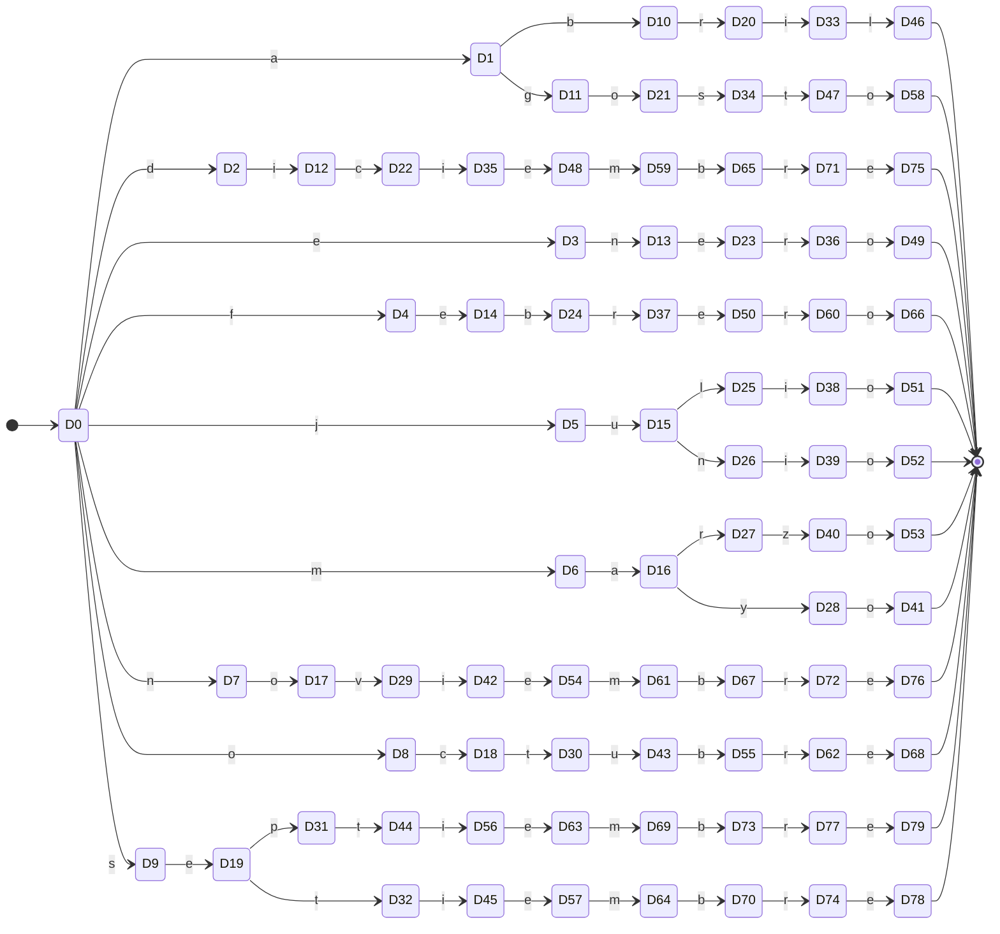

| Estado | Subconjunto AFN | `a` | `b` | `c` | `d` | `e` | `f` | `g` | `i` | `j` | `l` | `m` | `n` | `o` | `p` | `r` | `s` | `t` | `u` | `v` | `y` | `z` |
| --- | --- | --- | --- | --- | --- | --- | --- | --- | --- | --- | --- | --- | --- | --- | --- | --- | --- | --- | --- | --- | --- | --- |
| →D0 | {q0,q1,q2,q3,q4,q5,q6,q7,q8,q9,q10,q11,q12,q13} | D1 | — | — | D2 | D3 | D4 | — | — | D5 | — | D6 | D7 | D8 | — | — | D9 | — | — | — | — | — |
| D1 | {q17,q21,q30,q34} | — | D10 | — | — | — | — | D11 | — | — | — | — | — | — | — | — | — | — | — | — | — | — |
| D2 | {q25,q38} | — | — | — | — | — | — | — | D12 | — | — | — | — | — | — | — | — | — | — | — | — | — |
| D3 | {q14,q27} | — | — | — | — | — | — | — | — | — | — | — | D13 | — | — | — | — | — | — | — | — | — |
| D4 | {q15,q28} | — | — | — | — | D14 | — | — | — | — | — | — | — | — | — | — | — | — | — | — | — | — |
| D5 | {q19,q20,q32,q33} | — | — | — | — | — | — | — | — | — | — | — | — | — | — | — | — | — | D15 | — | — | — |
| D6 | {q16,q18,q29,q31} | D16 | — | — | — | — | — | — | — | — | — | — | — | — | — | — | — | — | — | — | — | — |
| D7 | {q24,q37} | — | — | — | — | — | — | — | — | — | — | — | — | D17 | — | — | — | — | — | — | — | — |
| D8 | {q23,q36} | — | — | D18 | — | — | — | — | — | — | — | — | — | — | — | — | — | — | — | — | — | — |
| D9 | {q22,q26,q35,q39} | — | — | — | — | D19 | — | — | — | — | — | — | — | — | — | — | — | — | — | — | — | — |
| D10 | {q43,q56} | — | — | — | — | — | — | — | — | — | — | — | — | — | — | D20 | — | — | — | — | — | — |
| D11 | {q47,q60} | — | — | — | — | — | — | — | — | — | — | — | — | D21 | — | — | — | — | — | — | — | — |
| D12 | {q51,q64} | — | — | D22 | — | — | — | — | — | — | — | — | — | — | — | — | — | — | — | — | — | — |
| D13 | {q40,q53} | — | — | — | — | D23 | — | — | — | — | — | — | — | — | — | — | — | — | — | — | — | — |
| D14 | {q41,q54} | — | D24 | — | — | — | — | — | — | — | — | — | — | — | — | — | — | — | — | — | — | — |
| D15 | {q45,q46,q58,q59} | — | — | — | — | — | — | — | — | — | D25 | — | D26 | — | — | — | — | — | — | — | — | — |
| D16 | {q42,q44,q55,q57} | — | — | — | — | — | — | — | — | — | — | — | — | — | — | D27 | — | — | — | — | D28 | — |
| D17 | {q50,q63} | — | — | — | — | — | — | — | — | — | — | — | — | — | — | — | — | — | — | D29 | — | — |
| D18 | {q49,q62} | — | — | — | — | — | — | — | — | — | — | — | — | — | — | — | — | D30 | — | — | — | — |
| D19 | {q48,q52,q61,q65} | — | — | — | — | — | — | — | — | — | — | — | — | — | D31 | — | — | D32 | — | — | — | — |
| D20 | {q69,q82} | — | — | — | — | — | — | — | D33 | — | — | — | — | — | — | — | — | — | — | — | — | — |
| D21 | {q73,q86} | — | — | — | — | — | — | — | — | — | — | — | — | — | — | — | D34 | — | — | — | — | — |
| D22 | {q77,q90} | — | — | — | — | — | — | — | D35 | — | — | — | — | — | — | — | — | — | — | — | — | — |
| D23 | {q66,q79} | — | — | — | — | — | — | — | — | — | — | — | — | — | — | D36 | — | — | — | — | — | — |
| D24 | {q67,q80} | — | — | — | — | — | — | — | — | — | — | — | — | — | — | D37 | — | — | — | — | — | — |
| D25 | {q72,q85} | — | — | — | — | — | — | — | D38 | — | — | — | — | — | — | — | — | — | — | — | — | — |
| D26 | {q71,q84} | — | — | — | — | — | — | — | D39 | — | — | — | — | — | — | — | — | — | — | — | — | — |
| D27 | {q68,q81} | — | — | — | — | — | — | — | — | — | — | — | — | — | — | — | — | — | — | — | — | D40 |
| D28 | {q70,q83} | — | — | — | — | — | — | — | — | — | — | — | — | D41 | — | — | — | — | — | — | — | — |
| D29 | {q76,q89} | — | — | — | — | — | — | — | D42 | — | — | — | — | — | — | — | — | — | — | — | — | — |
| D30 | {q75,q88} | — | — | — | — | — | — | — | — | — | — | — | — | — | — | — | — | — | D43 | — | — | — |
| D31 | {q74,q87} | — | — | — | — | — | — | — | — | — | — | — | — | — | — | — | — | D44 | — | — | — | — |
| D32 | {q78,q91} | — | — | — | — | — | — | — | D45 | — | — | — | — | — | — | — | — | — | — | — | — | — |
| D33 | {q95,q108} | — | — | — | — | — | — | — | — | — | D46 | — | — | — | — | — | — | — | — | — | — | — |
| D34 | {q99,q112} | — | — | — | — | — | — | — | — | — | — | — | — | — | — | — | — | D47 | — | — | — | — |
| D35 | {q103,q116} | — | — | — | — | D48 | — | — | — | — | — | — | — | — | — | — | — | — | — | — | — | — |
| D36 | {q92,q105} | — | — | — | — | — | — | — | — | — | — | — | — | D49 | — | — | — | — | — | — | — | — |
| D37 | {q93,q106} | — | — | — | — | D50 | — | — | — | — | — | — | — | — | — | — | — | — | — | — | — | — |
| D38 | {q98,q111} | — | — | — | — | — | — | — | — | — | — | — | — | D51 | — | — | — | — | — | — | — | — |
| D39 | {q97,q110} | — | — | — | — | — | — | — | — | — | — | — | — | D52 | — | — | — | — | — | — | — | — |
| D40 | {q94,q107} | — | — | — | — | — | — | — | — | — | — | — | — | D53 | — | — | — | — | — | — | — | — |
| *D41 | {q96,q109} | — | — | — | — | — | — | — | — | — | — | — | — | — | — | — | — | — | — | — | — | — |
| D42 | {q102,q115} | — | — | — | — | D54 | — | — | — | — | — | — | — | — | — | — | — | — | — | — | — | — |
| D43 | {q101,q114} | — | D55 | — | — | — | — | — | — | — | — | — | — | — | — | — | — | — | — | — | — | — |
| D44 | {q100,q113} | — | — | — | — | — | — | — | D56 | — | — | — | — | — | — | — | — | — | — | — | — | — |
| D45 | {q104,q117} | — | — | — | — | D57 | — | — | — | — | — | — | — | — | — | — | — | — | — | — | — | — |
| *D46 | {q109,q121} | — | — | — | — | — | — | — | — | — | — | — | — | — | — | — | — | — | — | — | — | — |
| D47 | {q124,q131} | — | — | — | — | — | — | — | — | — | — | — | — | D58 | — | — | — | — | — | — | — | — |
| D48 | {q128,q135} | — | — | — | — | — | — | — | — | — | — | D59 | — | — | — | — | — | — | — | — | — | — |
| *D49 | {q109,q118} | — | — | — | — | — | — | — | — | — | — | — | — | — | — | — | — | — | — | — | — | — |
| D50 | {q119,q130} | — | — | — | — | — | — | — | — | — | — | — | — | — | — | D60 | — | — | — | — | — | — |
| *D51 | {q109,q123} | — | — | — | — | — | — | — | — | — | — | — | — | — | — | — | — | — | — | — | — | — |
| *D52 | {q109,q122} | — | — | — | — | — | — | — | — | — | — | — | — | — | — | — | — | — | — | — | — | — |
| *D53 | {q109,q120} | — | — | — | — | — | — | — | — | — | — | — | — | — | — | — | — | — | — | — | — | — |
| D54 | {q127,q134} | — | — | — | — | — | — | — | — | — | — | D61 | — | — | — | — | — | — | — | — | — | — |
| D55 | {q126,q133} | — | — | — | — | — | — | — | — | — | — | — | — | — | — | D62 | — | — | — | — | — | — |
| D56 | {q125,q132} | — | — | — | — | D63 | — | — | — | — | — | — | — | — | — | — | — | — | — | — | — | — |
| D57 | {q129,q136} | — | — | — | — | — | — | — | — | — | — | D64 | — | — | — | — | — | — | — | — | — | — |
| *D58 | {q109,q138} | — | — | — | — | — | — | — | — | — | — | — | — | — | — | — | — | — | — | — | — | — |
| D59 | {q142,q148} | — | D65 | — | — | — | — | — | — | — | — | — | — | — | — | — | — | — | — | — | — | — |
| D60 | {q137,q144} | — | — | — | — | — | — | — | — | — | — | — | — | D66 | — | — | — | — | — | — | — | — |
| D61 | {q141,q147} | — | D67 | — | — | — | — | — | — | — | — | — | — | — | — | — | — | — | — | — | — | — |
| D62 | {q140,q146} | — | — | — | — | D68 | — | — | — | — | — | — | — | — | — | — | — | — | — | — | — | — |
| D63 | {q139,q145} | — | — | — | — | — | — | — | — | — | — | D69 | — | — | — | — | — | — | — | — | — | — |
| D64 | {q143,q149} | — | D70 | — | — | — | — | — | — | — | — | — | — | — | — | — | — | — | — | — | — | — |
| D65 | {q154,q158} | — | — | — | — | — | — | — | — | — | — | — | — | — | — | D71 | — | — | — | — | — | — |
| *D66 | {q109,q150} | — | — | — | — | — | — | — | — | — | — | — | — | — | — | — | — | — | — | — | — | — |
| D67 | {q153,q157} | — | — | — | — | — | — | — | — | — | — | — | — | — | — | D72 | — | — | — | — | — | — |
| *D68 | {q109,q152} | — | — | — | — | — | — | — | — | — | — | — | — | — | — | — | — | — | — | — | — | — |
| D69 | {q151,q156} | — | D73 | — | — | — | — | — | — | — | — | — | — | — | — | — | — | — | — | — | — | — |
| D70 | {q155,q159} | — | — | — | — | — | — | — | — | — | — | — | — | — | — | D74 | — | — | — | — | — | — |
| D71 | {q162,q166} | — | — | — | — | D75 | — | — | — | — | — | — | — | — | — | — | — | — | — | — | — | — |
| D72 | {q161,q165} | — | — | — | — | D76 | — | — | — | — | — | — | — | — | — | — | — | — | — | — | — | — |
| D73 | {q160,q164} | — | — | — | — | — | — | — | — | — | — | — | — | — | — | D77 | — | — | — | — | — | — |
| D74 | {q163,q167} | — | — | — | — | D78 | — | — | — | — | — | — | — | — | — | — | — | — | — | — | — | — |
| *D75 | {q109,q170} | — | — | — | — | — | — | — | — | — | — | — | — | — | — | — | — | — | — | — | — | — |
| *D76 | {q109,q169} | — | — | — | — | — | — | — | — | — | — | — | — | — | — | — | — | — | — | — | — | — |
| D77 | {q168,q172} | — | — | — | — | D79 | — | — | — | — | — | — | — | — | — | — | — | — | — | — | — | — |
| *D78 | {q109,q171} | — | — | — | — | — | — | — | — | — | — | — | — | — | — | — | — | — | — | — | — | — |
| *D79 | {q109,q173} | — | — | — | — | — | — | — | — | — | — | — | — | — | — | — | — | — | — | — | — | — |

#### AFD mínimo (refinamiento de particiones de Moore)

38 estados, 49 transiciones, alfabeto: {a, b, c, d, e, f, g, i, j, l, m, n, o, p, r, s, t, u, v, y, z}.

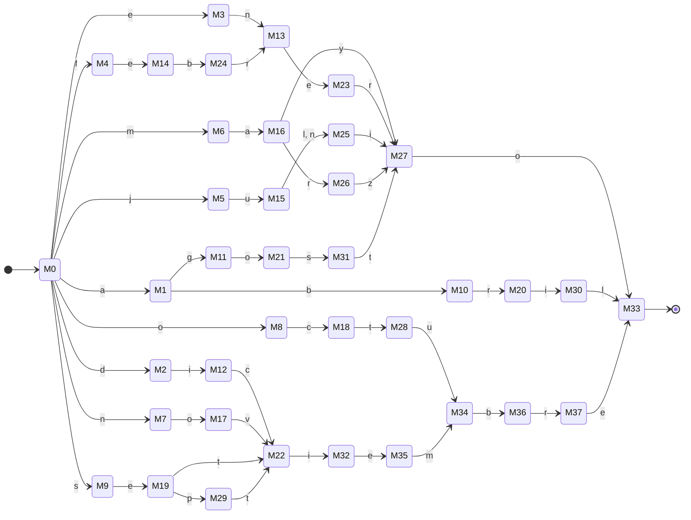

| Estado | `a` | `b` | `c` | `d` | `e` | `f` | `g` | `i` | `j` | `l` | `m` | `n` | `o` | `p` | `r` | `s` | `t` | `u` | `v` | `y` | `z` |
| --- | --- | --- | --- | --- | --- | --- | --- | --- | --- | --- | --- | --- | --- | --- | --- | --- | --- | --- | --- | --- | --- |
| →M0 | M1 | — | — | M2 | M3 | M4 | — | — | M5 | — | M6 | M7 | M8 | — | — | M9 | — | — | — | — | — |
| M1 | — | M10 | — | — | — | — | M11 | — | — | — | — | — | — | — | — | — | — | — | — | — | — |
| M2 | — | — | — | — | — | — | — | M12 | — | — | — | — | — | — | — | — | — | — | — | — | — |
| M3 | — | — | — | — | — | — | — | — | — | — | — | M13 | — | — | — | — | — | — | — | — | — |
| M4 | — | — | — | — | M14 | — | — | — | — | — | — | — | — | — | — | — | — | — | — | — | — |
| M5 | — | — | — | — | — | — | — | — | — | — | — | — | — | — | — | — | — | M15 | — | — | — |
| M6 | M16 | — | — | — | — | — | — | — | — | — | — | — | — | — | — | — | — | — | — | — | — |
| M7 | — | — | — | — | — | — | — | — | — | — | — | — | M17 | — | — | — | — | — | — | — | — |
| M8 | — | — | M18 | — | — | — | — | — | — | — | — | — | — | — | — | — | — | — | — | — | — |
| M9 | — | — | — | — | M19 | — | — | — | — | — | — | — | — | — | — | — | — | — | — | — | — |
| M10 | — | — | — | — | — | — | — | — | — | — | — | — | — | — | M20 | — | — | — | — | — | — |
| M11 | — | — | — | — | — | — | — | — | — | — | — | — | M21 | — | — | — | — | — | — | — | — |
| M12 | — | — | M22 | — | — | — | — | — | — | — | — | — | — | — | — | — | — | — | — | — | — |
| M13 | — | — | — | — | M23 | — | — | — | — | — | — | — | — | — | — | — | — | — | — | — | — |
| M14 | — | M24 | — | — | — | — | — | — | — | — | — | — | — | — | — | — | — | — | — | — | — |
| M15 | — | — | — | — | — | — | — | — | — | M25 | — | M25 | — | — | — | — | — | — | — | — | — |
| M16 | — | — | — | — | — | — | — | — | — | — | — | — | — | — | M26 | — | — | — | — | M27 | — |
| M17 | — | — | — | — | — | — | — | — | — | — | — | — | — | — | — | — | — | — | M22 | — | — |
| M18 | — | — | — | — | — | — | — | — | — | — | — | — | — | — | — | — | M28 | — | — | — | — |
| M19 | — | — | — | — | — | — | — | — | — | — | — | — | — | M29 | — | — | M22 | — | — | — | — |
| M20 | — | — | — | — | — | — | — | M30 | — | — | — | — | — | — | — | — | — | — | — | — | — |
| M21 | — | — | — | — | — | — | — | — | — | — | — | — | — | — | — | M31 | — | — | — | — | — |
| M22 | — | — | — | — | — | — | — | M32 | — | — | — | — | — | — | — | — | — | — | — | — | — |
| M23 | — | — | — | — | — | — | — | — | — | — | — | — | — | — | M27 | — | — | — | — | — | — |
| M24 | — | — | — | — | — | — | — | — | — | — | — | — | — | — | M13 | — | — | — | — | — | — |
| M25 | — | — | — | — | — | — | — | M27 | — | — | — | — | — | — | — | — | — | — | — | — | — |
| M26 | — | — | — | — | — | — | — | — | — | — | — | — | — | — | — | — | — | — | — | — | M27 |
| M27 | — | — | — | — | — | — | — | — | — | — | — | — | M33 | — | — | — | — | — | — | — | — |
| M28 | — | — | — | — | — | — | — | — | — | — | — | — | — | — | — | — | — | M34 | — | — | — |
| M29 | — | — | — | — | — | — | — | — | — | — | — | — | — | — | — | — | M22 | — | — | — | — |
| M30 | — | — | — | — | — | — | — | — | — | M33 | — | — | — | — | — | — | — | — | — | — | — |
| M31 | — | — | — | — | — | — | — | — | — | — | — | — | — | — | — | — | M27 | — | — | — | — |
| M32 | — | — | — | — | M35 | — | — | — | — | — | — | — | — | — | — | — | — | — | — | — | — |
| *M33 | — | — | — | — | — | — | — | — | — | — | — | — | — | — | — | — | — | — | — | — | — |
| M34 | — | M36 | — | — | — | — | — | — | — | — | — | — | — | — | — | — | — | — | — | — | — |
| M35 | — | — | — | — | — | — | — | — | — | — | M34 | — | — | — | — | — | — | — | — | — | — |
| M36 | — | — | — | — | — | — | — | — | — | — | — | — | — | — | M37 | — | — | — | — | — | — |
| M37 | — | — | — | — | M33 | — | — | — | — | — | — | — | — | — | — | — | — | — | — | — | — |

