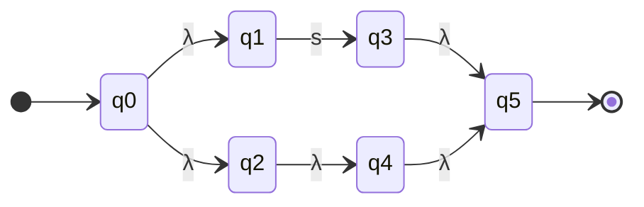
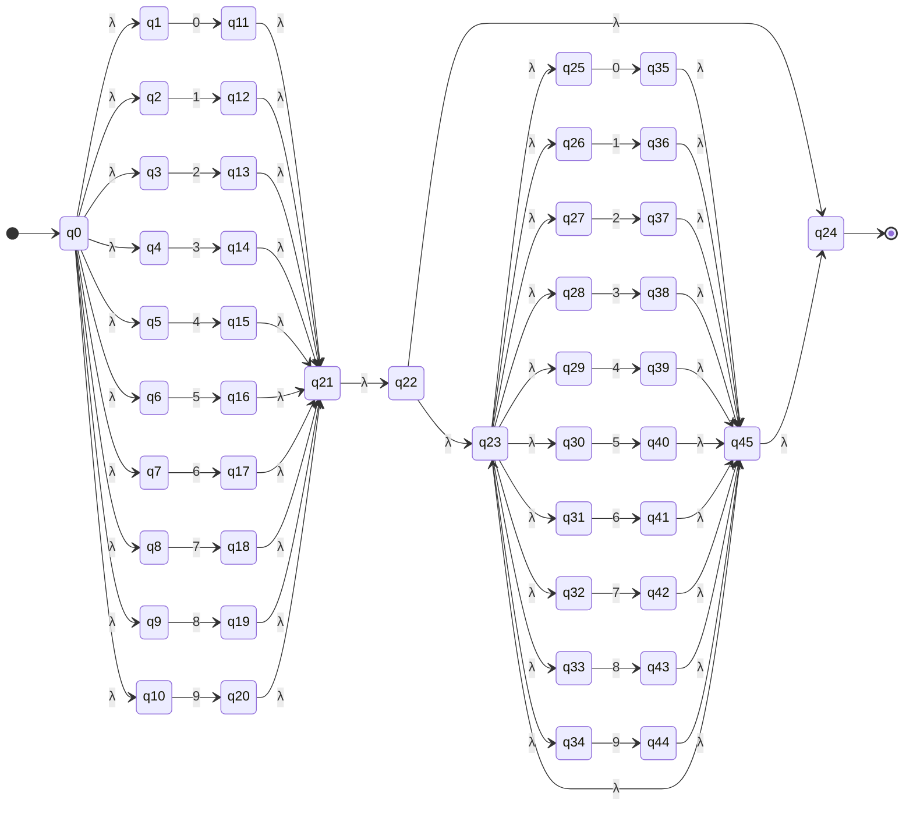
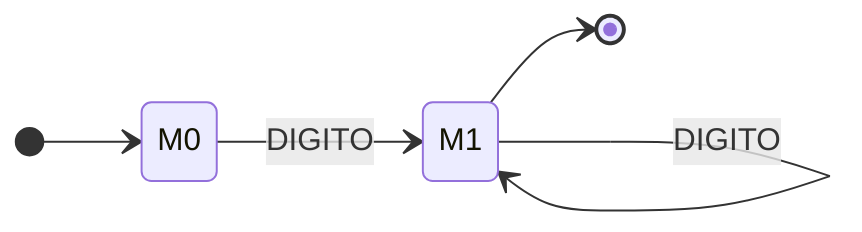
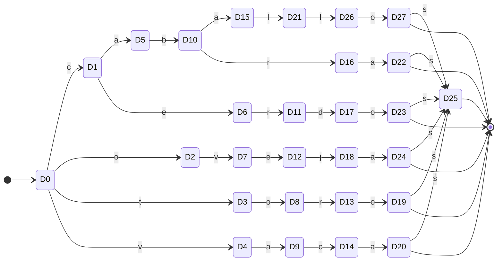
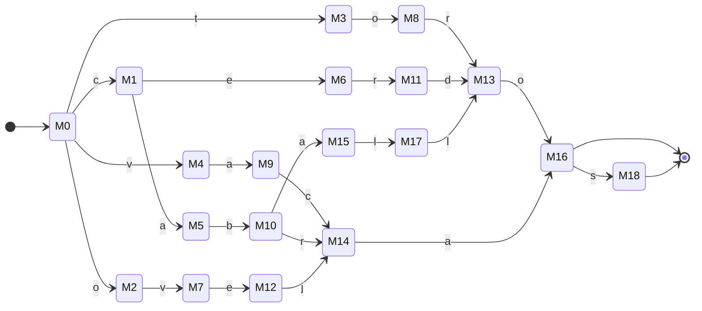

# Contratos rurales por voz — Informe técnico

**Materia:** Lenguajes de Programación · **Entregable 2:** documento con las expresiones regulares, los autómatas, la gramática y las máquinas de Turing del sistema.
**Integrantes:** (completar) · **Docente:** (completar) · **Fecha:** octubre de 2026

> Las tablas, diagramas y trazas marcados como _generados_ no se escribieron a mano: los produce
> `pnpm docs:generate` (`scripts/generate-docs.ts`) ejecutando el mismo código del núcleo (`src/core/`)
> que usa la aplicación. Si el código cambia, basta con volver a ejecutar el comando.
> Los diagramas están en sintaxis Mermaid (se dibujan en GitHub, VS Code y la mayoría de visores Markdown).

## 1. Introducción y problema

En el campo colombiano muchos arriendos de tierra se pactan de palabra. Redactar un contrato formal
exige escribir bastante y conocer fórmulas legales, lo que es una barrera para personas con poca
experiencia digital. Hablar, en cambio, es natural. El proyecto construye una aplicación web en la que
el usuario **dicta** las condiciones del arriendo (por ejemplo, _"arriendo lote La Esperanza de 5
hectáreas para 20 vacas de raza holstein para producción de leche por 12 meses"_) y obtiene un
**borrador de contrato** en Markdown listo para revisar.

El objetivo académico es aplicar, en un mismo sistema, los modelos de la materia: expresiones
regulares y autómatas finitos (análisis léxico), gramáticas libres de contexto y autómatas a pila
(análisis sintáctico) y máquinas de Turing (selección de plantilla y generación del texto). Todo el
núcleo formal está implementado a mano, sin generadores de analizadores y sin usar las `RegExp` de
JavaScript para reconocer tokens.

## 2. Arquitectura

```text
 Entrada (voz o texto)          Web Speech API (es-CO) o cuadro de texto: intercambiables
        │  "arriendo lote para 20 vacas holstein ..."
        ▼
 Analizador léxico               ER → AFN-λ (Thompson) → AFD (subconjuntos); coincidencia más larga
        │  [VERBO:arriendo] [PALABRA_CLAVE:lote] [NUM:20] [ANIMAL:vacas] ...
        ▼
 Analizador sintáctico           GLC + autómata a pila predictivo con anticipación de 1–2 tokens
        │  árbol de derivación + campos (lote, animales, fecha, valor, uso, ...)
        ▼
 Diálogo (§5.6)                  pregunta solo por los campos requeridos que faltan y fusiona respuestas
        ▼
 Selector de plantilla           Máquina de Turing que compara campos con los marcadores de cada plantilla
        ▼
 Generador                       Máquina de Turing de reemplazo sobre la cinta de la plantilla
        ▼
 Contrato .md                    descargable
```

| Módulo | Ruta | Responsabilidad |
| --- | --- | --- |
| Expresiones regulares | `src/core/regex/` | parser de ER en notación de la materia, Thompson, subconjuntos, simulación de AFD |
| Léxico | `src/core/lexer/` | definiciones de tokens, normalización (minúsculas, sin tildes), tokenizador con traza |
| Sintáctico | `src/core/parser/` | gramática como datos, tabla de predicción, AP con pila explícita, extracción de campos |
| Máquinas de Turing | `src/core/turing/` | MT genérica (cinta, cabeza, δ, traza), MT de selección, MT de relleno |
| Plantillas | `src/core/templates/` | PASTOREO, CULTIVO, MIXTA en `.md` con declaración de campos |
| Integración | `src/core/pipeline.ts`, `dialog.ts` | `runPipeline(texto)` y guía/preguntas por faltantes |
| Interfaz | `src/ui/` | React 19 + Tailwind 4: voz/texto, tokens, AFD, árbol, pila, cinta, contrato |

El núcleo (`src/core/`) no depende de React ni de librerías externas; la interfaz solo lo consume.
La aplicación corre completamente en el navegador (sin backend).

## 3. Fundamento teórico por etapa

| Etapa | Modelo | Por qué ese modelo |
| --- | --- | --- |
| Léxico | ER → AFN-λ → AFD | Cada categoría de palabra (número, animal, mes…) es un lenguaje **regular**: basta memoria finita. |
| Sintáctico | GLC → autómata a pila | Las listas anidadas (`de los cuales … fin`) requieren recordar niveles de anidación: lenguaje **libre de contexto**. |
| Selección | Máquina de Turing | Comparar dos listas de longitud arbitraria escritas en la misma cinta y contar coincidencias exige leer, marcar y volver. |
| Generación | Máquina de Turing | Recorrer la plantilla, borrar marcadores y escribir valores (incluso borrar secciones completas) exige escribir y moverse en ambos sentidos. |

**Jerarquía de Chomsky.** Los modelos forman una cadena de inclusiones estrictas:
regulares (AFD/AFN, tipo 3) ⊂ libres de contexto (AP, tipo 2) ⊂ recursivamente enumerables (MT, tipo 0).
Un AFD solo recuerda su estado actual, así que no puede verificar que cada `de los cuales` tenga su
`fin` (el lenguaje {(de los cuales)ⁿ … finⁿ} no es regular, por el lema de bombeo). El AP agrega una
pila, suficiente para la anidación. La MT agrega una cinta de lectura y escritura con movimiento en
ambos sentidos, que se usa como memoria de trabajo para transformar el texto. Se usa el modelo **más
débil que resuelve cada etapa**: el AFD es eficiente y solo se usa en el léxico; el centro del
proyecto son el AP y la MT.

### 3.1 ER, AFN-λ (Thompson) y AFD (subconjuntos)

Las ER se escriben en la notación de la materia: unión `|`, concatenación por yuxtaposición, `*`,
`+`, `?`, paréntesis, `λ` para la cadena vacía y nombres en MAYÚSCULAS que referencian otras
definiciones (`NUM = DIGITO DIGITO*`). El parser propio (`src/core/regex/parser.ts`) produce un árbol
sintáctico de la ER.

**Construcción de Thompson.** Cada nodo produce un fragmento con un estado inicial y uno de aceptación:
un símbolo `a` es `q_i —a→ q_f`; la concatenación une el final de un fragmento con el inicio del
siguiente por λ; la unión crea un inicio con λ hacia cada alternativa y λ desde cada final a un
nuevo final; la estrella agrega λ para saltar el fragmento y para repetirlo. El resultado es un
AFN-λ con estados `q0 … qn`.

**Construcción de subconjuntos.** Cada estado del AFD `Dk` es un conjunto de estados del AFN:
`D0 = λ-clausura({q0})` y `δ(D, a) = λ-clausura(mover(D, a))`. Solo se generan los estados alcanzables
y una transición ausente significa rechazo. Un `Dk` acepta si contiene el estado de aceptación del AFN.
Como documentación adicional, el script aplica la **minimización de Moore** (refinamiento de
particiones) para mostrar el AFD mínimo equivalente; el analizador usa directamente el AFD de
subconjuntos, que reconoce el mismo lenguaje.

**Tokenizador.** Se normaliza el texto (minúsculas y sin tildes), y en cada posición se ejecutan todos
los AFD: gana la **coincidencia más larga** y, a igual longitud, la definición que aparece primero
(por eso `vacas` es ANIMAL y no NOMBRE). Los espacios y signos de puntuación se saltan.

### 3.2 GLC y autómata a pila predictivo

La gramática define el contrato como una **secuencia de cláusulas en cualquier orden**
(`CONTRATO → CLAUSULA CONTRATO | λ`), cada una con un marcador de inicio reconocible. El AP es
predictivo (LL): su pila contiene los símbolos que faltan por derivar. En cada paso:

1. si el tope es un **no terminal** A, consulta la tabla de predicción con los 1 o 2 tokens siguientes
   (anticipación) y reemplaza A por el cuerpo de la producción elegida (apilado al revés);
2. si el tope es un **terminal**, debe coincidir con el token actual: lo desapila y avanza;
3. acepta cuando la entrada se consumió, la pila de símbolos está vacía y la pila de anidación es `Z0`.

Además de la pila de símbolos, el AP mantiene explícitamente la **pila de anidación** de la propuesta
(§5.2): `Z0` en el fondo, apila `SUB` al leer `de los cuales` y la desapila al leer `fin`. Un `fin`
con la pila en `Z0` o una frase que termina con `SUB` en la pila se rechazan con un mensaje claro.

La anticipación resuelve las ambigüedades de §5.5: `por` + `un` → VALOR, `por` + NUM → DURACION;
`el` + `lote` → LOTE; `los` + NUM → ANIMALES. Así, el 20 de "lote 20" (identificador) y el de
"20 toros" (cantidad) no se confunden.

### 3.3 Máquinas de Turing de selección y de relleno

Ambas usan la misma MT genérica (`src/core/turing/machine.ts`): cinta de celdas (cada celda guarda un
símbolo, que puede ser una palabra o un marcador como `{{`), cabeza, estado, función δ(estado,
símbolo) → (nuevo estado, símbolo a escribir, movimiento L/R/S), estados de aceptación y un límite
`maxSteps`. La traza guarda una instantánea cada vez que cambia la familia del estado (p. ej. de
`q_leer[...]` a `q_borrar[...]`), lo que la mantiene pequeña sin perder los eventos importantes.

- **MT de selección (§5.4).** Cinta: `campos extraídos # @PASTOREO m1 m2 … @CULTIVO … @MIXTA … ⊣`.
  Por cada marcador `m` lo marca `*m`, vuelve a la izquierda de `#` buscando `m` entre los campos y
  regresa a escribir `✓m` o `✗m`. Luego recorre los bloques y por cada `✓` agrega un `1` al final de
  la cinta bajo el encabezado `%PLANTILLA` (conteo **unario**). Se elige la plantilla con mayor
  proporción de coincidencias; empate o coincidencia baja (menos de la mitad) ⇒ el sistema pregunta.
- **MT de relleno (§5.3).** Estados `q_buscar` (avanza hasta `{{`), `q_leer[n]` (acumula el nombre del
  campo hasta `}}`), `q_borrar[n]` (vuelve borrando el marcador con blancos), `q_escribir[n]` (escribe
  el valor en la celda de `{{`) y `q_fin` (al llegar a `⊣`, acepta). Si un campo no tiene valor, se
  deja `{{campo}}` pendiente. Las cláusulas opcionales se marcan `[[?campo]] … [[/campo]]`: si el campo
  falta, `q_saltar[n]` borra toda la sección.

## 4. Diseño de tokens

Todas las ER, tal como están en `src/core/lexer/definitions.ts` (texto ya normalizado: sin tildes),
con el tamaño de sus autómatas. Están en orden de prioridad. _Generado:_

<!-- gen:tabla-er -->
| Nombre | Tipo de token | Estados AFN / AFD / AFD mín. | Expresión regular |
| --- | --- | --- | --- |
| DIGITO | (auxiliar) |  | `0\|1\|2\|3\|4\|5\|6\|7\|8\|9` |
| LETRA | (auxiliar) |  | `a\|b\|c\|d\|e\|f\|g\|h\|i\|j\|k\|l\|m\|n\|ñ\|o\|p\|q\|r\|s\|t\|u\|v\|w\|x\|y\|z` |
| NUM | (auxiliar) |  | `DIGITO DIGITO*` |
| NUM | NUM | 46 / 21 / 2 | `DIGITO DIGITO*` |
| NUM_MILES | NUM | 212 / 93 / 8 | `DIGITO (DIGITO\|λ) (DIGITO\|λ) (\. DIGITO DIGITO DIGITO)+` |
| NUM_PALABRA | NUM | 228 / 85 / 40 | `uno\|dos\|tres\|cuatro\|cinco\|seis\|siete\|ocho\|nueve\|diez\|once\|doce\|trece\|catorce\|quince\|dieciseis\|diecisiete\|dieciocho\|diecinueve\|veinte` |
| MES | MES | 174 / 80 / 38 | `enero\|febrero\|marzo\|abril\|mayo\|junio\|julio\|agosto\|septiembre\|octubre\|noviembre\|diciembre\|setiembre` |
| ANIMAL | ANIMAL | 188 / 65 / 42 | `(vaca\|toro\|caballo\|yegua\|cabra\|oveja\|cerdo\|ternero\|ternera\|novillo\|novilla\|becerro\|becerra\|mula)(s\|λ) \| (buey)(es\|λ)` |
| RAZA | RAZA | 180 / 85 / 65 | `holstein\|gir\|normando\|brahman\|jersey\|angus\|cebu\|simmental\|criollo\|guzerat\|romosinuano\|girolando\|pardo` |
| UNIDAD_TIEMPO | UNIDAD_TIEMPO | 48 / 19 / 15 | `(dia\|año\|semana)(s\|λ) \| (mes)(es\|λ)` |
| UNIDAD_AREA | UNIDAD_AREA | 52 / 24 / 20 | `(hectarea\|fanegada\|cuadra)(s\|λ)` |
| MONEDA | MONEDA | 42 / 14 / 13 | `(peso)(s\|λ) \| (millon)(es\|λ) \| mil` |
| VERBO | VERBO | 112 / 24 / 18 | `arriendo\|arrienda\|arriendan\|arrendar\|alquilo\|alquila\|alquilan` |
| USO | USO | 170 / 79 / 58 | `pastoreo\|ganaderia\|cultivo\|siembra\|leche\|carne\|ceba\|cria\|engorde\|levante\|agricultura\|produccion` |
| CULTIVO | CULTIVO | 228 / 94 / 64 | `(papa\|yuca\|platano\|arveja\|tomate\|cebolla\|aguacate\|naranja\|mango)(s\|λ) \| (frijol\|limon)(es\|λ) \| maiz\|cafe\|cacao\|arroz\|caña\|sorgo\|algodon\|pasto` |
| INSUMOS | INSUMOS | 86 / 40 / 31 | `(insumo\|semilla\|abono\|fertilizante\|fumigante)(s\|λ)` |
| CONECTOR | CONECTOR | 6 / 3 / 2 | `y\|e` |
| PALABRA_CLAVE | PALABRA_CLAVE | 288 / 85 / 54 | `(lote)(s\|λ) \| en\|el\|la\|los\|las\|de\|del\|al\|a\|raza\|por\|para\|un\|una\|valor\|desde\|hasta\|durante\|con\|se\|cuales\|fin\|arrendador\|arrendadora\|arrendatario\|arrendataria\|aporta\|aportan\|aporte` |
| COMA | COMA | 2 / 2 / 2 | `,` |
| NOMBRE | NOMBRE | 114 / 55 / 2 | `LETRA LETRA*` |
<!-- /gen:tabla-er -->

`NOMBRE = LETRA LETRA*` captura palabras desconocidas (nombres de lote o de personas, como
"Esperanza" o "Pérez"); como va de última, solo gana cuando ninguna otra categoría reconoce un lexema
igual de largo. Los números escritos en cifras (`NUM`, `NUM_MILES`) o en letras (`NUM_PALABRA`,
"veinte") dan el mismo tipo de token `NUM`.

### 4.1 Thompson para (s|λ)

La alternativa `(s|λ)` es la que permite plurales opcionales. _Generado:_

<!-- gen:afn-s-lambda -->
#### AFN-λ de (s|λ)

6 estados, 6 transiciones, alfabeto: {s}.



| Estado | `s` | `λ` |
| --- | --- | --- |
| →q0 | — | {q1,q2} |
| q1 | {q3} | — |
| q2 | — | {q4} |
| q3 | — | {q5} |
| q4 | — | {q5} |
| *q5 | — | — |
<!-- /gen:afn-s-lambda -->

### 4.2 NUM = DIGITO DIGITO*

_Generado:_

<!-- gen:afn-num -->
#### AFN-λ de NUM = DIGITO DIGITO*

46 estados, 65 transiciones, alfabeto: {0, 1, 2, 3, 4, 5, 6, 7, 8, 9}.



| Estado | `0` | `1` | `2` | `3` | `4` | `5` | `6` | `7` | `8` | `9` | `λ` |
| --- | --- | --- | --- | --- | --- | --- | --- | --- | --- | --- | --- |
| →q0 | — | — | — | — | — | — | — | — | — | — | {q1,q2,q3,q4,q5,q6,q7,q8,q9,q10} |
| q1 | {q11} | — | — | — | — | — | — | — | — | — | — |
| q2 | — | {q12} | — | — | — | — | — | — | — | — | — |
| q3 | — | — | {q13} | — | — | — | — | — | — | — | — |
| q4 | — | — | — | {q14} | — | — | — | — | — | — | — |
| q5 | — | — | — | — | {q15} | — | — | — | — | — | — |
| q6 | — | — | — | — | — | {q16} | — | — | — | — | — |
| q7 | — | — | — | — | — | — | {q17} | — | — | — | — |
| q8 | — | — | — | — | — | — | — | {q18} | — | — | — |
| q9 | — | — | — | — | — | — | — | — | {q19} | — | — |
| q10 | — | — | — | — | — | — | — | — | — | {q20} | — |
| q11 | — | — | — | — | — | — | — | — | — | — | {q21} |
| q12 | — | — | — | — | — | — | — | — | — | — | {q21} |
| q13 | — | — | — | — | — | — | — | — | — | — | {q21} |
| q14 | — | — | — | — | — | — | — | — | — | — | {q21} |
| q15 | — | — | — | — | — | — | — | — | — | — | {q21} |
| q16 | — | — | — | — | — | — | — | — | — | — | {q21} |
| q17 | — | — | — | — | — | — | — | — | — | — | {q21} |
| q18 | — | — | — | — | — | — | — | — | — | — | {q21} |
| q19 | — | — | — | — | — | — | — | — | — | — | {q21} |
| q20 | — | — | — | — | — | — | — | — | — | — | {q21} |
| q21 | — | — | — | — | — | — | — | — | — | — | {q22} |
| q22 | — | — | — | — | — | — | — | — | — | — | {q23,q24} |
| q23 | — | — | — | — | — | — | — | — | — | — | {q25,q26,q27,q28,q29,q30,q31,q32,q33,q34} |
| *q24 | — | — | — | — | — | — | — | — | — | — | — |
| q25 | {q35} | — | — | — | — | — | — | — | — | — | — |
| q26 | — | {q36} | — | — | — | — | — | — | — | — | — |
| q27 | — | — | {q37} | — | — | — | — | — | — | — | — |
| q28 | — | — | — | {q38} | — | — | — | — | — | — | — |
| q29 | — | — | — | — | {q39} | — | — | — | — | — | — |
| q30 | — | — | — | — | — | {q40} | — | — | — | — | — |
| q31 | — | — | — | — | — | — | {q41} | — | — | — | — |
| q32 | — | — | — | — | — | — | — | {q42} | — | — | — |
| q33 | — | — | — | — | — | — | — | — | {q43} | — | — |
| q34 | — | — | — | — | — | — | — | — | — | {q44} | — |
| q35 | — | — | — | — | — | — | — | — | — | — | {q45} |
| q36 | — | — | — | — | — | — | — | — | — | — | {q45} |
| q37 | — | — | — | — | — | — | — | — | — | — | {q45} |
| q38 | — | — | — | — | — | — | — | — | — | — | {q45} |
| q39 | — | — | — | — | — | — | — | — | — | — | {q45} |
| q40 | — | — | — | — | — | — | — | — | — | — | {q45} |
| q41 | — | — | — | — | — | — | — | — | — | — | {q45} |
| q42 | — | — | — | — | — | — | — | — | — | — | {q45} |
| q43 | — | — | — | — | — | — | — | — | — | — | {q45} |
| q44 | — | — | — | — | — | — | — | — | — | — | {q45} |
| q45 | — | — | — | — | — | — | — | — | — | — | {q23,q24} |
<!-- /gen:afn-num -->

<!-- gen:afd-num -->
#### AFD de NUM (subconjuntos)

21 estados, 210 transiciones, alfabeto: {0, 1, 2, 3, 4, 5, 6, 7, 8, 9}.

_Diagrama omitido por tamaño (más de 90 aristas); ver la tabla._

| Estado | Subconjunto AFN | `0` | `1` | `2` | `3` | `4` | `5` | `6` | `7` | `8` | `9` |
| --- | --- | --- | --- | --- | --- | --- | --- | --- | --- | --- | --- |
| →D0 | {q0,q1,q2,q3,q4,q5,q6,q7,q8,q9,q10} | D1 | D2 | D3 | D4 | D5 | D6 | D7 | D8 | D9 | D10 |
| *D1 | {q11,q21,q22,q23,q24,q25,q26,q27,q28,q29,q30,q31,q32,q33,q34} | D11 | D12 | D13 | D14 | D15 | D16 | D17 | D18 | D19 | D20 |
| *D2 | {q12,q21,q22,q23,q24,q25,q26,q27,q28,q29,q30,q31,q32,q33,q34} | D11 | D12 | D13 | D14 | D15 | D16 | D17 | D18 | D19 | D20 |
| *D3 | {q13,q21,q22,q23,q24,q25,q26,q27,q28,q29,q30,q31,q32,q33,q34} | D11 | D12 | D13 | D14 | D15 | D16 | D17 | D18 | D19 | D20 |
| *D4 | {q14,q21,q22,q23,q24,q25,q26,q27,q28,q29,q30,q31,q32,q33,q34} | D11 | D12 | D13 | D14 | D15 | D16 | D17 | D18 | D19 | D20 |
| *D5 | {q15,q21,q22,q23,q24,q25,q26,q27,q28,q29,q30,q31,q32,q33,q34} | D11 | D12 | D13 | D14 | D15 | D16 | D17 | D18 | D19 | D20 |
| *D6 | {q16,q21,q22,q23,q24,q25,q26,q27,q28,q29,q30,q31,q32,q33,q34} | D11 | D12 | D13 | D14 | D15 | D16 | D17 | D18 | D19 | D20 |
| *D7 | {q17,q21,q22,q23,q24,q25,q26,q27,q28,q29,q30,q31,q32,q33,q34} | D11 | D12 | D13 | D14 | D15 | D16 | D17 | D18 | D19 | D20 |
| *D8 | {q18,q21,q22,q23,q24,q25,q26,q27,q28,q29,q30,q31,q32,q33,q34} | D11 | D12 | D13 | D14 | D15 | D16 | D17 | D18 | D19 | D20 |
| *D9 | {q19,q21,q22,q23,q24,q25,q26,q27,q28,q29,q30,q31,q32,q33,q34} | D11 | D12 | D13 | D14 | D15 | D16 | D17 | D18 | D19 | D20 |
| *D10 | {q20,q21,q22,q23,q24,q25,q26,q27,q28,q29,q30,q31,q32,q33,q34} | D11 | D12 | D13 | D14 | D15 | D16 | D17 | D18 | D19 | D20 |
| *D11 | {q23,q24,q25,q26,q27,q28,q29,q30,q31,q32,q33,q34,q35,q45} | D11 | D12 | D13 | D14 | D15 | D16 | D17 | D18 | D19 | D20 |
| *D12 | {q23,q24,q25,q26,q27,q28,q29,q30,q31,q32,q33,q34,q36,q45} | D11 | D12 | D13 | D14 | D15 | D16 | D17 | D18 | D19 | D20 |
| *D13 | {q23,q24,q25,q26,q27,q28,q29,q30,q31,q32,q33,q34,q37,q45} | D11 | D12 | D13 | D14 | D15 | D16 | D17 | D18 | D19 | D20 |
| *D14 | {q23,q24,q25,q26,q27,q28,q29,q30,q31,q32,q33,q34,q38,q45} | D11 | D12 | D13 | D14 | D15 | D16 | D17 | D18 | D19 | D20 |
| *D15 | {q23,q24,q25,q26,q27,q28,q29,q30,q31,q32,q33,q34,q39,q45} | D11 | D12 | D13 | D14 | D15 | D16 | D17 | D18 | D19 | D20 |
| *D16 | {q23,q24,q25,q26,q27,q28,q29,q30,q31,q32,q33,q34,q40,q45} | D11 | D12 | D13 | D14 | D15 | D16 | D17 | D18 | D19 | D20 |
| *D17 | {q23,q24,q25,q26,q27,q28,q29,q30,q31,q32,q33,q34,q41,q45} | D11 | D12 | D13 | D14 | D15 | D16 | D17 | D18 | D19 | D20 |
| *D18 | {q23,q24,q25,q26,q27,q28,q29,q30,q31,q32,q33,q34,q42,q45} | D11 | D12 | D13 | D14 | D15 | D16 | D17 | D18 | D19 | D20 |
| *D19 | {q23,q24,q25,q26,q27,q28,q29,q30,q31,q32,q33,q34,q43,q45} | D11 | D12 | D13 | D14 | D15 | D16 | D17 | D18 | D19 | D20 |
| *D20 | {q23,q24,q25,q26,q27,q28,q29,q30,q31,q32,q33,q34,q44,q45} | D11 | D12 | D13 | D14 | D15 | D16 | D17 | D18 | D19 | D20 |
<!-- /gen:afd-num -->

Los estados de aceptación del AFD de subconjuntos solo se distinguen por el último dígito leído; son
equivalentes, y la minimización los colapsa en dos estados. _Generado:_

<!-- gen:afd-num-min -->
#### AFD mínimo de NUM

2 estados, 20 transiciones, alfabeto: {0, 1, 2, 3, 4, 5, 6, 7, 8, 9}.



| Estado | `0` | `1` | `2` | `3` | `4` | `5` | `6` | `7` | `8` | `9` |
| --- | --- | --- | --- | --- | --- | --- | --- | --- | --- | --- |
| →M0 | M1 | M1 | M1 | M1 | M1 | M1 | M1 | M1 | M1 | M1 |
| *M1 | M1 | M1 | M1 | M1 | M1 | M1 | M1 | M1 | M1 | M1 |
<!-- /gen:afd-num-min -->

### 4.3 ANIMAL

La propuesta define `ANIMAL = (vaca|toro|caballo|cabra|oveja|cerdo)(s|λ)`. Esa misma ER, compilada por
el código, da (_generado_):

<!-- gen:afd-animal -->
AFN-λ de Thompson: 68 estados y 73 transiciones (tabla completa en `docs/automatas.md`).

#### AFD de (vaca|toro|caballo|cabra|oveja|cerdo)(s|λ) (subconjuntos)

28 estados, 32 transiciones, alfabeto: {a, b, c, d, e, j, l, o, r, s, t, v}.



| Estado | Subconjunto AFN | `a` | `b` | `c` | `d` | `e` | `j` | `l` | `o` | `r` | `s` | `t` | `v` |
| --- | --- | --- | --- | --- | --- | --- | --- | --- | --- | --- | --- | --- | --- |
| →D0 | {q0,q1,q2,q3,q4,q5,q6} | — | — | D1 | — | — | — | — | D2 | — | — | D3 | D4 |
| D1 | {q9,q10,q12,q15,q16,q18} | D5 | — | — | — | D6 | — | — | — | — | — | — | — |
| D2 | {q11,q17} | — | — | — | — | — | — | — | — | — | — | — | D7 |
| D3 | {q8,q14} | — | — | — | — | — | — | — | D8 | — | — | — | — |
| D4 | {q7,q13} | D9 | — | — | — | — | — | — | — | — | — | — | — |
| D5 | {q21,q22,q27,q28} | — | D10 | — | — | — | — | — | — | — | — | — | — |
| D6 | {q24,q30} | — | — | — | — | — | — | — | — | D11 | — | — | — |
| D7 | {q23,q29} | — | — | — | — | D12 | — | — | — | — | — | — | — |
| D8 | {q20,q26} | — | — | — | — | — | — | — | — | D13 | — | — | — |
| D9 | {q19,q25} | — | — | D14 | — | — | — | — | — | — | — | — | — |
| D10 | {q33,q34,q39,q40} | D15 | — | — | — | — | — | — | — | D16 | — | — | — |
| D11 | {q36,q42} | — | — | — | D17 | — | — | — | — | — | — | — | — |
| D12 | {q35,q41} | — | — | — | — | — | D18 | — | — | — | — | — | — |
| D13 | {q32,q38} | — | — | — | — | — | — | — | D19 | — | — | — | — |
| D14 | {q31,q37} | D20 | — | — | — | — | — | — | — | — | — | — | — |
| D15 | {q45,q50} | — | — | — | — | — | — | D21 | — | — | — | — | — |
| D16 | {q46,q51} | D22 | — | — | — | — | — | — | — | — | — | — | — |
| D17 | {q48,q53} | — | — | — | — | — | — | — | D23 | — | — | — | — |
| D18 | {q47,q52} | D24 | — | — | — | — | — | — | — | — | — | — | — |
| *D19 | {q44,q49,q54,q59,q60,q63,q65} | — | — | — | — | — | — | — | — | — | D25 | — | — |
| *D20 | {q43,q49,q54,q59,q60,q63,q65} | — | — | — | — | — | — | — | — | — | D25 | — | — |
| D21 | {q55,q61} | — | — | — | — | — | — | D26 | — | — | — | — | — |
| *D22 | {q49,q54,q56,q59,q60,q63,q65} | — | — | — | — | — | — | — | — | — | D25 | — | — |
| *D23 | {q49,q54,q58,q59,q60,q63,q65} | — | — | — | — | — | — | — | — | — | D25 | — | — |
| *D24 | {q49,q54,q57,q59,q60,q63,q65} | — | — | — | — | — | — | — | — | — | D25 | — | — |
| *D25 | {q62,q65} | — | — | — | — | — | — | — | — | — | — | — | — |
| D26 | {q64,q66} | — | — | — | — | — | — | — | D27 | — | — | — | — |
| *D27 | {q49,q54,q59,q60,q63,q65,q67} | — | — | — | — | — | — | — | — | — | D25 | — | — |

#### AFD mínimo

19 estados, 23 transiciones, alfabeto: {a, b, c, d, e, j, l, o, r, s, t, v}.



| Estado | `a` | `b` | `c` | `d` | `e` | `j` | `l` | `o` | `r` | `s` | `t` | `v` |
| --- | --- | --- | --- | --- | --- | --- | --- | --- | --- | --- | --- | --- |
| →M0 | — | — | M1 | — | — | — | — | M2 | — | — | M3 | M4 |
| M1 | M5 | — | — | — | M6 | — | — | — | — | — | — | — |
| M2 | — | — | — | — | — | — | — | — | — | — | — | M7 |
| M3 | — | — | — | — | — | — | — | M8 | — | — | — | — |
| M4 | M9 | — | — | — | — | — | — | — | — | — | — | — |
| M5 | — | M10 | — | — | — | — | — | — | — | — | — | — |
| M6 | — | — | — | — | — | — | — | — | M11 | — | — | — |
| M7 | — | — | — | — | M12 | — | — | — | — | — | — | — |
| M8 | — | — | — | — | — | — | — | — | M13 | — | — | — |
| M9 | — | — | M14 | — | — | — | — | — | — | — | — | — |
| M10 | M15 | — | — | — | — | — | — | — | M14 | — | — | — |
| M11 | — | — | — | M13 | — | — | — | — | — | — | — | — |
| M12 | — | — | — | — | — | M14 | — | — | — | — | — | — |
| M13 | — | — | — | — | — | — | — | M16 | — | — | — | — |
| M14 | M16 | — | — | — | — | — | — | — | — | — | — | — |
| M15 | — | — | — | — | — | — | M17 | — | — | — | — | — |
| *M16 | — | — | — | — | — | — | — | — | — | M18 | — | — |
| M17 | — | — | — | — | — | — | M13 | — | — | — | — | — |
| *M18 | — | — | — | — | — | — | — | — | — | — | — | — |
<!-- /gen:afd-animal -->

El analizador real amplía el vocabulario (yegua, ternero/a, novillo/a, becerro/a, mula, buey con
plural `es`); sus autómatas completos están en [`automatas.md`](automatas.md).

### 4.4 Tokens de la fecha (NUM, MES)

La fecha no es un token: es una construcción sintáctica (`FECHA`) formada por los tokens `NUM`,
`MES` y las palabras clave `desde`, `el`, `de`. _Generado:_

<!-- gen:afd-mes -->
MES: AFN-λ de 174 estados → AFD de 80 estados → AFD mínimo de 38 estados (completos en `docs/automatas.md`).
<!-- /gen:afd-mes -->

## 5. Gramática completa

Notación: no terminales en MAYÚSCULAS; terminales de categoría en minúsculas (`num`, `animal`, `raza`,
`mes`…, uno por tipo de token); palabras clave entre comillas (`"lote"`, `"de"`); `λ` es la producción
vacía. Impresa por `formatGrammar` a partir de los datos que usa el AP. _Generado:_

<!-- gen:gramatica -->
```text
CONTRATO → CLAUSULA CONTRATO | λ
CLAUSULA → ANIMALES | LOTE | VALOR | FECHA | DURACION | USO | CULTIVO | INSUMOS | PARTES | VERBO | SEP
SEP → "," | "y"
ANIMALES → ARTANIM LISTA
ARTANIM → "los" | "las" | "para" | λ
LISTA → ITEM RESTO
RESTO → "," ITEM RESTO | "y" ITEM | λ
ITEM → num animal RAZAOPT SUBOPT | animal RAZAOPT SUBOPT
RAZAOPT → "de" "raza" raza | raza | λ
SUBOPT → "de" "los" "cuales" LISTA "fin" | λ
LOTE → ARTLOTE "lote" ID AREAOPT
ARTLOTE → "en" "el" | "el" | λ
ID → num | NOMBREPROPIO
NOMBREPROPIO → ART nombre NOMBRES
NOMBRES → nombre NOMBRES | λ
AREAOPT → "de" num unidad_area | λ
VALOR → "por" "un" "valor" "de" MONTO | "valor" DEOPT MONTO
DEOPT → "de" | λ
MONTO → num moneda MONEDAOPT
MONEDAOPT → "de" moneda | moneda | λ
FECHA → "desde" "el" num "de" mes ANIOOPT | "el" num "de" mes ANIOOPT
ANIOOPT → "de" num | λ
DURACION → "por" num unidad_tiempo
USO → "para" uso USOTAIL
USOTAIL → "de" uso USOTAIL | λ
CULTIVO → CULTPREF cultivo
CULTPREF → "para" | "de" | λ
INSUMOS → ART "insumos" ART "aporta" ART ROL
PARTES → ART ROL ROLTAIL
ROL → "arrendador" | "arrendatario"
ROLTAIL → "aporta" ART "insumos" | nombre NOMBRES
ART → "el" | "la" | "los" | "las" | λ
VERBO → verbo | "se" verbo
```
<!-- /gen:gramatica -->

`LISTA`, `RESTO`, `ITEM`, `RAZAOPT` y `SUBOPT` son las de la propuesta (§5.2), con dos extensiones: la
cantidad es opcional (`ITEM → animal …`) y la raza puede decirse sin "de raza" (`20 toros gir`).
`ID → num | NOMBREPROPIO` permite lotes como "lote 20" o "lote La Esperanza".

### 5.1 Tabla de predicción

El AP prueba las filas en orden; `*` significa cualquier token. Si ninguna fila aplica y el no
terminal tiene producción λ, la usa; si no, es un error de sintaxis. Los no terminales con una sola
producción no necesitan fila. _Generado:_

<!-- gen:prediccion -->
| No terminal | Anticipación (1–2 tokens) | Producción elegida |
| --- | --- | --- |
| CONTRATO | `*` | `CONTRATO → CLAUSULA CONTRATO` |
| CLAUSULA | `num animal` | `CLAUSULA → ANIMALES` |
| CLAUSULA | `animal` | `CLAUSULA → ANIMALES` |
| CLAUSULA | `"los" "insumos"` | `CLAUSULA → INSUMOS` |
| CLAUSULA | `"los" num` | `CLAUSULA → ANIMALES` |
| CLAUSULA | `"los" animal` | `CLAUSULA → ANIMALES` |
| CLAUSULA | `"las" num` | `CLAUSULA → ANIMALES` |
| CLAUSULA | `"las" animal` | `CLAUSULA → ANIMALES` |
| CLAUSULA | `"para" num` | `CLAUSULA → ANIMALES` |
| CLAUSULA | `"para" animal` | `CLAUSULA → ANIMALES` |
| CLAUSULA | `"lote"` | `CLAUSULA → LOTE` |
| CLAUSULA | `"en" "el"` | `CLAUSULA → LOTE` |
| CLAUSULA | `"el" "lote"` | `CLAUSULA → LOTE` |
| CLAUSULA | `"por" "un"` | `CLAUSULA → VALOR` |
| CLAUSULA | `"valor"` | `CLAUSULA → VALOR` |
| CLAUSULA | `"desde"` | `CLAUSULA → FECHA` |
| CLAUSULA | `"el" num` | `CLAUSULA → FECHA` |
| CLAUSULA | `"por" num` | `CLAUSULA → DURACION` |
| CLAUSULA | `"para" uso` | `CLAUSULA → USO` |
| CLAUSULA | `cultivo` | `CLAUSULA → CULTIVO` |
| CLAUSULA | `"para" cultivo` | `CLAUSULA → CULTIVO` |
| CLAUSULA | `"de" cultivo` | `CLAUSULA → CULTIVO` |
| CLAUSULA | `"insumos"` | `CLAUSULA → INSUMOS` |
| CLAUSULA | `"arrendador"` | `CLAUSULA → PARTES` |
| CLAUSULA | `"arrendatario"` | `CLAUSULA → PARTES` |
| CLAUSULA | `"el" "arrendador"` | `CLAUSULA → PARTES` |
| CLAUSULA | `"el" "arrendatario"` | `CLAUSULA → PARTES` |
| CLAUSULA | `verbo` | `CLAUSULA → VERBO` |
| CLAUSULA | `"se" verbo` | `CLAUSULA → VERBO` |
| CLAUSULA | `","` | `CLAUSULA → SEP` |
| CLAUSULA | `"y"` | `CLAUSULA → SEP` |
| SEP | `","` | `SEP → ","` |
| SEP | `"y"` | `SEP → "y"` |
| ARTANIM | `"los"` | `ARTANIM → "los"` |
| ARTANIM | `"las"` | `ARTANIM → "las"` |
| ARTANIM | `"para"` | `ARTANIM → "para"` |
| RESTO | `"," num` | `RESTO → "," ITEM RESTO` |
| RESTO | `"," animal` | `RESTO → "," ITEM RESTO` |
| RESTO | `"y" num` | `RESTO → "y" ITEM` |
| RESTO | `"y" animal` | `RESTO → "y" ITEM` |
| ITEM | `num` | `ITEM → num animal RAZAOPT SUBOPT` |
| ITEM | `animal` | `ITEM → animal RAZAOPT SUBOPT` |
| RAZAOPT | `"de" "raza"` | `RAZAOPT → "de" "raza" raza` |
| RAZAOPT | `raza` | `RAZAOPT → raza` |
| SUBOPT | `"de" "los"` | `SUBOPT → "de" "los" "cuales" LISTA "fin"` |
| ARTLOTE | `"en"` | `ARTLOTE → "en" "el"` |
| ARTLOTE | `"el"` | `ARTLOTE → "el"` |
| ID | `num` | `ID → num` |
| ID | `"el"` | `ID → NOMBREPROPIO` |
| ID | `"la"` | `ID → NOMBREPROPIO` |
| ID | `"los"` | `ID → NOMBREPROPIO` |
| ID | `"las"` | `ID → NOMBREPROPIO` |
| ID | `nombre` | `ID → NOMBREPROPIO` |
| NOMBRES | `nombre` | `NOMBRES → nombre NOMBRES` |
| AREAOPT | `"de" num` | `AREAOPT → "de" num unidad_area` |
| VALOR | `"por"` | `VALOR → "por" "un" "valor" "de" MONTO` |
| VALOR | `"valor"` | `VALOR → "valor" DEOPT MONTO` |
| DEOPT | `"de"` | `DEOPT → "de"` |
| MONEDAOPT | `"de" moneda` | `MONEDAOPT → "de" moneda` |
| MONEDAOPT | `moneda` | `MONEDAOPT → moneda` |
| FECHA | `"desde"` | `FECHA → "desde" "el" num "de" mes ANIOOPT` |
| FECHA | `"el"` | `FECHA → "el" num "de" mes ANIOOPT` |
| ANIOOPT | `"de" num` | `ANIOOPT → "de" num` |
| USOTAIL | `"de" uso` | `USOTAIL → "de" uso USOTAIL` |
| CULTPREF | `"para"` | `CULTPREF → "para"` |
| CULTPREF | `"de"` | `CULTPREF → "de"` |
| ROL | `"arrendador"` | `ROL → "arrendador"` |
| ROL | `"arrendatario"` | `ROL → "arrendatario"` |
| ROLTAIL | `"aporta"` | `ROLTAIL → "aporta" ART "insumos"` |
| ROLTAIL | `nombre` | `ROLTAIL → nombre NOMBRES` |
| ART | `"el"` | `ART → "el"` |
| ART | `"la"` | `ART → "la"` |
| ART | `"los"` | `ART → "los"` |
| ART | `"las"` | `ART → "las"` |
| VERBO | `verbo` | `VERBO → verbo` |
| VERBO | `"se"` | `VERBO → "se" verbo` |
<!-- /gen:prediccion -->

## 6. Ejemplos paso a paso

### 6.1 Léxico (§5.1): "20 vacas holstein"

Cada fila es un token reconocido y la secuencia de estados del AFD ganador. En `vacas` el AFD de
ANIMAL pasa por un estado de aceptación tras `vaca` (rama λ) y sigue con `s` (rama `s`): la
coincidencia más larga toma el plural. _Generado:_

<!-- gen:lex-51 -->
| Posición | Lexema | Token | Estados del AFD ganador |
| --- | --- | --- | --- |
| 0 | `20` | NUM | D0 → D3 → D11 |
| 3 | `vacas` | ANIMAL | D0 → D7 → D18 → D29 → D41 → D48 |
| 9 | `holstein` | RAZA | D0 → D5 → D17 → D29 → D41 → D52 → D62 → D71 → D76 |
<!-- /gen:lex-51 -->

### 6.2 Fecha (§5.5): "desde el 15 de noviembre de 2026"

Primero el léxico (_generado_):

<!-- gen:lex-fecha -->
| Posición | Lexema | Token | Estados del AFD ganador |
| --- | --- | --- | --- |
| 0 | `desde` | PALABRA_CLAVE | D0 → D3 → D18 → D37 → D52 → D62 |
| 6 | `el` | PALABRA_CLAVE | D0 → D4 → D20 |
| 9 | `15` | NUM | D0 → D2 → D16 |
| 12 | `de` | PALABRA_CLAVE | D0 → D3 → D18 |
| 15 | `noviembre` | MES | D0 → D7 → D17 → D29 → D42 → D54 → D61 → D67 → D72 → D76 |
| 25 | `de` | PALABRA_CLAVE | D0 → D3 → D18 |
| 28 | `2026` | NUM | D0 → D3 → D11 → D13 → D17 |
<!-- /gen:lex-fecha -->

Luego el AP reconoce `FECHA → "desde" "el" num "de" mes ANIOOPT`. Con `de 2026` la anticipación
(`"de"` seguido de `num`) elige la rama `ANIOOPT → "de" num`. _Generado:_

<!-- gen:pda-fecha -->
| # | Entrada restante | Acción | Pila de símbolos (tope a la derecha) | Pila de anidación |
| --- | --- | --- | --- | --- |
| 0 | `desde el 15 de noviembre de 2026` | inicio | `FECHA` | `Z0` |
| 1 | `desde el 15 de noviembre de 2026` | FECHA → "desde" "el" num "de" mes ANIOOPT | `ANIOOPT mes "de" num "el" "desde"` | `Z0` |
| 2 | `el 15 de noviembre de 2026` | lee 'desde' | `ANIOOPT mes "de" num "el"` | `Z0` |
| 3 | `15 de noviembre de 2026` | lee 'el' | `ANIOOPT mes "de" num` | `Z0` |
| 4 | `de noviembre de 2026` | lee '15' | `ANIOOPT mes "de"` | `Z0` |
| 5 | `noviembre de 2026` | lee 'de' | `ANIOOPT mes` | `Z0` |
| 6 | `de 2026` | lee 'noviembre' | `ANIOOPT` | `Z0` |
| 7 | `de 2026` | ANIOOPT → "de" num | `num "de"` | `Z0` |
| 8 | `2026` | lee 'de' | `num` | `Z0` |
| 9 | `ε` | lee '2026' | `ε` | `Z0` |
| 10 | `ε` | ACEPTA | `ε` | `Z0` |

Resultado: **ACEPTA**
<!-- /gen:pda-fecha -->

Si el usuario dice solo "desde el 15 de noviembre", se toma la rama λ y el año queda sin valor.
_Generado:_

<!-- gen:pda-fecha-lambda -->
| # | Entrada restante | Acción | Pila de símbolos (tope a la derecha) | Pila de anidación |
| --- | --- | --- | --- | --- |
| 0 | `desde el 15 de noviembre` | inicio | `FECHA` | `Z0` |
| 1 | `desde el 15 de noviembre` | FECHA → "desde" "el" num "de" mes ANIOOPT | `ANIOOPT mes "de" num "el" "desde"` | `Z0` |
| 2 | `el 15 de noviembre` | lee 'desde' | `ANIOOPT mes "de" num "el"` | `Z0` |
| 3 | `15 de noviembre` | lee 'el' | `ANIOOPT mes "de" num` | `Z0` |
| 4 | `de noviembre` | lee '15' | `ANIOOPT mes "de"` | `Z0` |
| 5 | `noviembre` | lee 'de' | `ANIOOPT mes` | `Z0` |
| 6 | `ε` | lee 'noviembre' | `ANIOOPT` | `Z0` |
| 7 | `ε` | ANIOOPT → λ | `ε` | `Z0` |
| 8 | `ε` | ACEPTA | `ε` | `Z0` |

Resultado: **ACEPTA**
<!-- /gen:pda-fecha-lambda -->

Las tres frases de §5.5, en distinto orden, producen los mismos campos (_generado_):

<!-- gen:frases-55 -->
| Frase | AP | Campos extraídos |
| --- | --- | --- |
| `arriendo el lote 20 para 20 toros gir por 30 días` | acepta | `{"lote":"20","animales":[{"animal":"toros","cantidad":20,"raza":"gir"}],"duracion":{"cantidad":30,"unidad":"días"}}` |
| `los 20 toros gir se arriendan en el lote 20 por 30 días` | acepta | `{"animales":[{"animal":"toros","cantidad":20,"raza":"gir"}],"lote":"20","duracion":{"cantidad":30,"unidad":"días"}}` |
| `por 30 días, lote 20, 20 toros gir` | acepta | `{"duracion":{"cantidad":30,"unidad":"días"},"lote":"20","animales":[{"animal":"toros","cantidad":20,"raza":"gir"}]}` |
<!-- /gen:frases-55 -->

### 6.3 Pila de anidación (§5.2)

Árbol de derivación de "20 vacas y 3 caballos" desde `LISTA` (_generado_):

<!-- gen:ast-52 -->
```text
LISTA
  ITEM
    num = "20"
    animal = "vacas"
    RAZAOPT
      λ
    SUBOPT
      λ
  RESTO
    "y" = "y"
    ITEM
      num = "3"
      animal = "caballos"
      RAZAOPT
        λ
      SUBOPT
        λ
```
<!-- /gen:ast-52 -->

Comportamiento de la pila de anidación con "20 vacas de raza holstein de los cuales 5 terneras fin y
3 caballos", igual a la tabla de la propuesta (_generado_):

<!-- gen:pila-52 -->
| Evento | Pila de anidación (tope a la derecha) |
| --- | --- |
| inicio | `Z0` |
| lee 'cuales': apila SUB | `Z0 SUB` |
| lee 'fin': desapila SUB | `Z0` |
| fin de entrada, pila = Z0 → ACEPTA | `Z0` |
<!-- /gen:pila-52 -->

Traza completa del AP (pila de símbolos y pila de anidación en cada paso). _Generado:_

<!-- gen:pda-52 -->
| # | Entrada restante | Acción | Pila de símbolos (tope a la derecha) | Pila de anidación |
| --- | --- | --- | --- | --- |
| 0 | `20 vacas de raza holstein de los cuales 5 terneras fin y 3 caballos` | inicio | `LISTA` | `Z0` |
| 1 | `20 vacas de raza holstein de los cuales 5 terneras fin y 3 caballos` | LISTA → ITEM RESTO | `RESTO ITEM` | `Z0` |
| 2 | `20 vacas de raza holstein de los cuales 5 terneras fin y 3 caballos` | ITEM → num animal RAZAOPT SUBOPT | `RESTO SUBOPT RAZAOPT animal num` | `Z0` |
| 3 | `vacas de raza holstein de los cuales 5 terneras fin y 3 caballos` | lee '20' | `RESTO SUBOPT RAZAOPT animal` | `Z0` |
| 4 | `de raza holstein de los cuales 5 terneras fin y 3 caballos` | lee 'vacas' | `RESTO SUBOPT RAZAOPT` | `Z0` |
| 5 | `de raza holstein de los cuales 5 terneras fin y 3 caballos` | RAZAOPT → "de" "raza" raza | `RESTO SUBOPT raza "raza" "de"` | `Z0` |
| 6 | `raza holstein de los cuales 5 terneras fin y 3 caballos` | lee 'de' | `RESTO SUBOPT raza "raza"` | `Z0` |
| 7 | `holstein de los cuales 5 terneras fin y 3 caballos` | lee 'raza' | `RESTO SUBOPT raza` | `Z0` |
| 8 | `de los cuales 5 terneras fin y 3 caballos` | lee 'holstein' | `RESTO SUBOPT` | `Z0` |
| 9 | `de los cuales 5 terneras fin y 3 caballos` | SUBOPT → "de" "los" "cuales" LISTA "fin" | `RESTO "fin" LISTA "cuales" "los" "de"` | `Z0` |
| 10 | `los cuales 5 terneras fin y 3 caballos` | lee 'de' | `RESTO "fin" LISTA "cuales" "los"` | `Z0` |
| 11 | `cuales 5 terneras fin y 3 caballos` | lee 'los' | `RESTO "fin" LISTA "cuales"` | `Z0` |
| 12 | `5 terneras fin y 3 caballos` | lee 'cuales': apila SUB | `RESTO "fin" LISTA` | `Z0 SUB` |
| 13 | `5 terneras fin y 3 caballos` | LISTA → ITEM RESTO | `RESTO "fin" RESTO ITEM` | `Z0 SUB` |
| 14 | `5 terneras fin y 3 caballos` | ITEM → num animal RAZAOPT SUBOPT | `RESTO "fin" RESTO SUBOPT RAZAOPT animal num` | `Z0 SUB` |
| 15 | `terneras fin y 3 caballos` | lee '5' | `RESTO "fin" RESTO SUBOPT RAZAOPT animal` | `Z0 SUB` |
| 16 | `fin y 3 caballos` | lee 'terneras' | `RESTO "fin" RESTO SUBOPT RAZAOPT` | `Z0 SUB` |
| 17 | `fin y 3 caballos` | RAZAOPT → λ | `RESTO "fin" RESTO SUBOPT` | `Z0 SUB` |
| 18 | `fin y 3 caballos` | SUBOPT → λ | `RESTO "fin" RESTO` | `Z0 SUB` |
| 19 | `fin y 3 caballos` | RESTO → λ | `RESTO "fin"` | `Z0 SUB` |
| 20 | `y 3 caballos` | lee 'fin': desapila SUB | `RESTO` | `Z0` |
| 21 | `y 3 caballos` | RESTO → "y" ITEM | `ITEM "y"` | `Z0` |
| 22 | `3 caballos` | lee 'y' | `ITEM` | `Z0` |
| 23 | `3 caballos` | ITEM → num animal RAZAOPT SUBOPT | `SUBOPT RAZAOPT animal num` | `Z0` |
| 24 | `caballos` | lee '3' | `SUBOPT RAZAOPT animal` | `Z0` |
| 25 | `ε` | lee 'caballos' | `SUBOPT RAZAOPT` | `Z0` |
| 26 | `ε` | RAZAOPT → λ | `SUBOPT` | `Z0` |
| 27 | `ε` | SUBOPT → λ | `ε` | `Z0` |
| 28 | `ε` | ACEPTA | `ε` | `Z0` |

Resultado: **ACEPTA**
<!-- /gen:pda-52 -->

Rechazo: un `fin` sin `de los cuales` encuentra la pila de anidación en `Z0`. _Generado:_

<!-- gen:pda-rechazo -->
| # | Entrada restante | Acción | Pila de símbolos (tope a la derecha) | Pila de anidación |
| --- | --- | --- | --- | --- |
| 0 | `20 vacas fin` | inicio | `CONTRATO` | `Z0` |
| 1 | `20 vacas fin` | CONTRATO → CLAUSULA CONTRATO | `CONTRATO CLAUSULA` | `Z0` |
| 2 | `20 vacas fin` | CLAUSULA → ANIMALES | `CONTRATO ANIMALES` | `Z0` |
| 3 | `20 vacas fin` | ANIMALES → ARTANIM LISTA | `CONTRATO LISTA ARTANIM` | `Z0` |
| 4 | `20 vacas fin` | ARTANIM → λ | `CONTRATO LISTA` | `Z0` |
| 5 | `20 vacas fin` | LISTA → ITEM RESTO | `CONTRATO RESTO ITEM` | `Z0` |
| 6 | `20 vacas fin` | ITEM → num animal RAZAOPT SUBOPT | `CONTRATO RESTO SUBOPT RAZAOPT animal num` | `Z0` |
| 7 | `vacas fin` | lee '20' | `CONTRATO RESTO SUBOPT RAZAOPT animal` | `Z0` |
| 8 | `fin` | lee 'vacas' | `CONTRATO RESTO SUBOPT RAZAOPT` | `Z0` |
| 9 | `fin` | RAZAOPT → λ | `CONTRATO RESTO SUBOPT` | `Z0` |
| 10 | `fin` | SUBOPT → λ | `CONTRATO RESTO` | `Z0` |
| 11 | `fin` | RESTO → λ | `CONTRATO` | `Z0` |
| 12 | `fin` | CONTRATO → CLAUSULA CONTRATO | `CONTRATO CLAUSULA` | `Z0` |
| 13 | `fin` | RECHAZA: 'fin' sin 'de los cuales' en la posición 9. | `CONTRATO` | `Z0` |

Resultado: **RECHAZA**: 'fin' sin 'de los cuales' en la posición 9.

Con `20 vacas de los cuales 5 terneras` (sin `fin`): Frase incompleta: falta 'fin' para cerrar 'de los cuales' (fin de la frase).
<!-- /gen:pda-rechazo -->

### 6.4 Selección de plantilla (§5.4)

Con los campos del ejemplo de la propuesta (lote, hectáreas, tipo de animal, cantidad, raza, uso).
Las plantillas actuales declaran más campos requeridos que el borrador de la propuesta (fecha,
duración y valor), por lo que los totales cambian (6 de 9 en lugar de 6 de 6), pero la decisión es la
misma: PASTOREO. _Generado:_

<!-- gen:mt-seleccion -->
Cinta inicial:

```text
lote hectareas tipo_animal cantidad_animales raza uso # @PASTOREO lote hectareas tipo_animal cantidad_animales raza fecha uso duracion valor @CULTIVO lote hectareas cultivo insumos fecha duracion valor @MIXTA lote hectareas tipo_animal cantidad_animales raza fecha uso cultivo insumos duracion valor ⊣
```

| Plantilla | Campos requeridos (marcadores) | Coincidencias |
| --- | --- | --- |
| PASTOREO | `lote, hectareas, tipo_animal, cantidad_animales, raza, fecha, uso, duracion, valor` | 6 de 9 |
| CULTIVO | `lote, hectareas, cultivo, insumos, fecha, duracion, valor` | 2 de 7 |
| MIXTA | `lote, hectareas, tipo_animal, cantidad_animales, raza, fecha, uso, cultivo, insumos, duracion, valor` | 6 de 11 |

Plantilla elegida: **PASTOREO** (empate: no, coincidencia baja: no).

Traza muestreada de la MT de selección (ventana de ±5 celdas, cabeza entre corchetes):

```text
q_inicio                 cabeza=  0  [lote] hectareas tipo_animal cantidad_animales raza   (inicio)
q_siguiente              cabeza=  7  tipo_animal cantidad_animales raza uso # [@PASTOREO] lote hectareas tipo_animal cantidad_animales
q_volver[lote]           cabeza=  7  tipo_animal cantidad_animales raza uso # [@PASTOREO] *lote hectareas tipo_animal cantidad_animales
q_comparar[lote]         cabeza=  5  lote hectareas tipo_animal cantidad_animales raza [uso] # @PASTOREO *lote hectareas
q_encontrado[lote]       cabeza=  1  lote [hectareas] tipo_animal cantidad_animales raza uso
q_siguiente              cabeza=  9  raza uso # @PASTOREO ✓lote [hectareas] tipo_animal cantidad_animales raza fecha
q_volver[hectareas]      cabeza=  8  cantidad_animales raza uso # @PASTOREO [✓lote] *hectareas tipo_animal cantidad_animales raza
q_comparar[hectareas]    cabeza=  5  lote hectareas tipo_animal cantidad_animales raza [uso] # @PASTOREO ✓lote *hectareas
q_encontrado[hectareas]  cabeza=  2  lote hectareas [tipo_animal] cantidad_animales raza uso #
q_siguiente              cabeza= 10  uso # @PASTOREO ✓lote ✓hectareas [tipo_animal] cantidad_animales raza fecha uso
q_volver[tipo_animal]    cabeza=  9  raza uso # @PASTOREO ✓lote [✓hectareas] *tipo_animal cantidad_animales raza fecha
q_comparar[tipo_animal]  cabeza=  5  lote hectareas tipo_animal cantidad_animales raza [uso] # @PASTOREO ✓lote ✓hectareas
…
q_anotar[1]              cabeza= 34  +tipo_animal +cantidad_animales +raza ✗fecha +uso [✗cultivo] ✗insumos ✗duracion ✗valor ⊣
q_retorno                cabeza= 54  %MIXTA 1 1 1 1 [1] 1
q_contar                 cabeza= 34  +tipo_animal +cantidad_animales +raza ✗fecha +uso [✗cultivo] ✗insumos ✗duracion ✗valor ⊣
q_fin                    cabeza= 38  +uso ✗cultivo ✗insumos ✗duracion ✗valor [⊣] %PASTOREO 1 1 1
```

ACEPTA en 2176 pasos; 164 instantáneas (una por cada cambio de familia de estado).

Cola de la cinta final (conteo unario por plantilla):

```text
⊣ %PASTOREO 1 1 1 1 1 1 %CULTIVO 1 1 %MIXTA 1 1 1 1 1 1
```
<!-- /gen:mt-seleccion -->

### 6.5 Cinta de la MT de relleno (§5.3)

Fragmento de plantilla con dos campos y una cláusula opcional ausente. _Generado:_

<!-- gen:mt-relleno -->
Plantilla en la cinta (los marcadores `{{`, `}}`, `[[?`, `[[/`, `]]` ocupan una sola celda):

```text
El ARRENDATARIO {{arrendatario}} pagará {{valor}}.[[?insumos]] Los insumos los aporta {{insumos}}.[[/insumos]] Fin.
```

Valores: `{"arrendatario":"Ana Gómez","valor":"$ 6.000.000"}` (sin `insumos`, así que su sección opcional se borra).

Traza muestreada (ventana de ±8 celdas alrededor de la cabeza, □ = blanco):

```text
q_buscar                 cabeza=  0  [E] l   A R R E N   (inicio)
q_leer[]                 cabeza= 17  A T A R I O   {{ [a] r r e n d a t
q_borrar[arrendatario]   cabeza= 28  e n d a t a r i [o] □   p a g a r
q_escribir[arrendatario] cabeza= 16  D A T A R I O   [□] □ □ □ □ □ □ □
q_buscar                 cabeza= 17  A T A R I O   Ana Gómez [□] □ □ □ □ □ □ □
q_leer[]                 cabeza= 39  p a g a r á   {{ [v] a l o r }} . [[?
q_borrar[valor]          cabeza= 43  r á   {{ v a l o [r] □ . [[? i n s u
q_escribir[valor]        cabeza= 38    p a g a r á   [□] □ □ □ □ □ □ .
q_buscar                 cabeza= 39  p a g a r á   $ 6.000.000 [□] □ □ □ □ □ . [[?
q_seccion[]              cabeza= 47  □ □ □ □ □ □ . □ [i] n s u m o s ]]
q_saltar[insumos]        cabeza= 55  □ □ □ □ □ □ □ □ [ ] L o s   i n s
q_cerrar                 cabeza= 90  □ □ □ □ □ □ □ □ [i] n s u m o s ]]
q_buscar                 cabeza= 98  □ □ □ □ □ □ □ □ [ ] F i n . ⊣
q_fin                    cabeza=103  □ □ □   F i n . [□]
```

ACEPTA en 144 pasos; 14 instantáneas (una por cada cambio de familia de estado).

Salida (cinta sin blancos):

```text
El ARRENDATARIO Ana Gómez pagará $ 6.000.000. Fin.
```
<!-- /gen:mt-relleno -->

### 6.6 Ejemplo completo de la propuesta (§6)

La frase de §6 produce estos tokens y, con la plantilla PASTOREO, la CLÁUSULA SEGUNDA esperada
(generada en modo forzado, porque la frase no menciona fecha ni valor). _Generado:_

<!-- gen:clausula-6 -->
```text
[VERBO:arriendo] [PALABRA_CLAVE:lote] [PALABRA_CLAVE:La] [NOMBRE:Esperanza] [PALABRA_CLAVE:de] [NUM:5] [UNIDAD_AREA:hectáreas] [PALABRA_CLAVE:para] [NUM:20] [ANIMAL:vacas] [PALABRA_CLAVE:de] [PALABRA_CLAVE:raza] [RAZA:holstein] [PALABRA_CLAVE:para] [USO:producción] [PALABRA_CLAVE:de] [USO:leche] [PALABRA_CLAVE:por] [NUM:12] [UNIDAD_TIEMPO:meses]
```

Plantilla: **PASTOREO**; campos faltantes: fecha, valor.

> CLÁUSULA SEGUNDA. El ARRENDATARIO podrá mantener en el lote La Esperanza (5 hectáreas) un máximo de 20 vacas de raza Holstein, destinadas exclusivamente a la producción de leche, durante 12 meses. No podrá ingresar un número mayor de animales ni darle al lote un uso distinto sin autorización escrita del ARRENDADOR.
<!-- /gen:clausula-6 -->

## 7. Plantillas y campos configurables

Cada plantilla es un archivo Markdown (`src/core/templates/*.md`) con un encabezado que **declara**
sus campos; el diálogo y la MT de selección los leen de ahí, sin listas fijas en el código:

| Plantilla | Requeridos | Opcionales |
| --- | --- | --- |
| PASTOREO | lote, hectareas, tipo_animal, cantidad_animales, raza, fecha, uso, duracion, valor | arrendador, arrendatario, animales_descripcion |
| CULTIVO | lote, hectareas, cultivo, insumos, fecha, duracion, valor | arrendador, arrendatario |
| MIXTA | lote, hectareas, tipo_animal, cantidad_animales, raza, fecha, uso, cultivo, insumos, duracion, valor | arrendador, arrendatario, animales_descripcion |

Todas tienen cláusulas fijas de objeto, destinación, duración, precio y forma de pago, obligaciones de
las partes, terminación y resolución de conflictos, más la leyenda de borrador. Los valores se
sustituyen con `{{campo}}`; las cláusulas opcionales van entre `[[?campo]] … [[/campo]]` y la MT las
borra si el campo no se dijo. Volver obligatorio un campo es mover su nombre de `opcionales` a
`requeridos`: no hay que tocar la gramática ni los autómatas.

**Diálogo (§5.6).** Tras cada dictado se fusionan los campos nuevos con los anteriores y se calcula
qué requeridos faltan en la plantilla elegida; la pregunta menciona solo esos (p. ej. "Falta la fecha
y para qué se usará el lote."). Con todos completos, la MT de relleno genera el contrato.

Los tres contratos de demostración (entregable 3) se generan con `pnpm docs:generate` a partir de una
frase dictada cada uno: [pastoreo](contratos-demo/01-pastoreo.md), [cultivo](contratos-demo/02-cultivo.md)
y [mixta](contratos-demo/03-mixta.md). Campos extraídos de cada frase (_generado_):

<!-- gen:seleccion-demo -->
| Contrato | Campos extraídos |
| --- | --- |
| 01-pastoreo | `lote, hectareas, cantidad_animales, raza, tipo_animal, uso, duracion, fecha, valor` |
| 02-cultivo | `lote, hectareas, uso, cultivo, insumos, duracion, fecha, valor` |
| 03-mixta | `lote, hectareas, cantidad_animales, raza, tipo_animal, uso, cultivo, insumos, duracion, fecha, valor` |
<!-- /gen:seleccion-demo -->

## 8. Pruebas

| Tipo | Herramienta | Qué cubre |
| --- | --- | --- |
| Unitarias del núcleo | Vitest | ER y autómatas, léxico, gramática y AP, MT genérica, selección, relleno, plantillas, diálogo y pipeline |
| Componentes | Vitest + Testing Library | flujo de la interfaz con texto (incluye el diálogo de faltantes) y la fuente de voz |
| Extremo a extremo | Playwright | tres contratos (pastoreo, cultivo, mixta) con la voz simulada por texto |

Resultado de `pnpm test` al cierre de este informe: **11 archivos, 122 pruebas, todas en verde**;
115 de ellas son del núcleo:

| Archivo | Pruebas |
| --- | --- |
| `regex/regex.test.ts` | 23 |
| `templates/templates.test.ts` | 19 |
| `pipeline.test.ts` | 17 |
| `parser/parser.test.ts` | 15 |
| `lexer/lexer.test.ts` | 14 |
| `turing/selection.test.ts` | 8 |
| `turing/fill.test.ts` | 7 |
| `turing/machine.test.ts` | 7 |
| `dialog.test.ts` | 5 |

Entre otras cosas, las pruebas verifican que el AFD de varias ER acepta exactamente lo mismo que su
AFN, que las tres frases de §5.5 dan los mismos campos, la secuencia `Z0 → Z0 SUB → Z0` de la pila, el
rechazo de `fin` sin apertura, el 6/2/6 de §5.4, el borrado de secciones opcionales y la CLÁUSULA
SEGUNDA de §6. La puerta de calidad completa es
`pnpm lint && pnpm typecheck && pnpm test && pnpm build && pnpm test:e2e`.

## 9. Limitaciones

- **Voz.** Se usa la Web Speech API del navegador (Chrome o Edge, con conexión a internet). Puede
  equivocarse con nombres propios, cifras y regionalismos; por eso el texto reconocido se muestra y se
  puede corregir antes de generar, y el cuadro de texto siempre funciona como plan B.
- **Vocabulario y estructuras.** Solo se reconocen las palabras y construcciones de la gramática.
  Frases fuera de ella producen errores de sintaxis o campos faltantes, que el diálogo vuelve a pedir.
  Los números en letras llegan hasta "veinte"; los montos se dicen como "6 millones de pesos".
- **Nombres.** Una palabra desconocida es `NOMBRE`; un nombre que coincide con una palabra del
  vocabulario (p. ej. un lote llamado "La Ceba") se clasifica con esa otra categoría.
- **Validez jurídica.** El resultado es un **borrador** informativo: no reemplaza la revisión de un
  abogado, no verifica identidades ni incluye firma digital.

## 10. Conclusiones

El proyecto muestra en una aplicación concreta por qué cada modelo de la jerarquía de Chomsky está
donde está. Las categorías de palabras son regulares y un AFD construido mecánicamente (Thompson y
subconjuntos) las reconoce en tiempo lineal. La estructura de la frase, con listas anidadas y
cláusulas en cualquier orden, necesita una gramática libre de contexto y la pila de un AP; la
anticipación de uno o dos tokens basta para eliminar las ambigüedades del dominio. La selección y la
generación transforman texto de longitud arbitraria escribiendo sobre la misma memoria, lo que es
natural en una máquina de Turing. Separar la entrada (voz o texto) del núcleo formal permitió
desarrollar y probar todo con texto y conectar la voz al final, y declarar los campos en las
plantillas hace que el sistema se adapte a requisitos legales sin tocar los autómatas.

## 11. Respuestas tentativas a las preguntas al docente

1. **¿Basta combinar ER/AFD, AP y MT, o centrarse en un modelo?** Proponemos mantener los tres porque
   cada uno resuelve una etapa distinta y su uso está justificado por la jerarquía (sección 3); el peso
   del proyecto está en el AP (anidación y orden libre) y en las dos MT.
2. **¿Se puede usar una librería externa de voz a texto?** Sí: el reconocimiento de voz no es parte del
   contenido de la materia. Usamos la Web Speech API del navegador detrás de una interfaz
   intercambiable, y todo funciona igual con texto escrito.
3. **¿Qué lenguaje de implementación?** TypeScript estricto en una aplicación web (Vite + React), sin
   backend: se ejecuta en cualquier navegador y permite visualizar autómatas, pila y cinta. El núcleo
   formal no usa librerías ni `RegExp` para reconocer tokens.
4. **¿Es adecuado el alcance?** Se partió de una plantilla base (pastoreo) y se amplió a tres
   (pastoreo, cultivo y mixta) con campos configurables, sin validez jurídica, firma digital ni
   reconocedor de voz propio.

---

_Este proyecto genera borradores informativos y no reemplaza la asesoría de un abogado._
